# HEATLA — heat vulnerability and cooling-centre siting in Los Angeles County

CSCI 461: AI for Sustainable Development
SDG 3 (health), SDG 11 (sustainable cities), SDG 13 (climate action)

Interactive dashboard: <https://heatla.vercel.app>

---

## 0. The two questions

1. Which census tracts in LA County are most vulnerable to extreme heat?
2. Where should a limited number of new public cooling centres go, so they
   reach the most vulnerable people?

Unit of analysis is the 2020 census tract: 2,498 of them in LA County, about
9.9 million residents. Everything below is computed at that level.

> **Which data this run used.** Every number in this document comes from a run
> with `data_mode: mock` — a synthetic LA-shaped county built so the whole
> pipeline could be developed and tested before the last real inputs landed.
> The structure of the synthetic data is realistic (spatially correlated heat,
> wealth, canopy and age; cooling centres biased towards populous, established
> neighbourhoods) but **these are not findings about Los Angeles.** Section 7
> lists exactly which real inputs are already wired up, which are still
> missing, and what it takes to regenerate this document against real data —
> it is one config flag and a re-run.

---

## 1. Data

| Dataset | Provides | Unit | Vintage |
|---|---|---|---|
| TIGER/Line tracts | polygons, GEOID, centroids | 2020 tract | 2023 release |
| ACS 5-year DP05 | population, 65+, under 5, under 18, race/ethnicity | tract | 2019–2023 |
| ACS 5-year DP03 | poverty rate, median household income | tract | 2019–2023 |
| CDC/ATSDR SVI | comparison index, demographic fallback | tract | 2022 |
| Landsat 8/9 C2 L2 `ST_B10` | peak summer surface temperature | 30 m → tract | Jun–Sep 2021–2025 |
| NLCD impervious | % pavement and roofs | 30 m → tract | 2021 |
| USFS / NLCD tree canopy | % canopy | 30 m → tract | 2021 |
| CalEnviroScreen 4.0 | pollution, health, socioeconomic indicators | **2010 tract** | 2021 |
| LA County cooling centres | existing site locations | point | official layer, 153 sites |
| CDPH / CalBRACE heat ER visits | HVI validation target | **ZIP (ZCTA)** | latest published |

Full source URLs are in `data/README.md`. The vintage reconciliation — every
source's year, its spatial unit, and why combining them is defensible — is in
`data/vintages.md`, and that table is also rendered in the dashboard's
Methods tab so a reader never has to go hunting for it.

### Two things that needed real work, not a join

**CalEnviroScreen is published on 2010 tract boundaries.** LA County redrew
its tracts for 2020: some split, some merged. Matching a 2010 ID to a 2020 ID
as a string is wrong in exactly the places where population changed most,
which is to say the places this project cares about. The pipeline uses the
Census 2020↔2010 relationship file and area-weights the overlap, so a 2020
tract built from several 2010 tracts gets a weighted average.

**ER visits are published by ZIP code.** ZIP codes are mail routes; they do
not nest inside tracts. ZIP rates are pushed down to tracts weighted by the
population each tract contributes to the ZCTA. Two consequences, repeated
wherever these numbers appear: every tract inside one ZIP gets the same rate,
so within-ZIP variation is invented; and the HVI-vs-ER correlation is
therefore attenuated and partly mechanical. It is corroboration, not a test.

### Children as a tracked group

The original plan only had residents 65 and over as the sensitive population.
Heat also harms small children, who thermoregulate poorly and do not control
their own environment, so **% under 5** and **% under 18** are carried
alongside **% 65+** everywhere: in the Part A distribution comparison, as
variables of interest in Part B, and as separate rows in the Part C fairness
table.

### Temperature source: Landsat now, ECOSTRESS as the upgrade

Landsat's thermal band is the default. It is well documented, 30 m, and has a
long archive — but it only sees about 10:30 in the morning, so it measures
*daytime surface* heat. The heat that kills is night-time heat: a home that
never cools below 80 °F gives the body no recovery window. ECOSTRESS flies on
the ISS, so its overpasses drift across the day and include night passes, at
~70 m. An export script for it is in `gee/export_lst_ecostress.js` and
`lst_source: ecostress` switches to it. It is deliberately **not** the default
yet — that is a change worth confirming before making it primary, since it
would change every HVI exposure percentile in the project.

---

## 2. The Heat Vulnerability Index

Following the CCHVI framing, a tract's HVI is the **mean percentile rank** of
four inputs, one per pathway:

| Pathway | Input |
|---|---|
| Exposure | peak summer land-surface temperature |
| Sensitivity | % residents aged 65+ |
| Adaptive capacity | % below the poverty line |
| Adaptive capacity | % without tree canopy |

Percentile ranks rather than z-scores, for two reasons: the four inputs have
incompatible units (°F, %, %, %), and one extremely hot tract would otherwise
drag the whole index. A tract missing one input still gets a score from the
remaining three rather than dropping off the map; the count of available
components is stored alongside.

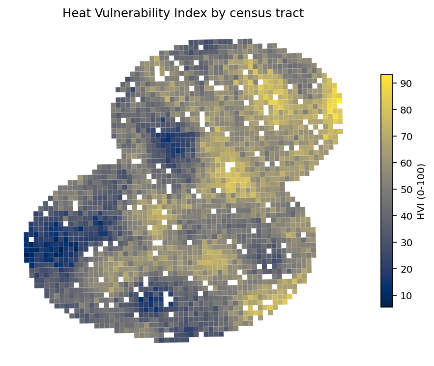

### Validation

| Compared with | Spearman ρ | p | n | Top-10% overlap |
|---|---|---|---|---|
| Heat-related ER visits (ZIP-apportioned) | 0.64 | <1e-200 | 2,498 | — |
| CDC/ATSDR SVI | 0.44 | <1e-100 | 2,498 | 15% |
| CalEnviroScreen score | 0.54 | <1e-180 | 2,498 | 17% |

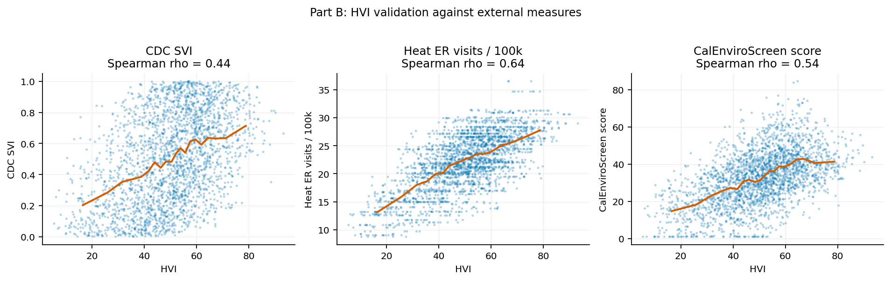

The ER correlation is the one that matters most, since it is an actual health
outcome rather than another index — but see the ZIP caveat above; some of that
0.64 is the apportionment itself.

The SVI comparison is worth reading carefully. ρ = 0.44 is a *partial*
agreement, and that is the right answer: SVI has no heat-exposure term at all,
so if the two indices ranked tracts identically the HVI would be adding
nothing beyond social vulnerability, and if they disagreed entirely something
would be wrong with its social inputs. What is more striking is that the
**top-10% sets only overlap by 15%** — the two indices agree broadly on the
ordering and disagree sharply about who is worst off. Since the worst-off set
is exactly what a siting decision keys on, that disagreement is not a footnote.

None of the four components dominates: their correlations with the composite
run 0.31 (65+) to 0.61 (no canopy).

---

## 3. Part A — who do the existing cooling centres serve?

Method: a close-vs-far distribution comparison. For every indicator, hold two
distributions side by side — all 2,498 tracts, and only the tracts within the
service radius of one of the 153 existing centres — and measure the shift with
a standardised mean difference and a KS statistic rather than eyeballing a
histogram. Three outcomes are possible: no shift (siting is uncorrelated with
need), a shift towards vulnerability (siting is corrective), or a shift away
from it (an equity problem).

### Coverage

| Radius | Tracts served | Residents served | High-HVI residents **beyond** reach |
|---|---|---|---|
| 1 mile (1,609 m) | 328 (13%) | 1.38M (14.0%) | **84.5%** |
| 2 km | 533 (21%) | 2.22M (22.5%) | **73.7%** |
| 2 miles (3,219 m) | 1,082 (43%) | 4.41M (44.6%) | **53.9%** |

The headline number: at a 2 km radius, **73.7% of the people living in
top-quartile-HVI tracts have no cooling centre within reach** — about 1.82
million residents. At a one-mile walking threshold it is 84.5%. Median
distance to the nearest centre is 3.5 km; the 90th percentile is 6.4 km.

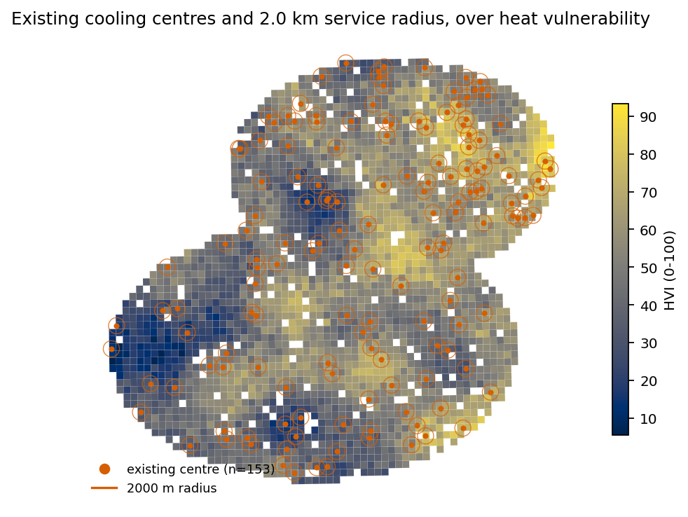

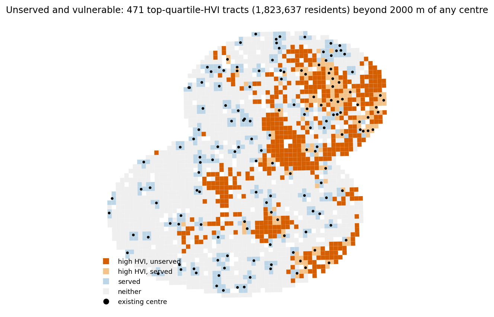

### Are the centres where the vulnerable people are?

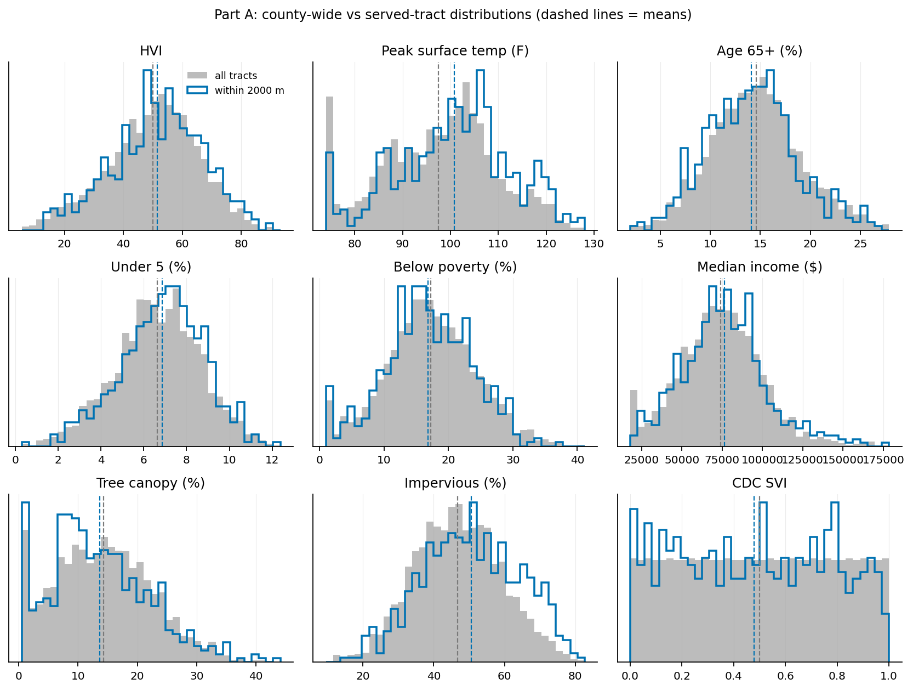

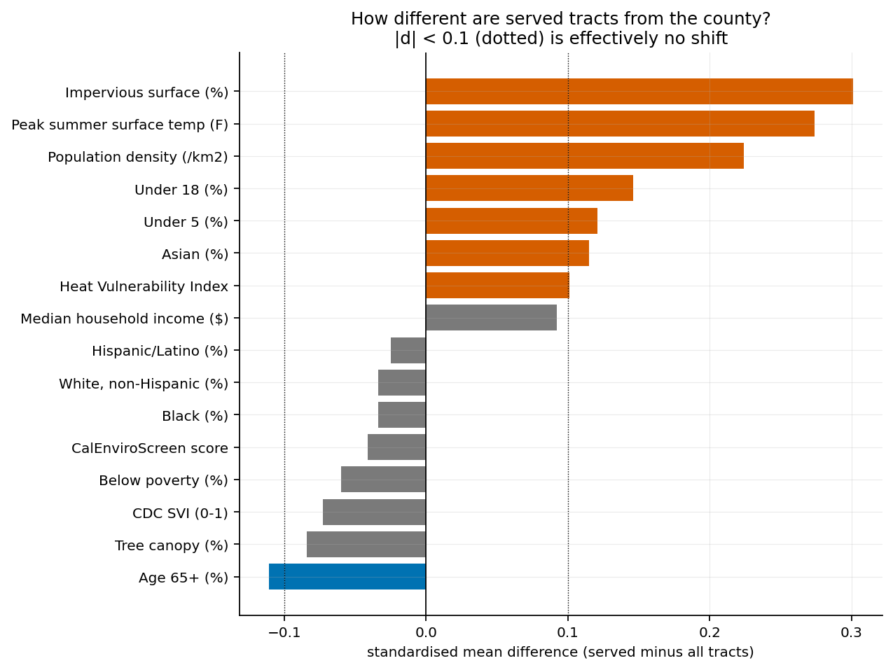

| Indicator | All tracts | Served tracts | Std. mean diff | Reading |
|---|---|---|---|---|
| HVI | 50.0 | 51.6 | +0.10 | marginally higher |
| Peak surface temp (°F) | 97.5 | 100.7 | +0.27 | higher |
| Impervious surface (%) | 46.8 | 50.6 | +0.30 | higher |
| Population density (/km²) | 1,303 | 1,375 | +0.22 | higher |
| Under 18 (%) | 23.3 | 24.0 | +0.15 | slightly higher |
| Under 5 (%) | 6.6 | 6.9 | +0.12 | slightly higher |
| Age 65+ (%) | 14.6 | 14.1 | −0.11 | slightly **lower** |
| Below poverty (%) | 17.2 | 16.8 | −0.06 | no shift |
| Median income ($) | 73,981 | 76,355 | +0.09 | no shift |
| CDC SVI | 0.50 | 0.48 | −0.07 | no shift |
| Tree canopy (%) | 14.3 | 13.7 | −0.08 | no shift |
| Hispanic/Latino (%) | 45.5 | 45.2 | −0.03 | no shift |
| Black (%) | 8.9 | 8.7 | −0.03 | no shift |

Read as a whole, this is a *weak* alignment with need, and the alignment that
exists is mostly geographic rather than social. Served tracts are hotter
(+0.27 SD), more paved (+0.30 SD) and denser (+0.22 SD) — which is what you
would expect if centres are sited in built-up urban cores, where civic
buildings already exist. On the social indicators the served set is
indistinguishable from the county: poverty, income, SVI and every
race/ethnicity share all sit under |d| = 0.1. The HVI shift of +0.10 sits
right on the boundary of "detectable".

The sharpest result is the one on the wrong side: **tracts near a centre have
slightly *fewer* residents aged 65+**, the single group most likely to die in
a heat wave. It is a small effect (−0.11 SD), but it is not a shift towards
the people who need it.

So the honest summary is: existing centres are in hot, paved, dense places,
which is a reasonable accident of where public buildings are. They are not
preferentially in poor places, in high-SVI places, or in places with many
elderly residents. There is room for a placement rule to do better, which is
what Part C is for.

### Heat and green-space gaps between quartiles

By surface-temperature quartile:

| | Peak temp (°F) | Canopy (%) | Impervious (%) | HVI | Served (%) |
|---|---|---|---|---|---|
| Q1 (coolest) | 81.6 | 14.8 | 39.3 | 37.9 | 15 |
| Q4 (hottest) | 112.1 | 11.7 | 58.3 | 60.6 | 32 |
| **Q4 − Q1** | **+30.5** | **−3.1** | **+19.0** | **+22.6** | +17 |

By median-income quartile:

| | Peak temp (°F) | Canopy (%) | HVI | Poverty (%) | Distance to centre (m) |
|---|---|---|---|---|---|
| Q1 (poorest) | 97.3 | 12.0 | 57.7 | 24.9 | 4,181 |
| Q4 (wealthiest) | 95.0 | 18.0 | 39.2 | 9.8 | 3,393 |
| **Q4 − Q1** | −2.3 | **+6.0** | **−18.5** | −15.1 | −788 |

A 30 °F spread between the coolest and hottest quartile, and the hottest
quartile has three percentage points *less* canopy and nineteen points more
pavement. On the income cut, the wealthiest quartile has half again as much
tree canopy as the poorest (18.0% vs 12.0%) and sits 18.5 HVI points lower,
while living on average 800 m closer to a cooling centre.

---

## 4. Part B — association study (not a predictor)

### Why this is framed as an association study

The original proposal was to *predict* HVI from a second feature set
(impervious surface, CalEnviroScreen indicators, density, land cover). That
turns out not to be a meaningful exercise, and this is the single most
important methodological point in the project. HVI is a deterministic function
of four inputs. Hand a model features that correlate with those inputs and it
will relearn the formula and report a flattering R², which demonstrates
nothing about heat and nothing about Los Angeles. There is no forecasting
problem here: HVI is computable today for every tract from data that already
exists.

So the modelling is reframed as an **association analysis** in the
social-science sense — fit a flexible model to *describe* relationships, not
to deploy it. The question becomes:

> Controlling for the immutable physical reality of a place — how hot it
> actually gets, how paved it is, how dense — which socio-demographic
> characteristics are most associated with heat vulnerability?

Mechanically the physical and social variables go into the same model; the
difference is interpretive. Physical variables are **controls**; the social
variables are the **variables of interest**, and the ranking among them is the
deliverable. Fitting flexible models for inference rather than prediction is
standard practice: Breiman (2001) on the two cultures of statistical modelling;
Molnar (2022) chs. 8–9 on reading SHAP, PDP and ALE off a fitted surface;
Athey & Imbens (2019) on where ML methods are and are not informative for
economists; Roberts et al. (2017) on why spatially structured data needs
blocked cross-validation.

### Two guards

**Leakage from HVI's own inputs.** Three of the four HVI inputs would
otherwise be natural right-hand-side variables. They are dropped from the
predictor set when HVI is the outcome, which makes it an analysis of the
*residual* social structure. And the whole analysis is run a second time on a
leakage-free outcome — heat-related ER visits — where no such exclusion is
needed.

**Spatial leakage.** Neighbouring tracts are near-copies. A random train/test
split leaves each test tract's neighbours in training, so the model
interpolates instead of generalising. Folds are k-means clusters of tract
centroids, so a whole contiguous region is held out at a time.

That choice is not cosmetic:

| Model | R² (spatial folds) | R² (random split) | Optimism a random split would have added |
|---|---|---|---|
| Ridge + splines | 0.46 | 0.67 | **+0.21** |
| XGBoost | 0.37 | 0.71 | **+0.34** |
| Random forest | 0.24 | 0.70 | **+0.45** |

A random split would have made the random forest look three times better than
it is. The flexible models lose the most, because they are the best at
memorising a neighbourhood. These R² values are reported as **adequacy checks
only** — they say the fitted surface is stable enough to interpret. They are
not the result.

### What is associated with vulnerability

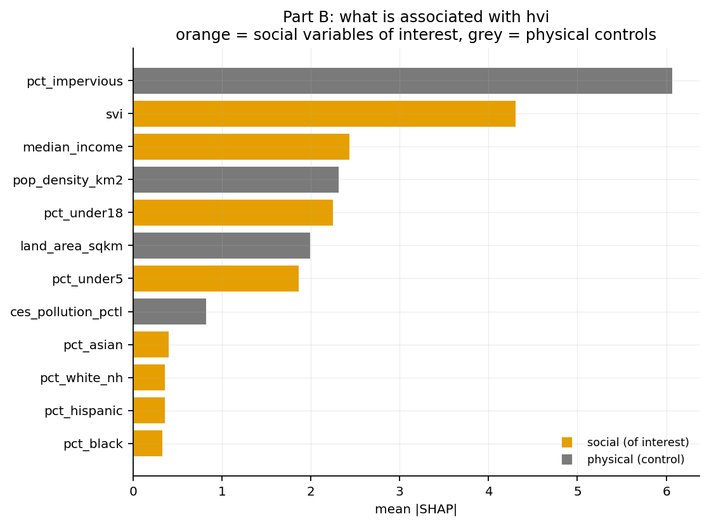

Outcome: HVI (its four inputs excluded). Orange = social, grey = physical control.

| Feature | Role | mean \|SHAP\| | Direction |
|---|---|---|---|
| Impervious surface | control | 6.07 | more pavement → more vulnerable |
| **CDC SVI** | **social** | **4.30** | higher → more vulnerable |
| **Median income** | **social** | **2.43** | higher → less vulnerable |
| Population density | control | 2.32 | denser → less vulnerable |
| **% under 18** | **social** | **2.25** | higher → less vulnerable |
| Land area | control | 1.99 | larger → less vulnerable |
| **% under 5** | **social** | **1.86** | higher → less vulnerable |
| Pollution percentile | control | 0.82 | — |
| % Asian / white / Hispanic / Black | social | 0.33–0.40 | weak |

On the leakage-free outcome (heat-related ER visits) the ordering among the
social variables changes in an informative way:

| Feature | Role | mean \|SHAP\| | Direction |
|---|---|---|---|
| Peak surface temp | control | 2.24 | hotter → more visits |
| **% age 65+** | **social** | **0.63** | higher → more visits |
| Tree canopy | control | 0.62 | more canopy → fewer visits |
| **Median income** | **social** | **0.46** | higher → fewer visits |
| **% below poverty** | **social** | **0.34** | higher → more visits |

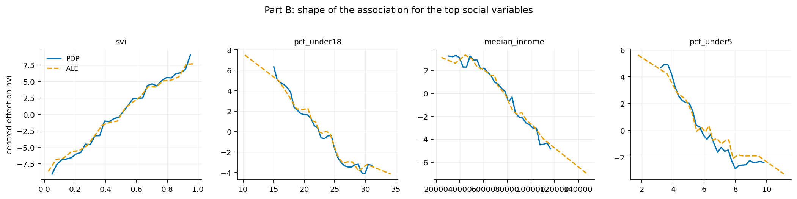

Reading these together: once physical heat is held fixed, **income and
composite social vulnerability are the social variables that move with heat
vulnerability**, and on the health outcome **age 65+ moves to the top** —
which is what the heat-mortality literature would predict, and which is also
exactly the group Part A found to be slightly *under*-served by existing
centres. Race and ethnicity shares carry little independent signal once income
and SVI are in the model, which is the usual pattern when a composite
deprivation measure is included alongside them; it does not mean race is
unrelated to heat vulnerability, it means SVI is already carrying that
information.

The PDP and ALE curves agree on direction but not always on magnitude. Where
they diverge, trust the ALE: PDP asks the model about variable combinations
that may not exist in the data (a tract that is simultaneously 90% elderly and
90% children), while ALE only ever evaluates local moves within the observed
distribution.

**What this is not.** These are associations in a fitted surface, not causal
effects. Nothing here licenses "raising incomes in this tract would lower its
HVI".

---

## 5. Part C — where should new centres go?

### Setup

A maximum-coverage location problem (MCLP). Candidate sites are the 2,498
tract centroids. A site covers every tract whose centroid is within the
service radius. Choose K sites to maximise covered benefit, on top of the
coverage the 153 existing centres already provide.

**Two objectives:**

- `count` — maximise the number of tracts covered. Since tracts are drawn to
  hold roughly equal populations, this approximates population covered.
- `pop_x_hvi` — maximise Σ (population × HVI) over covered tracts. This is the
  objective that actually encodes the project's goal.

**Two solvers:**

- **Greedy** — repeatedly add the site covering the most still-uncovered
  weight. Coverage is a monotone submodular set function, so greedy is
  guaranteed to land within (1 − 1/e) ≈ 63% of the optimum.
- **ILP** — the exact optimum via CBC: maximise Σ wⱼyⱼ subject to
  yⱼ ≤ Σ_{e covers j} xₑ and Σ xₑ = K, all binary.

### Optimise for one thing, evaluate on everything

This is the design point that makes the results readable. Each
method × objective cell produces a chosen site set, and **every** chosen set is
then scored on **all** metrics — exactly like training against one loss and
reporting a whole panel of metrics. A solution that optimised raw tract count
is still scored on how much high-vulnerability population it reached and on
coverage by demographic subgroup.

### Results at the reported budgets (r = 2 km)

| Method | Optimised for | K | Pop covered | Pop×HVI covered | Top-quartile HVI covered | High−low HVI gap | vs random |
|---|---|---|---|---|---|---|---|
| existing only | — | 0 | 22.5% | 23.5% | 26.3% | — | — |
| random | — | 10 | 24.0% | 24.8% | 27.7% | 6.5 pp | 0.00 |
| most populous | — | 10 | 23.8% | 24.1% | 26.3% | 2.5 pp | −0.72 |
| hottest tracts | — | 10 | 23.0% | 24.2% | 28.4% | 8.8 pp | −0.57 |
| sort by SVI | — | 10 | 23.8% | 24.9% | 27.5% | 8.0 pp | +0.09 |
| sort by HVI | — | 10 | 23.3% | 24.7% | 29.6% | 10.0 pp | −0.07 |
| greedy | count | 10 | 24.5% | 25.5% | 27.6% | 7.0 pp | +0.68 |
| **greedy** | **Pop×HVI** | **10** | 24.9% | **26.8%** | **34.5%** | **14.9 pp** | **+1.96** |
| ILP | Pop×HVI | 10 | 24.9% | 26.8% | 34.8% | 15.3 pp | +1.99 |
| sort by HVI | — | 20 | 24.0% | 25.7% | 32.2% | 12.6 pp | −0.46 |
| greedy | count | 20 | 26.5% | 27.7% | 30.8% | 9.0 pp | +1.51 |
| **greedy** | **Pop×HVI** | **20** | 27.2% | **29.8%** | **41.2%** | **21.6 pp** | **+3.63** |
| ILP | Pop×HVI | 20 | 27.2% | 29.9% | 41.2% | 21.6 pp | +3.66 |

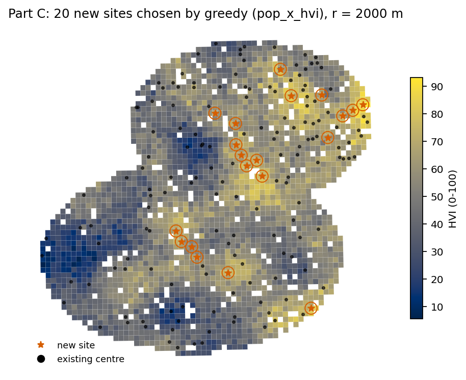

Three things stand out.

**1. The objective matters more than the solver.** Greedy on `pop_x_hvi`
reaches 41.2% of top-quartile-HVI residents at K = 20; greedy on `count`
reaches 30.8% with the same budget. Those are the same algorithm with the same
number of sites — a 10-point difference bought purely by weighting the
objective by who lives there. Meanwhile greedy and ILP are within 0.1 points
of each other.

**2. Greedy is effectively optimal here.** It achieves **99.9%** of the ILP
optimum at K = 20, far above the 63% worst-case guarantee. That matters
practically: CBC on 2,498 candidate sites is slow, and greedy returns in
milliseconds, so the dashboard can sweep the whole budget range interactively.

**3. Sorting by index — the way agencies actually prioritise — is barely
better than random, and sometimes worse.** "Sort by HVI" at K = 20 covers
25.7% of vulnerability-weighted population against random's 26.2%: it loses by
half a point. The reason is redundancy: the #1 and #2 highest-HVI tracts are
usually *neighbours*, so the second site mostly re-covers the first one's
catchment. Ranking has no way to see this; greedy does, because it scores the
marginal gain against what is already covered. The ranking rule does put
slightly more top-quartile-HVI people in range (32.2% vs random's 29.1%) — it
is aiming at the right tracts — it just wastes much of the budget doing it.

Everything is reported as a **delta over random placement**, because absolute
coverage numbers are not very meaningful on their own (random placement ≈ a
random sample of the population ≈ the county mean). The gain over random is
what strategic siting actually buys.

### Fairness: coverage by demographic subgroup

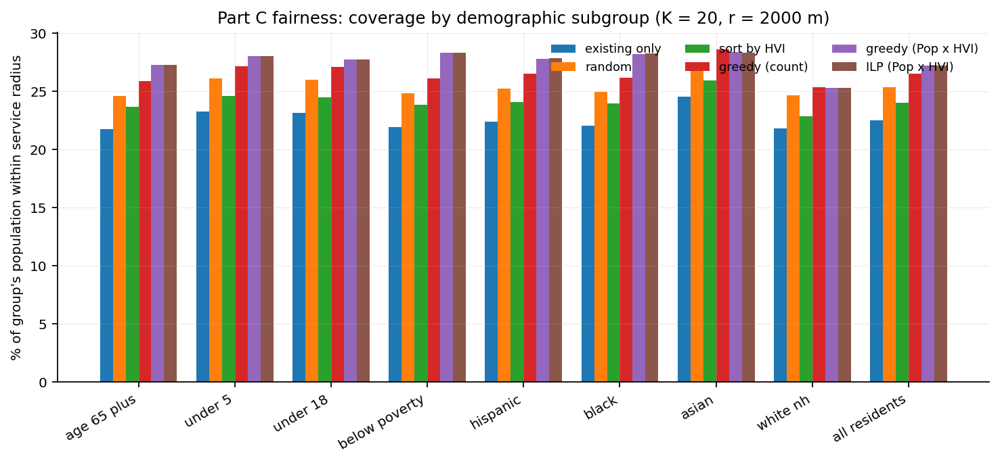

Coverage rate per group at K = 20, r = 2 km:

| Solution | 65+ | Under 5 | Below poverty | All residents |
|---|---|---|---|---|
| existing only | 21.7% | 23.3% | 21.9% | 22.5% |
| random | 24.6% | 26.1% | 24.8% | 25.4% |
| sort by HVI | 23.7% | 24.6% | 23.9% | 24.0% |
| greedy (count) | 25.9% | 27.1% | 26.1% | 26.5% |
| **greedy (Pop×HVI)** | **27.2%** | **28.0%** | **28.3%** | **27.2%** |

An aggregate coverage number can hide a group being left behind, which is why
this is reported per group rather than as a single index. Under the
vulnerability-weighted objective, every group improves and the poverty group
improves most (+6.4 points over the status quo). The 65+ group starts furthest
behind under the existing network (21.7%, below the all-residents 22.5%) and
is still the lowest-covered group afterwards — the gap narrows but does not
close. If closing it is the policy goal, the objective should say so
explicitly: the optimiser takes a pluggable score, and
`pop_x_hvi_x_age65` is already implemented.

### Budget and radius sensitivity

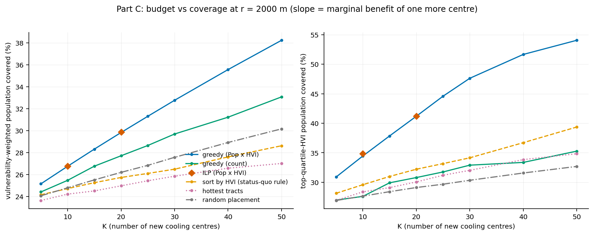

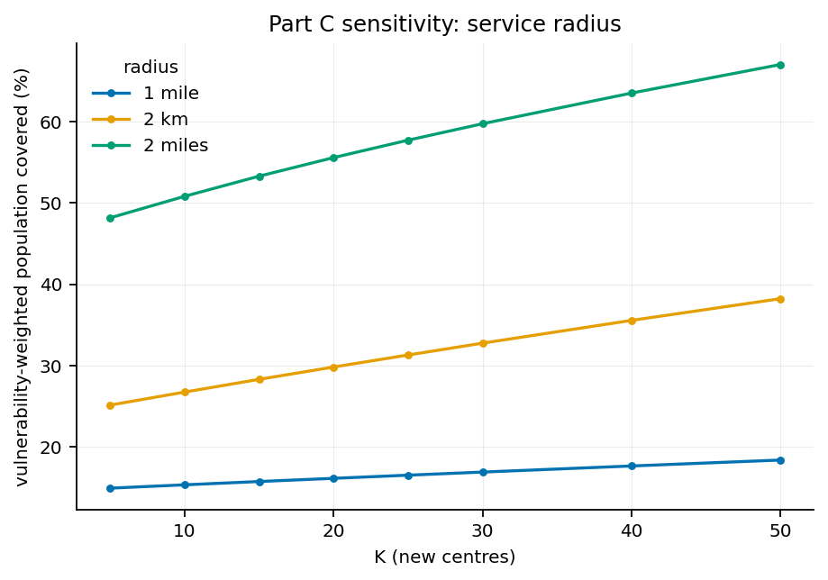

The curves are monotonic by construction, and ILP sits at or above greedy
everywhere. The useful quantity is the **slope** — the marginal benefit of one
more centre. On the greedy `pop_x_hvi` curve it is about **0.32 percentage
points of vulnerability-weighted population per centre** between K = 5 and
K = 10, and still **0.27** between K = 40 and K = 50. The curve is barely
bending: at realistic budgets (≤ ~20 centres) we are nowhere near saturation,
and every centre added still reaches people nobody is reaching now. That is
the number to hand a budget committee.

Radius matters more than budget. Moving from a 1-mile to a 2-mile service
radius changes coverage far more than doubling K does — which is really a
statement about what "served" means. If the realistic standard is *walking*
distance for an elderly resident on a 100 °F day, the 1-mile curve is the
honest one, and the unmet need is correspondingly larger (84.5% of
high-HVI residents unserved today).

---

## 6. What I would tell the county

1. **Reach, not count.** Weight the objective by population × vulnerability.
   Same budget, same algorithm, ten more points of high-HVI residents reached.
2. **Stop ranking tracts.** Sorting by HVI — or SVI, or CalEnviroScreen — and
   taking the top K performs about as well as choosing at random, because the
   top-ranked tracts are neighbours and their catchments overlap. Greedy takes
   milliseconds and recovers almost all of the available gain.
3. **The 65+ gap is real and does not close on its own.** They are the group
   least well served today and still the least well served after optimisation.
   If that is unacceptable, put it in the objective.
4. **Decide what "served" means before deciding how many to build.** The
   service radius moves the answer more than the budget does.

---

## 7. Limitations, and what is still mock

**This run is on synthetic data.** The pipeline, every statistic and every
figure above are real code running end to end; the inputs are a simulated
county. Current state of the real inputs:

| Input | Status |
|---|---|
| Tract geometry (TIGER 2023) | ✅ downloaded, 2,498 LA tracts |
| CDC SVI 2022 | ✅ downloaded, 2,495 tracts |
| CalEnviroScreen 4.0 + 5.0 | ✅ downloaded, crosswalk wired |
| Census 2010↔2020 and ZCTA↔tract crosswalks | ✅ downloaded |
| LA County cooling centres | ✅ 153 real sites |
| Tree canopy by tract | ✅ real LA County layer |
| ACS DP03/DP05 | ⚠️ needs a free Census API key (`CENSUS_API_KEY`); SVI covers most columns meanwhile, but **% under 5** and **median income** need it |
| Land-surface temperature, impervious surface | ⚠️ run `gee/export_lst_landsat.js` and `gee/export_canopy_impervious.js` in Earth Engine |
| Heat-related ER visits | ⚠️ export from the CDPH CCHVIz portal to `data/raw/heat_er_zip.csv` |

With those three in place, `make real` regenerates every table, figure and the
dashboard with no code change.

Other limitations worth stating plainly:

- **Centroid coverage is a simplification.** A tract is either covered or not,
  based on its centroid. Real access depends on transit, street network and
  barriers like freeways, and a large tract's far edge may be nowhere near its
  centroid.
- **Candidate sites are tract centroids**, not actual buildings. A real siting
  exercise would restrict candidates to libraries, rec centres and schools
  with the right capacity and hours.
- **Capacity is ignored.** Every centre is treated as able to serve everyone
  within its radius.
- **Cooling centres are seasonal and the published list changes.** The
  analysis describes a plausible current network, not a guaranteed-live one.
- **Surface temperature is not air temperature,** and daytime surface
  temperature is not the night-time heat that drives mortality. Hence the
  ECOSTRESS path.
- **The ER validation is apportioned from ZIPs** and is therefore attenuated
  and partly mechanical.
- **Nothing here is causal.** Part B describes associations in a fitted
  surface.

---

## 8. Reproducing this

```bash
make setup     # venv + pinned dependencies
make mock      # full pipeline on synthetic data (~45 s)
make test      # 25 unit tests
make fetch     # download every public source that needs no credentials
make real      # same pipeline against data/raw
make dashboard # build the static dashboard
```

All randomness is seeded (`seed: 461`). The run is stamped with its config and
timings in `reports/run_manifest.json`, and `data/processed/provenance.json`
records which source filled each column.

Tests cover the things that would silently corrupt results rather than crash:
GEOID normalisation and join integrity, the ZIP and 2010→2020 apportionment
arithmetic, HVI monotonicity and unit-invariance, coverage sets against a
brute-force distance check, greedy monotonicity in K, the submodular
(1 − 1/e) bound, and ILP ≥ greedy.

---

## References

Breiman, L. (2001). Statistical modeling: the two cultures. *Statistical
Science*, 16(3), 199–231.

Athey, S., & Imbens, G. W. (2019). Machine learning methods that economists
should know about. *Annual Review of Economics*, 11, 685–725.

Roberts, D. R., et al. (2017). Cross-validation strategies for data with
temporal, spatial, hierarchical, or phylogenetic structure. *Ecography*,
40(8), 913–929.

Molnar, C. (2022). *Interpretable Machine Learning* (2nd ed.), chs. 8–9.

Church, R., & ReVelle, C. (1974). The maximal covering location problem.
*Papers of the Regional Science Association*, 32, 101–118.

Nemhauser, G. L., Wolsey, L. A., & Fisher, M. L. (1978). An analysis of
approximations for maximizing submodular set functions. *Mathematical
Programming*, 14, 265–294.
