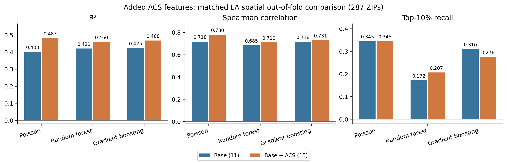
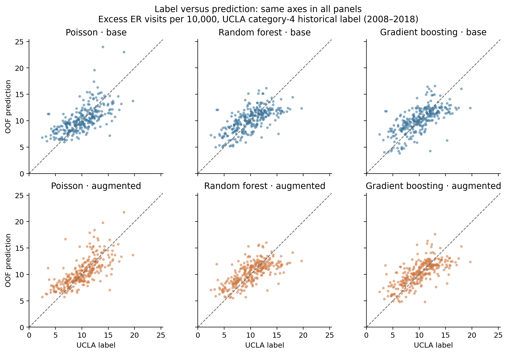
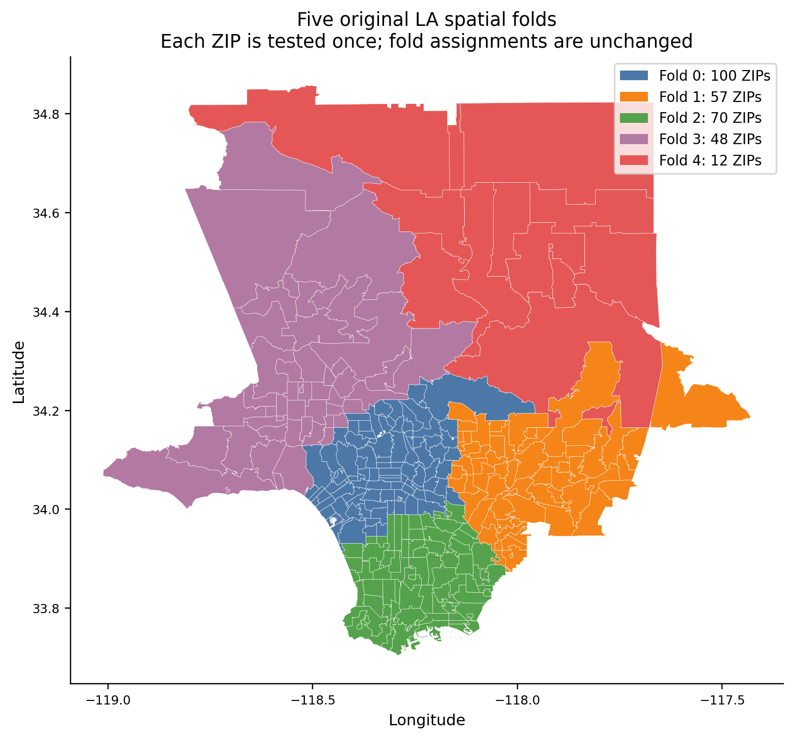
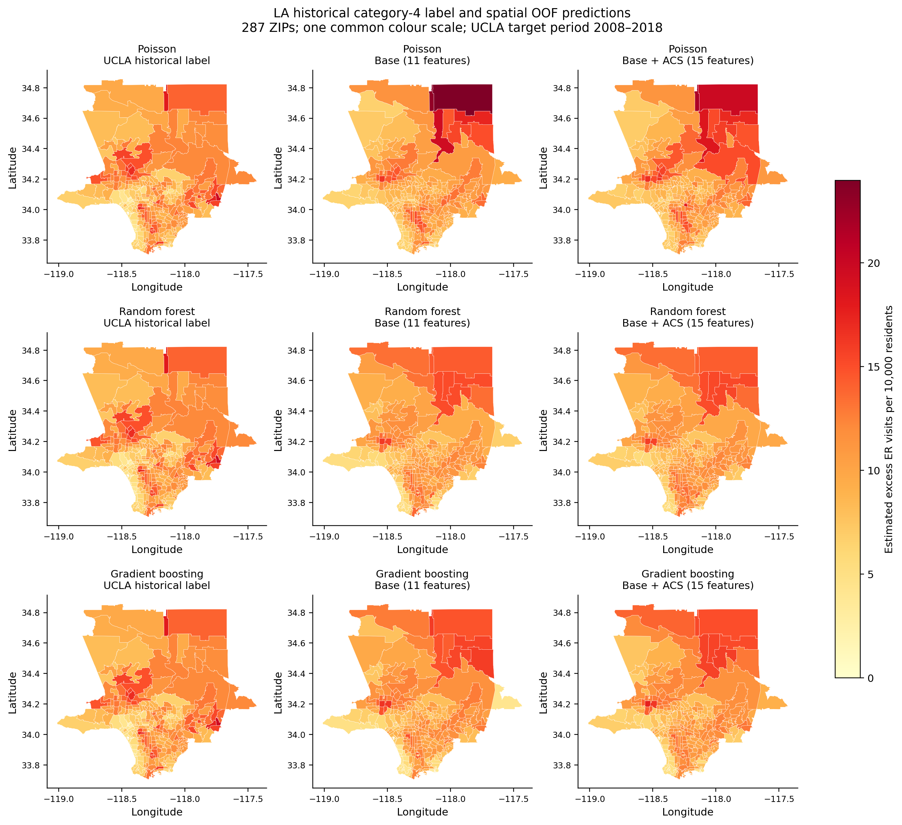
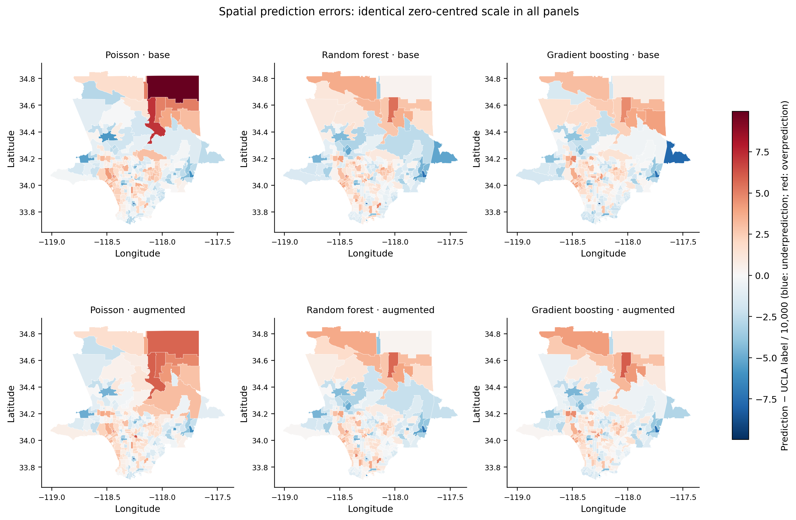
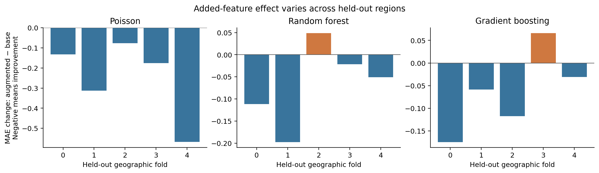

## Figures and captions

All predictions below are out-of-fold (OOF) estimates from the same five original LA spatial folds. Each of 287 ZIPs is tested once, with training restricted to the other four groups. The target is UCLA's published category-4 historical estimated excess ER visits per 10,000 residents, labelled 2008–2018; it is not a raw observed visit count or a daily forecast. Base has 11 common predictors. Augmented has the same 11 plus four ACS 2018 five-year indicators (2014–2018). Missing-value imputation, and Poisson standardization, use training rows only. Geographic boundaries have not been harmonized across source vintages.

### Figure 1. Overall predictive performance

**Caption:** Pooled OOF performance for Poisson regression, random forest and gradient boosting on the same 287 LA ZIPs and UCLA category-4 target (2008–2018). Blue bars show the base configuration (11 features); orange bars show the augmented configuration (15 features). R², Spearman correlation and top-10% recall are dimensionless; larger values indicate better performance. Top-10% recall measures recovery of the 29 ZIPs with the highest UCLA labels, with ties broken by ascending ZIP code. Improved overall fit does not necessarily improve recovery of the highest-burden ZIPs.

### Figure 2. UCLA label versus prediction

**Caption:** Each point is one of 287 LA ZIPs. Horizontal coordinates show the UCLA category-4 historical label (2008–2018); vertical coordinates show spatial OOF predictions. Both axes use estimated excess ER visits per 10,000 residents. Columns show Poisson, random forest and gradient boosting; rows show base and augmented configurations. All panels share identical axis limits. Points above the dashed identity line indicate overprediction relative to the UCLA label; points below it indicate underprediction. UCLA labels are model-derived estimates, not raw visit counts.

### Figure 3. Spatial cross-validation groups

**Caption:** ZIP polygons show the five original geographic groups used for the LA-only category-4 experiment (287 ZIPs; target period 2008–2018). Colours identify fold membership, not burden. Groups 0–4 contain 100, 57, 70, 48 and 12 ZIPs, respectively. Each group is held out once while the other four train the model. The same assignments are reused for both feature configurations and all three algorithms; they are not refitted for this comparison. Axes show longitude and latitude in degrees. This is within-LA validation, not training outside LA and testing on the whole county.

### Figure 4. UCLA label and predicted burden maps

**Caption:** Maps compare the published UCLA category-4 label (left), base OOF predictions (middle) and augmented OOF predictions (right) for the same 287 LA ZIPs. Rows show Poisson, random forest and gradient boosting. The identical UCLA label map is repeated in each row for direct comparison. All nine panels share one colour scale in estimated excess ER visits per 10,000 residents; darker colours indicate larger values. The target represents 2008–2018, while the four added ACS indicators represent 2014–2018. Predictions are held out geographically within LA. Polygon colours assign each ZIP's aggregate value to its entire area and do not show variation within a ZIP, cooling-center accessibility or prevented ER visits. Axes are longitude and latitude in degrees.

### Figure 5. Spatial prediction errors

**Caption:** Spatial OOF prediction errors for 287 LA ZIPs against UCLA's category-4 historical label (2008–2018). Columns show Poisson, random forest and gradient boosting; the upper row uses base features and the lower row uses augmented features. Error equals prediction minus UCLA label, measured in excess ER visits per 10,000 residents. All six maps use the same symmetric colour range centred at zero: blue indicates underprediction, red indicates overprediction and near-white indicates small error. Axes show longitude and latitude in degrees. These are errors relative to the published estimated label, not independently measured errors against raw visits.

### Figure 6. Change in MAE by held-out region

**Caption:** Change in mean absolute error (MAE) after adding four ACS indicators, calculated as augmented minus base for each held-out LA group and algorithm. All comparisons use the same ZIPs and UCLA category-4 historical target (2008–2018); groups 0–4 have 100, 57, 70, 48 and 12 test ZIPs. The vertical axis is in excess ER visits per 10,000 residents. Negative blue bars indicate lower error with augmented features; positive orange bars indicate higher error. Unequal and sometimes small group sizes limit conclusions about regional consistency. Bars are descriptive differences, not confidence intervals.

All six figures are also supplied as PDF files with the same names in results/feature_comparison/figures/.
