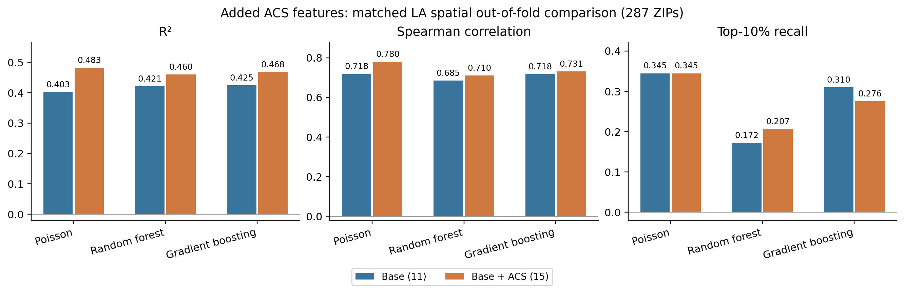
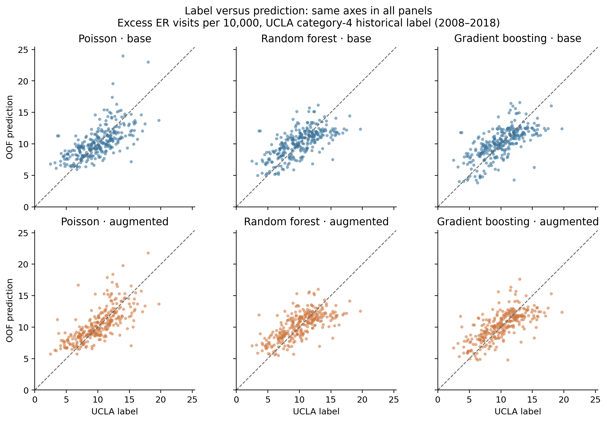
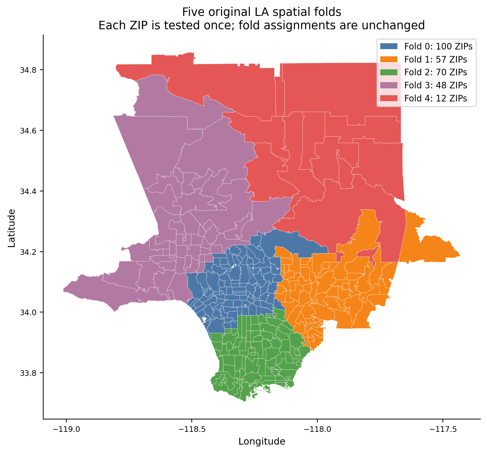
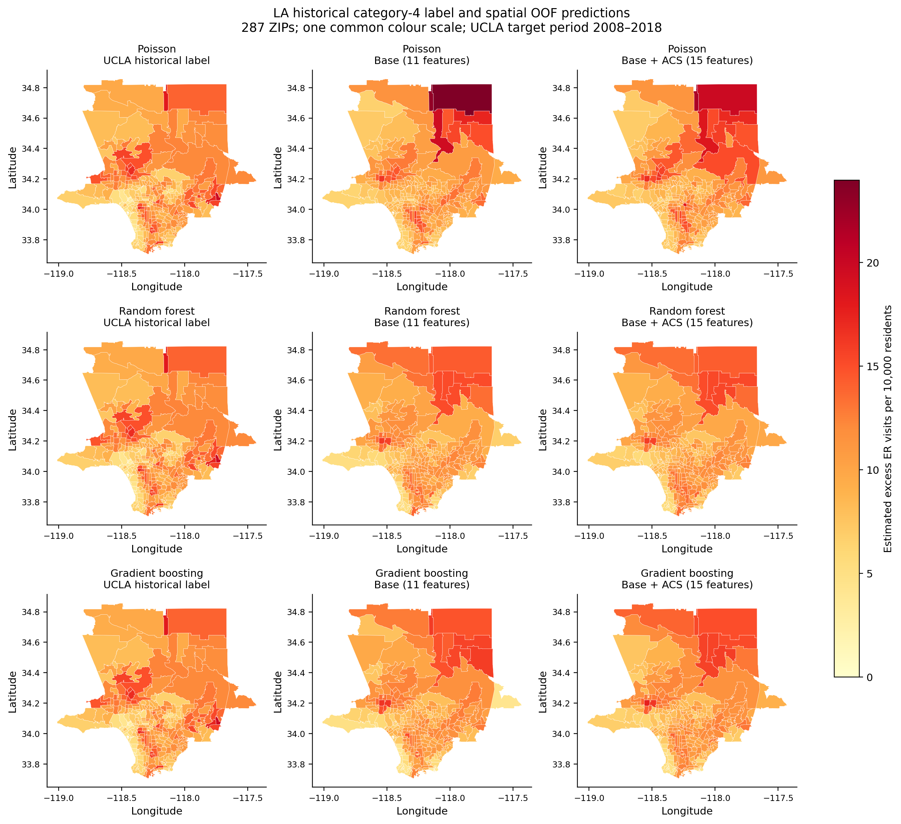
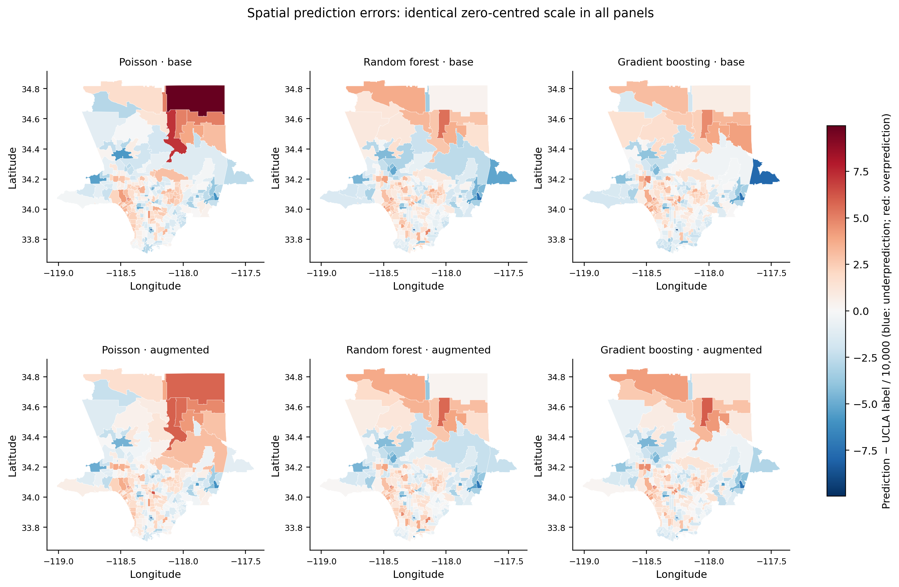
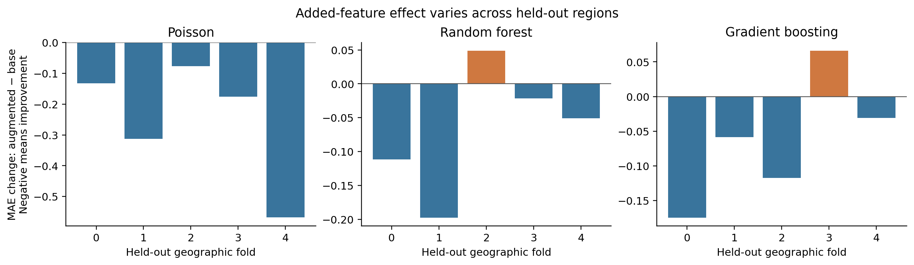

# Part 2 — LA feature comparison

## Research question and result

Do four additional historical ACS community indicators improve estimation of UCLA's published category-4 excess ER label, beyond the common statewide feature set, within Los Angeles County?

All three algorithms improve pooled out-of-fold R² and MAE when the four ACS features are added. Ranking and high-burden recovery are evaluated separately below. These are spatial generalization results for a historical model-derived label, not forecasts of future daily ER visits or estimates of the causal benefit of cooling centers.

For Poisson, pooled R² changes from 0.403 to 0.483, Spearman from 0.718 to 0.780, and MAE from 1.851 to 1.670. Its MAE improves in 5 of five held-out groups. Its top-10% recall changes from 0.345 to 0.345 (10 of 29 ZIPs after augmentation). Changes in top-k recovery can differ from overall error improvements; better fit should not be presented as uniformly better identification of the highest-burden ZIPs.

## Data and controlled comparison

- Target: unchanged UCLA category-4 estimated excess ER visits per 10,000 residents, labelled 2008–2018. Its cumulative interpretation is pending confirmation; no L4−L3 replacement is used.
- Sample: all 287 original LA ZIPs. The same ZIPs and original five geographic groups are used in both configurations. Fold sizes: 0: 100, 1: 57, 2: 70, 3: 48, 4: 12.
- Base: 11 features from Member 1's corrected CES 4.0 statewide table, with heat level omitted because it is constant. Features: pm25, ozone, asthma_ed_per10k, cardiovascular_ed_per10k, poverty_pct, elderly65_pct, edu_lt_hs_pct, ling_isol_pct, unemployment_pct, housing_burden_pct, pop_density_per_sqmi.
- Augmented: the same base values plus renters, no-vehicle households, uninsured population and construction-industry employment percentages from ACS 2018 five-year estimates (2014–2018).
- Total population and median household income are not predictors. Population remains the sample weight for Poisson fitting.
- 270 ZIPs have complete base inputs and 266 have complete augmented inputs. Missingness does not change the evaluation sample.

## Experimental setup — Part 2

**Question:** Do four additional ACS features improve prediction of UCLA's historical category-4 label within LA County?

| Item | Setup |
|---|---|
| Study area and sample | LA County; 287 unique ZIPs and 287 rows in each configuration. |
| Exclusions | Start with 289 ZIPs; exclude 91123 and 91522 because coordinates are missing. No rows are excluded for missing feature values. |
| Prediction target | UCLA's published category-4 estimated excess ER visits per 10,000 residents, labelled 2008–2018. The target is unchanged; no L4−L3 subtraction is used. |
| Base model | 11 common predictors from the corrected statewide input table. Heat level is fixed at 4 and omitted as a predictor. |
| Augmented model | The same 11 predictors plus renter share, no-vehicle household share, uninsured share and construction-industry employment share: 15 predictors in total. The four additions use ACS 2018 five-year estimates (2014–2018). |
| Validation | Five-fold spatial cross-validation within LA. Reuse the original geographic groups. Train on four groups and test on the remaining group, repeating until every ZIP has one out-of-fold prediction. |
| Controlled conditions | Identical ZIPs, labels, folds, common feature values, model settings and evaluation rules for both configurations. |
| Algorithms | Poisson regression, random forest and gradient boosting; fixed settings, seed 42, no tuning on held-out data. Exact settings are in experiment_config.json. |
| Missing values and scaling | Fit median imputation on each training fold only. For Poisson, also fit standardization on the training fold only. |
| Population | Excluded as a predictor; retained as a Poisson training weight. Evaluation weights ZIPs equally. Median household income is also excluded as a predictor. |
| References | Training-fold mean baseline; CES percentile ranking reference on the same 273 ZIPs with available CES values. CES is not evaluated with ER-rate R². |
| Evaluation metrics | R², RMSE, MAE, Spearman correlation and top-10% recall; supplementary top-20% recall. Report pooled out-of-fold and per-fold results. |

### Fold sizes

| Held-out group | Training ZIPs | Test ZIPs |
|---|---:|---:|
| 0 | 187 | 100 |
| 1 | 230 | 57 |
| 2 | 217 | 70 |
| 3 | 239 | 48 |
| 4 | 275 | 12 |

**Difference from Part 1's whole-LA holdout:** Part 2 trains and tests on separate geographic groups within LA. The whole-LA holdout trains on California ZIPs outside LA and tests on LA. These are different evaluation designs.

**Scope:** This estimates a historical label; it is not a daily heat-wave forecast. ACS 2014–2018 does not cover the full 2008–2018 target period, geographic boundaries have not been harmonized, and the cumulative interpretation of the category-4 label remains unconfirmed. Feature definitions and source periods are in [Unified Feature Comparison](FEATURE_COMPARISON_TABLE.md).

## Unified feature comparison

| Feature field | Base (11) | Original LA (13) | Augmented (15) |
|---|---|---|---|
| pm25 | Yes | Yes | Yes |
| ozone | Yes | Yes | Yes |
| asthma_ed_per10k | Yes | Yes | Yes |
| cardiovascular_ed_per10k | Yes | Yes | Yes |
| poverty_pct | Yes | — | Yes |
| elderly65_pct | Yes | — | Yes |
| edu_lt_hs_pct | Yes | — | Yes |
| ling_isol_pct | Yes | — | Yes |
| unemployment_pct | Yes | — | Yes |
| housing_burden_pct | Yes | — | Yes |
| pop_density_per_sqmi | Yes | Yes | Yes |
| median_hh_income | — | Yes | — |
| pct_poverty | — | Yes | — |
| pct_age_65plus | — | Yes | — |
| pct_renters | — | Yes | Yes |
| pct_no_vehicle | — | Yes | Yes |
| pct_uninsured | — | Yes | Yes |
| pct_construction | — | Yes | Yes |
| total_pop | — | Yes | — |

The complete row-by-row definitions, units, raw fields, data sources and reference periods are supplied in [Unified Feature Comparison](FEATURE_COMPARISON_TABLE.md) and results/unified_feature_comparison.csv. The original LA model is shown for provenance; the controlled experiment compares only the new base and augmented configurations.

Identical field names do not guarantee identical source values. In particular, the original LA density uses ACS 2022 population, while the new base/augmented density uses UCLA population. CES poverty uses twice the federal poverty threshold; the old ACS poverty feature uses the threshold itself. The new pair preserves identical values and sources for all 11 common predictors. The CES age-field reference year and UCLA population reference year remain explicitly unconfirmed shared items.

## Rationale for the four additional community features

The four ACS indicators represent community conditions beyond the common CES-based inputs. Prior research provides a rationale for evaluating these features; their predictive utility is tested empirically in the paired experiment.

**Construction-industry employment.** [Riley et al. (2018)](https://doi.org/10.3390/ijerph15040580) linked community employment patterns to heat-related morbidity across LA ZIPs. This motivates construction employment as an occupational-exposure proxy, although it neither measures every worker's exposure nor includes all outdoor industries.

**Households without a vehicle.** [Derakhshan et al. (2024)](https://doi.org/10.1016/j.joclim.2023.100276) examined car access alongside excess ER outcomes in California and LA. We include no-vehicle share as a candidate access-related indicator, not a direct measure of cooling-center travel time.

**Uninsured population.** [Hess et al. (2014)](https://doi.org/10.1289/ehp.1306796) documented differences in acute heat-illness ED burden by insurance status. Insurance may also reflect healthcare utilization; consequently, we do not impose a positive association between uninsured share and the UCLA label. Individual-level evidence does not establish a ZIP-level causal effect.

**Renter-occupied housing.** The publisher abstract of [Scott et al. (2025)](https://doi.org/10.1016/j.apgeog.2025.103537) reports disparities in residential AC access by housing tenure. This provides indirect motivation for renter share as a cooling-resource proxy, not direct evidence of higher ER rates. Full-text verification remains pending.

The experiment tests these four indicators **jointly** against an otherwise identical base configuration. It does not identify their individual contributions. Full citations, evidence boundaries and verification status are in [Supporting Literature](SUPPORTING_LITERATURE.md).

## Method

The fixed algorithms and hyperparameters match the audited project: PoissonRegressor(alpha=1, max_iter=5000), RandomForestRegressor(n_estimators=500, min_samples_leaf=2, n_jobs=1), and default GradientBoostingRegressor. Random seeds are 42. No hyperparameters were selected using the held-out folds.

For each of five folds, training uses the other four geographic groups. Median imputation is fitted only on training rows; standardization is also fitted only on training rows for Poisson. Only Poisson uses training population weights. Evaluation weights each ZIP equally. Each model/configuration therefore produces one genuinely held-out prediction for every ZIP. There are 30 fitted fold models.

Top-k recall uses k = round(fraction × sample size): 29 for top 10% and 57 for top 20% on the full sample. Both true and predicted rankings break score ties by ascending ZIP. This deterministic convention can differ from the old project's unspecified NumPy tie order; close recall differences should not be overstated.

## Results on all 287 ZIPs

| config | model | r2 | rmse | mae | spearman | top10_recall | top20_recall |
|---|---|---|---|---|---|---|---|
| base | poisson | 0.403 | 2.389 | 1.851 | 0.718 | 0.345 | 0.579 |
| base | random_forest | 0.421 | 2.352 | 1.851 | 0.685 | 0.172 | 0.456 |
| base | gradient_boosting | 0.425 | 2.345 | 1.825 | 0.718 | 0.310 | 0.509 |
| augmented | poisson | 0.483 | 2.224 | 1.670 | 0.780 | 0.345 | 0.596 |
| augmented | random_forest | 0.460 | 2.271 | 1.779 | 0.710 | 0.207 | 0.456 |
| augmented | gradient_boosting | 0.468 | 2.255 | 1.734 | 0.731 | 0.276 | 0.439 |
| reference | training_fold_mean | -0.111 | 3.259 | 2.644 | — | — | — |

The mean reference predicts the mean label of the training folds, never the full sample mean. Ranking scores are omitted because this is not an intended ZIP-risk ranking method.

## Added-feature change (augmented minus base)

| model | delta_r2 | delta_rmse | delta_mae | delta_spearman | delta_top10_recall | delta_top20_recall |
|---|---|---|---|---|---|---|
| poisson | 0.080 | -0.165 | -0.180 | 0.061 | 0.000 | 0.018 |
| random_forest | 0.039 | -0.081 | -0.072 | 0.025 | 0.034 | 0.000 |
| gradient_boosting | 0.043 | -0.090 | -0.091 | 0.013 | -0.034 | -0.070 |

Positive R², Spearman and recall changes indicate improvement; negative RMSE and MAE changes indicate improvement. A top-10% recall change of 1/29 (about 0.0345) is one ZIP, so seemingly visible percentage changes may represent few ZIPs.

| model | folds_with_lower_MAE | folds_with_higher_R2 |
|---|---|---|
| poisson | 5 | 5 |
| random_forest | 4 | 3 |
| gradient_boosting | 4 | 3 |

Fold results are available in metrics_per_fold.csv. Pooled OOF R² is not the arithmetic mean of fold R². The five group sizes differ substantially, including a 12-ZIP fold, which limits precise interpretation of regional differences.

## CES ranking reference: matched sample only

| config | model | n | r2 | spearman | top10_recall | top20_recall |
|---|---|---|---|---|---|---|
| base | poisson | 273 | 0.441 | 0.752 | 0.259 | 0.564 |
| base | random_forest | 273 | 0.485 | 0.737 | 0.148 | 0.455 |
| base | gradient_boosting | 273 | 0.493 | 0.760 | 0.259 | 0.509 |
| augmented | poisson | 273 | 0.544 | 0.811 | 0.333 | 0.600 |
| augmented | random_forest | 273 | 0.503 | 0.744 | 0.148 | 0.436 |
| augmented | gradient_boosting | 273 | 0.521 | 0.763 | 0.222 | 0.436 |
| reference | CES_percentile | 273 | — | 0.566 | 0.148 | 0.345 |

This table restricts every predictor to the identical 273 ZIPs with a corrected CES percentile. CES is a ranking index, so it has no R², RMSE or MAE against the ER-rate target. Do not compare its correlation to a model score from all 287 ZIPs as if those were matched.

## Exploratory paired uncertainty

| model | metric | lower | upper |
|---|---|---|---|
| poisson | r2 | 0.032 | 0.256 |
| poisson | mae | -0.310 | -0.113 |
| poisson | spearman | 0.030 | 0.097 |
| random_forest | r2 | -0.017 | 0.083 |
| random_forest | mae | -0.151 | 0.017 |
| random_forest | spearman | -0.022 | 0.067 |
| gradient_boosting | r2 | -0.032 | 0.080 |
| gradient_boosting | mae | -0.152 | 0.013 |
| gradient_boosting | spearman | -0.039 | 0.042 |

These 95% percentile intervals summarize augmented-minus-base differences from 1,000 paired resamples of the five geographic blocks, with OOF predictions held fixed. Only five blocks are available; models are not refitted in these resamples and upstream UCLA estimation uncertainty is not represented. The intervals are exploratory and are not a definitive significance or equivalence test.

## Figures and captions

All predictions below are out-of-fold (OOF) estimates from the same five original LA spatial folds. Each of 287 ZIPs is tested once, with training restricted to the other four groups. The target is UCLA's published category-4 historical estimated excess ER visits per 10,000 residents, labelled 2008–2018; it is not a raw observed visit count or a daily forecast. Base has 11 common predictors. Augmented has the same 11 plus four ACS 2018 five-year indicators (2014–2018). Missing-value imputation, and Poisson standardization, use training rows only. Geographic boundaries have not been harmonized across source vintages.

### Figure 1. Overall predictive performance

**Caption:** Pooled OOF performance for Poisson regression, random forest and gradient boosting on the same 287 LA ZIPs and UCLA category-4 target (2008–2018). Blue bars show the base configuration (11 features); orange bars show the augmented configuration (15 features). R², Spearman correlation and top-10% recall are dimensionless; larger values indicate better performance. Top-10% recall measures recovery of the 29 ZIPs with the highest UCLA labels, with ties broken by ascending ZIP code. Improved overall fit does not necessarily improve recovery of the highest-burden ZIPs.

### Figure 2. UCLA label versus prediction

**Caption:** Each point is one of 287 LA ZIPs. Horizontal coordinates show the UCLA category-4 historical label (2008–2018); vertical coordinates show spatial OOF predictions. Both axes use estimated excess ER visits per 10,000 residents. Columns show Poisson, random forest and gradient boosting; rows show base and augmented configurations. All panels share identical axis limits. Points above the dashed identity line indicate overprediction relative to the UCLA label; points below it indicate underprediction. UCLA labels are model-derived estimates, not raw visit counts.

### Figure 3. Spatial cross-validation groups

**Caption:** ZIP polygons show the five original geographic groups used for the LA-only category-4 experiment (287 ZIPs; target period 2008–2018). Colours identify fold membership, not burden. Groups 0–4 contain 100, 57, 70, 48 and 12 ZIPs, respectively. Each group is held out once while the other four train the model. The same assignments are reused for both feature configurations and all three algorithms; they are not refitted for this comparison. Axes show longitude and latitude in degrees. This is within-LA validation, not training outside LA and testing on the whole county.

### Figure 4. UCLA label and predicted burden maps

**Caption:** Maps compare the published UCLA category-4 label (left), base OOF predictions (middle) and augmented OOF predictions (right) for the same 287 LA ZIPs. Rows show Poisson, random forest and gradient boosting. The identical UCLA label map is repeated in each row for direct comparison. All nine panels share one colour scale in estimated excess ER visits per 10,000 residents; darker colours indicate larger values. The target represents 2008–2018, while the four added ACS indicators represent 2014–2018. Predictions are held out geographically within LA. Polygon colours assign each ZIP's aggregate value to its entire area and do not show variation within a ZIP, cooling-center accessibility or prevented ER visits. Axes are longitude and latitude in degrees.

### Figure 5. Spatial prediction errors

**Caption:** Spatial OOF prediction errors for 287 LA ZIPs against UCLA's category-4 historical label (2008–2018). Columns show Poisson, random forest and gradient boosting; the upper row uses base features and the lower row uses augmented features. Error equals prediction minus UCLA label, measured in excess ER visits per 10,000 residents. All six maps use the same symmetric colour range centred at zero: blue indicates underprediction, red indicates overprediction and near-white indicates small error. Axes show longitude and latitude in degrees. These are errors relative to the published estimated label, not independently measured errors against raw visits.

### Figure 6. Change in MAE by held-out region

**Caption:** Change in mean absolute error (MAE) after adding four ACS indicators, calculated as augmented minus base for each held-out LA group and algorithm. All comparisons use the same ZIPs and UCLA category-4 historical target (2008–2018); groups 0–4 have 100, 57, 70, 48 and 12 test ZIPs. The vertical axis is in excess ER visits per 10,000 residents. Negative blue bars indicate lower error with augmented features; positive orange bars indicate higher error. Unequal and sometimes small group sizes limit conclusions about regional consistency. Bars are descriptive differences, not confidence intervals.

All six figures are also supplied as PDF files with the same names in results/feature_comparison/figures/.

## Interpretation and limits

This controlled feature-set comparison asks whether the four indicators jointly improve held-out prediction. It does not estimate each indicator's causal effect or prove that cooling centers change those indicators. Correlated indicators may substitute for one another. A joint benefit does not imply that every added feature is individually useful.

ACS 2018 represents 2014–2018, not the entire target period. Historical matching is by unchanged ZIP code: 285 codes match and two (90639, 90840) have no 2010 ZCTA record. Other suppressed/undefined cells are also missing and handled only within training folds. No 2022 values or zero placeholders are substituted.

A possible supplementary experiment would use UCLA's official 2014–2018 label version for a matched-period comparison; this has not been performed and would require the team to adopt the same alternative target and rerun the affected experiments.

The official 2010/2020 ZCTA comparison documents boundary differences. It does not establish a known mismatch for every project feature, and does not independently verify UCLA's geometry vintage. Land overlap is not population equivalence. No geographic harmonization is claimed, no ZIPs are excluded by the exploratory overlap flag, and a high-overlap subset experiment is not part of this primary analysis.

The CES inputs have mixed reference periods and their tract-to-ZIP aggregation is approximate. Asthma and cardiovascular indicators are retained in both configurations; a no-health-indicator ablation is not conducted here. Source overlap with the UCLA label is a limitation to assess, not automatic proof of data leakage. The selected supporting literature motivates the added feature categories; Scott et al. remains verified at abstract level only.

These results are not directly attributable to training geography when compared with Part 1: Part 1 uses a different geographic evaluation design. They also should not be compared uncritically to the old 13-feature LA model, which used different input definitions and sources.

## Reproducibility and handoff

Run run_feature_comparison.py, make_comparison_figures.py and write_comparison_report.py with the Part 2 virtual environment. requirements-models.txt pins the principal packages; results/feature_comparison/environment_freeze.txt records all installed versions. run_manifest.json records input/script hashes, settings, preprocessing checks, runtime versions and warnings.

Website handoff: website_exports/predictions_oof_base.csv and predictions_oof_augmented.csv use the original ZIP/group/y_true/pred_* column convention, with corresponding errors. website_exports/metadata.json identifies each configuration. These are new handoff files, not updates to the repository's old predictions or live website. Member 3 must explicitly choose and import the final configuration.
