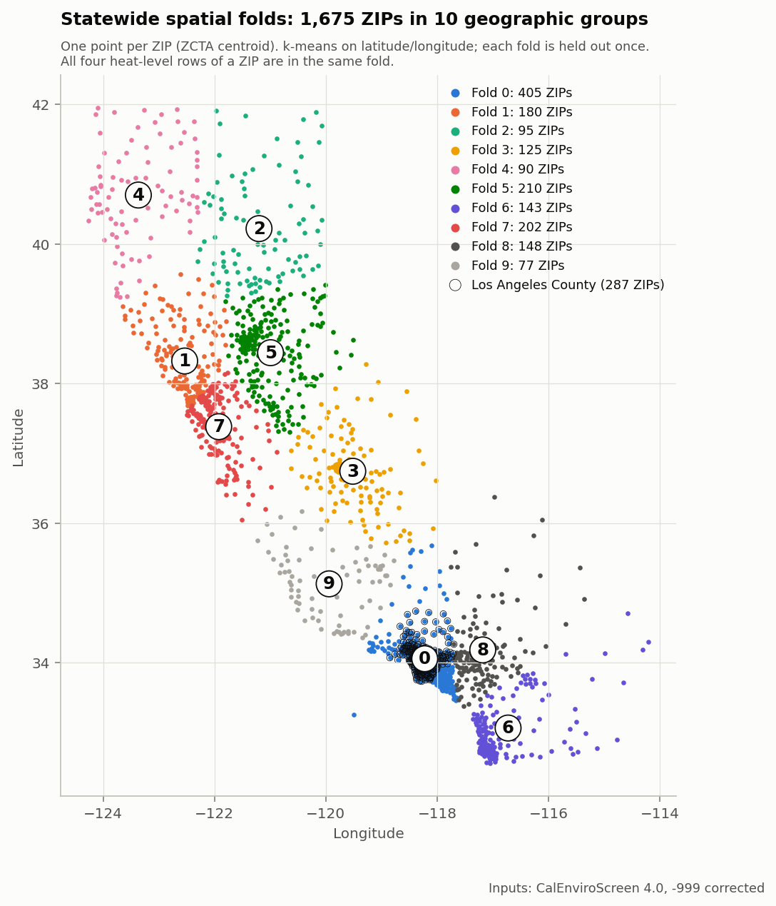
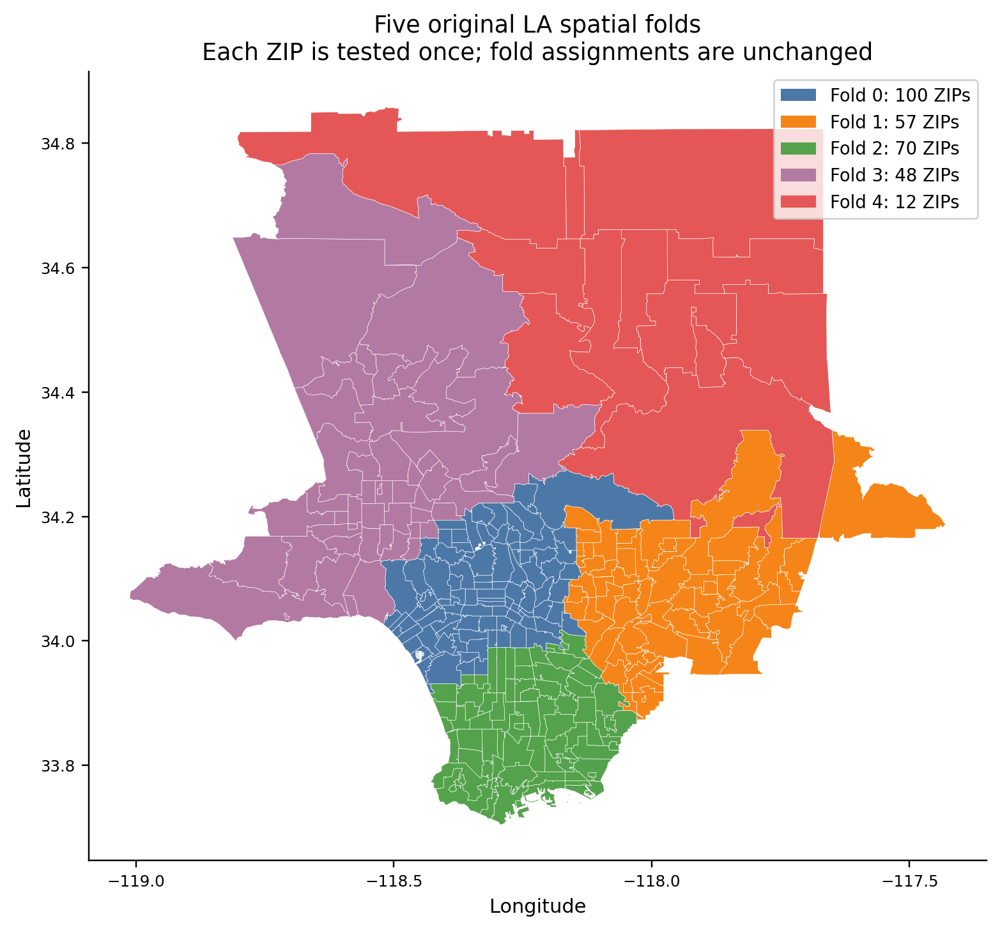
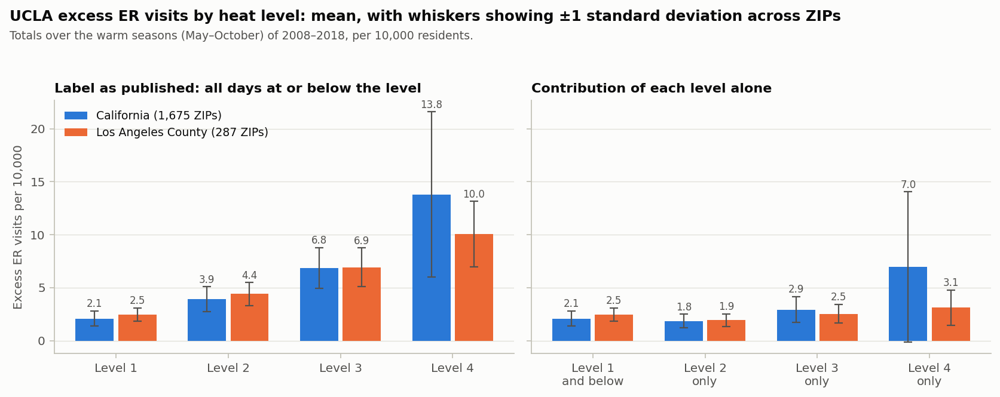
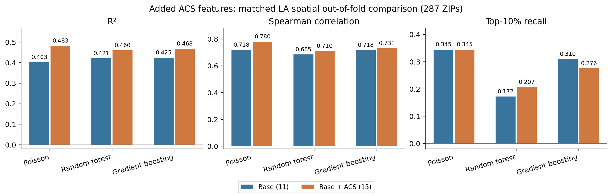
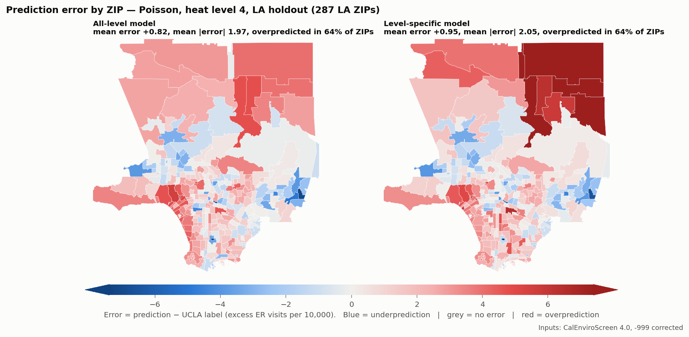
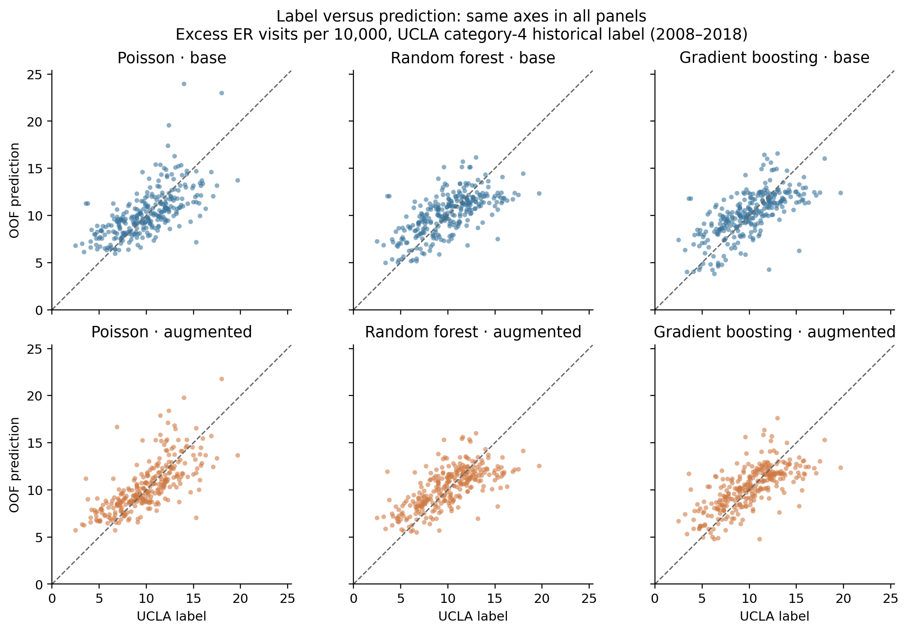

# HEATLA: Predicting Heat-Related Excess Emergency Visits by ZIP Code in California and Los Angeles County

**CSCI 461 midterm report** · Rohit Shetty, Utkarsh Landge, Neel Kothari, Haochen (Char) Song

> **Draft notes for the team. Delete this box before submitting.**
>
> - **Decisions assumed, not yet agreed:** the published level-4 label is the main target with level-4-only beside it; Part 2 augmented Poisson is the official LA model; siting is not rerun. The website now shows the corrected Part 1 and Part 2 results.
> - **Part 2 follow-up runs (level-4-only target, no asthma/cardiovascular inputs) are done** (section 5.8, `part2/FOLLOWUP_EXPERIMENTS.md`); Char should review them.
> - **Check against a course sample report:** nobody has confirmed the expected format or length.
> - **Literature:** Riley, Derakhshan and Hess were checked in full and Scott from its abstract only. The other papers had only their bibliographic details checked, so read them before submitting. Every journal reference's authors, volume, pages and DOI were checked against Crossref.
> - **Unconfirmed:** that UCLA's level values are cumulative, whether UCLA's published layer used its optional socioeconomic adjustment, and the reference year of the CalEnviroScreen age-65+ field.

## Abstract

Extreme heat raises emergency room (ER) visits unevenly across neighborhoods. We ask whether community characteristics can predict UCLA's estimates of heat-related excess ER visits, whether patterns learned elsewhere in California transfer to Los Angeles County, and how predictions could inform cooling-center siting. Using 1,675 California ZIP codes at four heat levels, a Poisson model trained outside LA ranks LA ZIPs well on UCLA's published level-4 label (Spearman ρ = 0.73, R² = 0.35). That label totals all heat levels. On the excess attributable to level-4 days alone, ranking holds up (ρ = 0.68) but the amount of excess does not transfer (R² = 0.09). Without two inputs drawn from the same hospital records as the label, ρ falls to 0.63 and 0.50. Within LA, four added community features raise Poisson R² from 0.40 to 0.48 and ρ from 0.72 to 0.78, without improving recovery of the top 10% of ZIPs. We document how the labels are built, correct a missing-value error in the inputs, audit data years, and state the siting problem as an integer program.

## 1. Introduction

During extreme heat, ER visits rise more in some communities than others. Knowing which neighborhoods carry the greatest burden could help direct limited resources such as cooling centers. UCLA Heat Maps publishes estimates of heat-related excess ER visits for California ZIP codes for 2008–2018.

This report addresses three questions:

1. **Geographic transfer.** Can patterns learned elsewhere in California predict LA County, especially under extreme heat? (Part 1)
2. **Added community features.** Do additional community indicators improve prediction within LA? (Part 2)
3. **Labels and siting.** What do the UCLA labels measure, and how can they be used to site cooling centers? (Part 3)

The siting component is at the formulation stage. Its design will be discussed at office hours.

## 2. Related work

**Heat and emergency care in California.** During the 2006 California heat wave, ER visits rose for heat illness, cardiovascular disease, renal failure and other causes, with young children and older adults at greatest risk (Knowlton et al., 2009). Across California climate zones, higher apparent temperature is associated with more ER visits, and that work also tested confounding by air pollutants (Basu et al., 2012). In LA County, communities with more outdoor workers had higher rates of heat-related ER visits (Riley et al., 2018). UCLA's Heat Maps page also cites this study.

**Community vulnerability.** Heat-vulnerability indices commonly combine age, poverty, education, social isolation and related factors (Reid et al., 2009). Racial and socioeconomic disparities in heat-related health effects are reviewed by Gronlund (2014). Linguistic and social isolation were associated with heat distress calls in Phoenix (Uejio et al., 2011). Derakhshan et al. (2024) compared social vulnerability measures, including car access, with excess ER outcomes in California.

**Health conditions and air pollution.** Heat is associated with emergency hospitalization for respiratory disease (Anderson et al., 2013) and with asthma ER visits (Xu et al., 2013). Air pollutants modify and confound heat effects (Analitis et al., 2014).

**Access to care and cooling.** Insurance status is relevant to the burden of acute heat illness in emergency departments (Hess et al., 2014), and residential air-conditioning access differs by housing tenure (Scott et al., 2025).

**Siting.** Our formulation is the maximal covering location problem (Church and ReVelle, 1974).

Section 3.3 links each input to this evidence. The evidence is strongest for age, poverty, and cardiovascular and respiratory disease, and weakest for housing burden, unemployment and population density, which rest on general socioeconomic arguments.

## 3. Data

### 3.1 The prediction target: UCLA Heat Maps

UCLA's documentation describes a Bayesian spatial Poisson model fitted with INLA to daily ER visits and temperature (UCLA, 2025). ZIP-level baselines and heat slopes are spatially smoothed. Excess visits on a day equal observed visits minus the visits the model expects at a typical counterfactual temperature, by default the ZIP's long-term mean.

**What the label is.**

- **A model-based estimate.** It is not a raw count. The observed part is ER data; the baseline it is compared with comes from a model.
- **A total over the period.** UCLA's yearly values sum to the label to within rounding in the two ZIPs we checked. It covers the eleven warm seasons (May–October) of 2008–2018 and is expressed per 10,000 residents.
- **Probably cumulative across heat levels.** In all 1,675 ZIPs the level-4 row covers exactly 2,024 days, which is every warm-season day (184 × 11), and both day counts and labels rise with level. We therefore read the level-k value as covering all days at or below level k. **This is our inference; UCLA does not state it.**
- **ZIP-specific heat levels.** Thresholds are temperatures specific to each ZIP (level 4 ranges from 69.7 to 107.6 °F).

**Does the label already use our features?** Under UCLA's documented default, the model uses ER counts, temperature, population, calendar terms and ZIP adjacency, with no socioeconomic inputs. UCLA's code has an optional socioeconomic adjustment, and the setting used for the published layer is not stated. Spatial smoothing also means labels vary smoothly across space, which supports spatial cross-validation and limits how feature importance can be read.

The ER data source (California HCAI records), diagnoses (dehydration, renal failure, heat illness) and temperature data (gridMET daily maximum apparent temperature) come from an earlier UCLA methods document that has since been removed from its repository (UCLA, 2025b).

We use two targets:

- **Published label:** UCLA's level-k value, read as total heat burden up to that level.
- **Level-only:** the contribution of level k alone, label(k) − label(k−1). Level-4-only is the quantity that corresponds to extreme-heat days.

### 3.2 Sample

The unit of observation is a ZIP and heat-level pair. Each ZIP has four rows that describe one place.

| Sample | Unique ZIPs | Rows |
|---|---|---|
| California, raw | 1,686 | 6,744 |
| California, after cleaning (label, centroid and population present) | 1,675 | 6,700 |
| Los Angeles County (LA holdout test set) | 287 | 1,148 |
| Rest of California (LA holdout training set) | 1,388 | 5,552 |
| LA-only experiment (level 4; 2 of 289 ZIPs lack coordinates) | 287 | 287 |

Rows with missing inputs are kept. Missing values are filled with the training-fold median, fitted only on training data.

### 3.3 Input features

| Input | Definition | Reference period | Source | Models | Supporting evidence |
|---|---|---|---|---|---|
| Heat level | CalHeatScore level 1–4 | 2008–2018 | UCLA | Statewide | — |
| PM2.5 | Annual mean, µg/m³ | 2015–2017 | CES 4.0 | All | Analitis 2014; Basu 2012 |
| Ozone | Mean daily maximum 8-hour, ppm | 2017–2019 | CES 4.0 | All | Analitis 2014; Basu 2012 |
| Asthma ED rate | Age-adjusted visits per 10,000 | 2015–2017 | CES 4.0 | All | Anderson 2013; Xu 2013 |
| Cardiovascular ED rate | Age-adjusted heart-attack visits per 10,000 | 2015–2017 | CES 4.0 | All | Knowlton 2009; Basu 2012 |
| Poverty | % below 2× federal poverty level | ACS 2015–2019 | CES 4.0 | All | Reid 2009; Gronlund 2014 |
| Age 65+ | % of population | To confirm | CES 4.0 | All | Reid 2009; Knowlton 2009 |
| Education | % over 25 without high school | ACS 2015–2019 | CES 4.0 | All | Reid 2009; Gronlund 2014 |
| Linguistic isolation | % limited-English households | ACS 2015–2019 | CES 4.0 | All | Uejio 2011 |
| Unemployment | % over 16 in labor force unemployed | ACS 2015–2019 | CES 4.0 | All | Gronlund 2014 |
| Housing burden | % low-income households paying over 50% on housing | HUD CHAS 2013–2017 | CES 4.0 | All | Gronlund 2014 |
| Population density | Persons per square mile | 2020 population, 2023 land area | UCLA; Census Gazetteer | All | Uejio 2011 (indirect) |
| Renters | % renter-occupied housing units | ACS 2014–2018 | ACS | LA augmented | Scott 2025; Derakhshan 2024 |
| No vehicle | % occupied units with no vehicle | ACS 2014–2018 | ACS | LA augmented | Derakhshan 2024 |
| Uninsured | % civilian noninstitutionalized | ACS 2014–2018 | ACS | LA augmented | Hess 2014; Derakhshan 2024 |
| Construction | % of employed residents in construction industry | ACS 2014–2018 | ACS | LA augmented | Riley 2018 |

"All" means the statewide model and both LA configurations. CalEnviroScreen (CES) values are tract-level and aggregated to ZIP by population weight. Construction employment is an industry proxy and does not cover all outdoor work. Total population is not an input.

### 3.4 Data quality and data years

**Missing-value correction.** CalEnviroScreen marks a missing tract value as −999. The original aggregation averaged those markers into ZIP values, changing the inputs of 436 of 1,675 ZIPs (92 of 287 in LA). All results here treat −999 as missing before aggregation. No negative values remain.

**Data years.** The label covers 2008–2018, and the inputs do not match it exactly. CalEnviroScreen 4.0 inputs describe about 2013–2019, and the four added ACS features describe 2014–2018. We tested CalEnviroScreen 3.0 inputs, which describe 2009–2015, as a sensitivity check (section 5.7).

**Population.** UCLA's population field represents the 2020 Census. Its California total is 39,535,231 against 39,538,212 in the Census Bureau's 2020 base, and its county totals fit 2020 better than any year from 2010 to 2023. Statewide, 2020 is about 3.4% above 2013 and 6.1% above 2010. It is used for density and as the Poisson weight, and it is the denominator of UCLA's rate. We kept it in all parts and document the mismatch as a limitation. To check it, we reran Parts 1 and 2 with 2010 Census population (Census 2010 Gazetteer ZCTA file; 285 of the 287 LA ZIPs matched). Spearman changed by at most 0.022 and R² by about 0.01, except random forest's LA-holdout level-4 R² (−0.48 to −0.34, still well below zero). The conclusions did not change (`results/population_year_check.md`).

## 4. Experimental setups

| | A. Statewide spatial CV | B. LA holdout | C. LA-only spatial CV |
|---|---|---|---|
| Purpose | General out-of-area skill | Transfer to LA | Value of added features within LA |
| Training set | 9 of 10 geographic folds, California | All California outside LA County (1,388 ZIPs, 5,552 rows) | 4 of 5 geographic folds within LA |
| Test set | Held-out fold; every ZIP once (1,675 ZIPs, 6,700 rows) | LA County (287 ZIPs, 1,148 rows) | Held-out LA fold; every ZIP once (287 ZIPs) |
| Heat levels | 1–4 | 1–4 | 4 only |
| Folds | 10, k-means on ZIP centroids; 77 to 405 ZIPs | Single split | 5 groups: 100, 57, 70, 48, 12 ZIPs |
| Inputs | 12 | 12 | 11 (base) or 15 (augmented) |

All four heat-level rows of a ZIP stay in one fold. Folds cross county lines, but 286 of the 287 LA ZIPs fall in one statewide fold, so for LA experiments A and B are nearly the same test.

**Models.** Poisson regression (ridge penalty 1.0, population-weighted, standardized inputs), random forest (500 trees, minimum leaf 2) and gradient boosting (default settings). Seed 42. Imputation and scaling are fitted on training data only.

**All-level and level-specific models.** An all-level model is trained on all four levels with heat level as an input. A level-specific model is trained only on one level, without the heat-level input. "Level 4" results from an all-level model filter the test rows; they are not a separate model.

**Metrics.** R², Spearman correlation and top-10% recall, with top-20% recall as a supplement. **Error = prediction − UCLA label**, so positive values are overprediction. The CalEnviroScreen percentile is compared on rank metrics only, on matched ZIPs.

*Figure 1. The ten statewide spatial folds, 1,675 ZIPs, one point at each ZIP centroid. Experiment A.*

*Figure 2. The five LA folds, 287 ZIPs. Experiment C.*

## 5. Results

### 5.1 How the label varies by heat level

*Excess ER visits per 10,000, total over May–October 2008–2018.*

| Region | Heat level | Published label: mean | SD | That level alone: mean | SD  | Share of level-4 total |
|---|---|---|---|---|---|---|
| California | 1 | 2.08 | 0.73 | 2.08 | 0.73 | 15.1% |
| California | 2 | 3.93 | 1.17 | 1.84 | 0.65 | 13.4% |
| California | 3 | 6.84 | 1.94 | 2.92 | 1.22 | 21.2% |
| California | 4 | 13.80 | 7.82 | 6.95 | 7.10 | 50.4% |
| Los Angeles County | 1 | 2.47 | 0.61 | 2.47 | 0.61 | 24.6% |
| Los Angeles County | 2 | 4.40 | 1.09 | 1.92 | 0.59 | 19.2% |
| Los Angeles County | 3 | 6.93 | 1.83 | 2.53 | 0.88 | 25.2% |
| Los Angeles County | 4 | 10.04 | 3.10 | 3.11 | 1.68 | 30.9% |

*Figure 3. Mean label by heat level; whiskers show ±1 standard deviation across ZIPs. California 1,675 ZIPs, LA County 287 ZIPs.*

Statewide, the mean doubles from level 3 to level 4 and the spread quadruples. Level-4-only days contribute half of the statewide total. LA differs at level 4: its level-4-only mean is 3.11, against 7.75 in the rest of California. Levels also rank ZIPs differently: the rank correlation between the level-1 and level-4 labels across California is −0.29. Together these motivate testing level-specific models.

### 5.2 Performance by heat level (published label, all-level models)

**LA holdout (experiment B).**

| Model | Scope | n | R² | Spearman ρ | Top-10% | Top-20% |
|---|---|---|---|---|---|---|
| Poisson | All levels pooled | 1,148 | 0.781 | 0.905 | 0.75 | 0.77 |
| Poisson | Level 1 | 287 | −0.235 | 0.282 | 0.14 | 0.30 |
| Poisson | Level 2 | 287 | 0.046 | 0.468 | 0.21 | 0.44 |
| Poisson | Level 3 | 287 | 0.277 | 0.630 | 0.24 | 0.47 |
| Poisson | Level 4 | 287 | 0.349 | 0.730 | 0.34 | 0.56 |
| Random forest | All levels pooled | 1,148 | 0.619 | 0.911 | 0.66 | 0.82 |
| Random forest | Level 1 | 287 | −0.047 | 0.213 | 0.17 | 0.39 |
| Random forest | Level 2 | 287 | 0.212 | 0.480 | 0.34 | 0.40 |
| Random forest | Level 3 | 287 | 0.321 | 0.531 | 0.31 | 0.47 |
| Random forest | Level 4 | 287 | −0.483 | 0.688 | 0.14 | 0.44 |
| Gradient boosting | All levels pooled | 1,148 | 0.642 | 0.898 | 0.70 | 0.78 |
| Gradient boosting | Level 1 | 287 | −0.259 | 0.148 | 0.03 | 0.19 |
| Gradient boosting | Level 2 | 287 | −0.140 | 0.267 | 0.21 | 0.26 |
| Gradient boosting | Level 3 | 287 | 0.243 | 0.487 | 0.21 | 0.32 |
| Gradient boosting | Level 4 | 287 | −0.291 | 0.683 | 0.24 | 0.40 |

**Statewide spatial cross-validation (experiment A).**

| Model | Scope | n | R² | Spearman ρ | Top-10% | Top-20% |
|---|---|---|---|---|---|---|
| Poisson | All levels pooled | 6,700 | 0.525 | 0.871 | 0.56 | 0.81 |
| Poisson | Level 1 | 1,675 | −1.791 | −0.314 | 0.03 | 0.08 |
| Poisson | Level 2 | 1,675 | −0.621 | −0.017 | 0.05 | 0.16 |
| Poisson | Level 3 | 1,675 | 0.001 | 0.342 | 0.14 | 0.27 |
| Poisson | Level 4 | 1,675 | −0.015 | 0.512 | 0.16 | 0.35 |
| Random forest | All levels pooled | 6,700 | 0.629 | 0.900 | 0.61 | 0.81 |
| Random forest | Level 1 | 1,675 | −0.022 | 0.250 | 0.11 | 0.27 |
| Random forest | Level 2 | 1,675 | 0.020 | 0.286 | 0.20 | 0.30 |
| Random forest | Level 3 | 1,675 | 0.106 | 0.348 | 0.25 | 0.35 |
| Random forest | Level 4 | 1,675 | 0.199 | 0.567 | 0.32 | 0.43 |
| Gradient boosting | All levels pooled | 6,700 | 0.665 | 0.888 | 0.64 | 0.81 |
| Gradient boosting | Level 1 | 1,675 | −0.259 | −0.101 | 0.04 | 0.16 |
| Gradient boosting | Level 2 | 1,675 | −0.032 | 0.042 | 0.14 | 0.23 |
| Gradient boosting | Level 3 | 1,675 | 0.146 | 0.330 | 0.23 | 0.27 |
| Gradient boosting | Level 4 | 1,675 | 0.284 | 0.585 | 0.33 | 0.41 |

Pooled scores mostly reflect the gap between heat levels. Within a level they are much lower. On the published label, rank correlation rises from level 1 to level 4, which may partly reflect that level 4 includes all lower levels. Tree models rank LA ZIPs well at level 4 but have negative R²: they carry the higher level-4 values of the rest of California into LA.

### 5.3 Extreme heat alone: published label versus level-4-only

| Evaluation | Model | R² published | R² level-4 only | ρ published | ρ level-4 only | Top-10% published | Top-10% level-4 only |
|---|---|---|---|---|---|---|---|
| LA holdout (287 ZIPs) | Poisson | 0.349 | 0.089 | 0.730 | 0.681 | 0.34 | 0.34 |
| LA holdout (287 ZIPs) | Random forest | −0.483 | −2.748 | 0.688 | 0.650 | 0.14 | 0.28 |
| LA holdout (287 ZIPs) | Gradient boosting | −0.291 | −2.143 | 0.683 | 0.646 | 0.24 | 0.38 |
| Spatial CV (1,675 ZIPs) | Poisson | −0.015 | −0.078 | 0.512 | 0.451 | 0.16 | 0.19 |
| Spatial CV (1,675 ZIPs) | Random forest | 0.199 | 0.181 | 0.567 | 0.563 | 0.32 | 0.33 |
| Spatial CV (1,675 ZIPs) | Gradient boosting | 0.284 | 0.269 | 0.585 | 0.574 | 0.33 | 0.33 |

Rank correlation falls only slightly on the level-4-only target, and top-10% recall does not fall. **The amount of excess does not transfer:** on the LA holdout, Poisson R² falls to 0.09 (95% interval −0.12 to 0.24) and tree-model R² is strongly negative. Extreme-day excess averages 7.75 per 10,000 outside LA and 3.11 in LA. **To answer whether patterns learned elsewhere predict LA under extreme heat: ZIPs can be ranked (ρ about 0.68), but the size of the excess cannot be transferred.** On each level's own days, level 3 is ranked best in LA, so the finding that level 4 is best predicted applies only to the published label.

### 5.4 Pooled versus level-specific models (level 4)

| Evaluation | Target | Model | R² all-level | R² level-specific | ρ all-level | ρ level-specific | Top-10% all-level | Top-10% level-specific |
|---|---|---|---|---|---|---|---|---|
| LA holdout | Published label | Poisson | 0.349 | 0.174 | 0.730 | 0.711 | 0.34 | 0.28 |
| LA holdout | Published label | Random forest | −0.483 | −0.485 | 0.688 | 0.683 | 0.14 | 0.14 |
| LA holdout | Published label | Gradient boosting | −0.291 | −0.325 | 0.683 | 0.670 | 0.24 | 0.24 |
| LA holdout | Level-4 only | Poisson | 0.089 | −0.597 | 0.681 | 0.625 | 0.34 | 0.31 |
| LA holdout | Level-4 only | Random forest | −2.748 | −2.710 | 0.650 | 0.658 | 0.28 | 0.28 |
| LA holdout | Level-4 only | Gradient boosting | −2.143 | −2.509 | 0.646 | 0.593 | 0.38 | 0.38 |
| Spatial CV | Published label | Poisson | −0.015 | 0.123 | 0.512 | 0.564 | 0.16 | 0.23 |
| Spatial CV | Published label | Random forest | 0.199 | 0.201 | 0.567 | 0.569 | 0.32 | 0.33 |
| Spatial CV | Published label | Gradient boosting | 0.284 | 0.289 | 0.585 | 0.595 | 0.33 | 0.36 |
| Spatial CV | Level-4 only | Poisson | −0.078 | 0.075 | 0.451 | 0.534 | 0.19 | 0.28 |
| Spatial CV | Level-4 only | Random forest | 0.181 | 0.182 | 0.563 | 0.567 | 0.33 | 0.32 |
| Spatial CV | Level-4 only | Gradient boosting | 0.269 | 0.250 | 0.574 | 0.569 | 0.33 | 0.36 |

A level-specific model does not meaningfully improve LA at level 4 on either target. It has a quarter of the training rows and learns only from non-LA level-4 rows, whose values are much higher than LA's. In statewide cross-validation the level-specific Poisson model improves modestly, and tree models change little, since they can already split on heat level.

### 5.5 Without the asthma and cardiovascular inputs

These two inputs are ER-visit rates from the same state records as the label, so a model using them may partly learn which communities use the ER more.

| Evaluation | Target | Model | R² with | R² without | ρ with | ρ without | Top-10% with | Top-10% without |
|---|---|---|---|---|---|---|---|---|
| LA holdout | Published label | Poisson | 0.349 | 0.233 | 0.730 | 0.633 | 0.34 | 0.31 |
| LA holdout | Published label | Random forest | −0.483 | −0.329 | 0.688 | 0.559 | 0.14 | 0.17 |
| LA holdout | Published label | Gradient boosting | −0.291 | −0.121 | 0.683 | 0.586 | 0.24 | 0.21 |
| LA holdout | Level-4 only | Poisson | 0.089 | −0.161 | 0.681 | 0.502 | 0.34 | 0.14 |
| LA holdout | Level-4 only | Random forest | −2.748 | −1.915 | 0.650 | 0.372 | 0.28 | 0.17 |
| LA holdout | Level-4 only | Gradient boosting | −2.143 | −1.628 | 0.646 | 0.390 | 0.38 | 0.24 |
| Spatial CV | Published label | Poisson | −0.015 | −0.021 | 0.512 | 0.441 | 0.16 | 0.14 |
| Spatial CV | Published label | Random forest | 0.199 | 0.115 | 0.567 | 0.461 | 0.32 | 0.29 |
| Spatial CV | Published label | Gradient boosting | 0.284 | 0.199 | 0.585 | 0.469 | 0.33 | 0.32 |
| Spatial CV | Level-4 only | Poisson | −0.078 | −0.082 | 0.451 | 0.345 | 0.19 | 0.21 |
| Spatial CV | Level-4 only | Random forest | 0.181 | 0.104 | 0.563 | 0.446 | 0.33 | 0.28 |
| Spatial CV | Level-4 only | Gradient boosting | 0.269 | 0.202 | 0.574 | 0.480 | 0.33 | 0.32 |

Removing them lowers level-4 rank correlation for every model, in both evaluations and on both targets. The effect is largest on level-4-only days in LA, where Poisson top-10% recall falls from 0.34 to 0.14. This does not make the inputs invalid, since prior disease may truly mark vulnerable communities. It does show that skill at extreme heat depends heavily on inputs that measure ER use.

### 5.6 Comparison with the CalEnviroScreen percentile (matched ZIPs, level 4)

| Evaluation | Target | ZIPs | CES percentile ρ | Poisson ρ | Random forest ρ | Gradient boosting ρ | CES top-10% | Poisson top-10% |
|---|---|---|---|---|---|---|---|---|
| LA holdout | Published label | 273 | 0.566 | 0.757 | 0.736 | 0.742 | 0.15 | 0.30 |
| LA holdout | Level-4 only | 273 | 0.498 | 0.707 | 0.695 | 0.698 | 0.15 | 0.37 |
| Spatial CV | Published label | 1,326 | 0.300 | 0.647 | 0.631 | 0.644 | 0.11 | 0.24 |
| Spatial CV | Level-4 only | 1,326 | 0.254 | 0.597 | 0.614 | 0.624 | 0.09 | 0.29 |

Scores use only ZIPs with a percentile, so each model and the index are compared on identical ZIPs. The models outperform the index. Without the two ER-based inputs, the Poisson model is close to the index on level-4-only days in LA (ρ 0.535 against 0.498, on 273 ZIPs) and has lower top-10% recall (0.11 against 0.15).

### 5.7 Sensitivity to input year

*Level 4, published label, same ZIPs with complete inputs in both versions (LA holdout 270 ZIPs; spatial CV 1,262 ZIPs).*

| Evaluation | Model | R² CES 4.0 | R² CES 3.0 | ρ CES 4.0 | ρ CES 3.0 | Top-10% CES 4.0 | Top-10% CES 3.0 |
|---|---|---|---|---|---|---|---|
| LA holdout | Poisson | 0.396 | 0.410 | 0.767 | 0.783 | 0.33 | 0.19 |
| LA holdout | Random forest | −0.029 | 0.150 | 0.749 | 0.760 | 0.19 | 0.30 |
| LA holdout | Gradient boosting | 0.048 | 0.076 | 0.747 | 0.715 | 0.22 | 0.22 |
| Spatial CV | Poisson | 0.174 | 0.200 | 0.657 | 0.682 | 0.25 | 0.29 |
| Spatial CV | Random forest | 0.327 | 0.371 | 0.643 | 0.684 | 0.48 | 0.48 |
| Spatial CV | Gradient boosting | 0.374 | 0.351 | 0.650 | 0.652 | 0.46 | 0.42 |

Replacing inputs from about 2013–2019 with inputs from 2009–2015 changes R² and rank correlation by amounts within sampling variation. Top-10% recall moves in both directions; in LA one ZIP changes recall by about 0.04. Four inputs also changed in method between versions, so this is a robustness check rather than a clean test of year.

### 5.8 Value of additional features within LA

*Experiment C: same 287 ZIPs, labels, folds and models. Base has 11 inputs; augmented adds renters, no-vehicle, uninsured and construction.*

| Configuration | Model | R² | MAE | Spearman ρ | Top-10% | Top-20% |
|---|---|---|---|---|---|---|
| Base (11) | Poisson | 0.403 | 1.85 | 0.718 | 0.34 | 0.58 |
| Base (11) | Random forest | 0.421 | 1.85 | 0.685 | 0.17 | 0.46 |
| Base (11) | Gradient boosting | 0.425 | 1.83 | 0.718 | 0.31 | 0.51 |
| Augmented (15) | Poisson | 0.483 | 1.67 | 0.780 | 0.34 | 0.60 |
| Augmented (15) | Random forest | 0.460 | 1.78 | 0.710 | 0.21 | 0.46 |
| Augmented (15) | Gradient boosting | 0.468 | 1.73 | 0.731 | 0.28 | 0.44 |
| Reference | Training-fold mean | −0.111 | 2.64 | — | — | — |

Adding the four features improves R² and rank correlation for all three models, most clearly for Poisson (R² +0.080, Spearman +0.061), whose MAE and R² improve in all five folds. Random forest and gradient boosting improve in pooled fit, but their exploratory resampling intervals include zero. Top-10% recall does not improve consistently: unchanged for Poisson, one ZIP higher for random forest and one ZIP lower for gradient boosting. This measures the four features as a group, not each one alone. On the 273 ZIPs with a CalEnviroScreen percentile, the index has ρ = 0.566 and augmented Poisson 0.811.

**Local training versus transfer.** LA-only Poisson has R² 0.403 and ρ 0.718, and the LA holdout Poisson has R² 0.349 and ρ 0.730 on the level-4 label. These come from different designs, so they are not directly comparable. Part 1 trains outside LA on all four heat levels with 12 inputs. Part 2 trains on the other LA folds at level 4 only with 11 inputs. The higher LA-only figures in earlier drafts (R² 0.445, ρ 0.785, `results/metrics.json`) came from the original 13-input model on inputs before the −999 correction.

**Extreme heat alone and without the ER-rate inputs.** The same comparison was repeated on the level-4-only target and without the asthma and heart-attack ER-rate inputs (`part2/FOLLOWUP_EXPERIMENTS.md`; same ZIPs, folds and models).

| Variant | Poisson ρ base → augmented | Best ρ, any model | Augmented Poisson vs CES percentile, ρ (273 ZIPs) |
|---|---|---|---|
| Published label | 0.718 → 0.780 | 0.780 | 0.811 vs 0.566 |
| Level-4 only | 0.637 → 0.648 | 0.673 | 0.674 vs 0.498 |
| Published label, no ER rates | 0.553 → 0.691 | 0.691 | 0.716 vs 0.566 |
| Level-4 only, no ER rates | 0.275 → 0.424 | 0.472 | 0.432 vs 0.498 |

On extreme-heat days alone, the four ACS features no longer improve ranking, though the models still beat the index. Without the ER-rate inputs, the ACS features help more on the published label (Poisson +0.14; exploratory interval 0.06 to 0.18). For extreme-heat days without the ER-rate inputs, no model clearly beats the CalEnviroScreen percentile, which matches Part 1 (section 5.5). The Poisson R² of −3.06 in that last setting comes mostly from ZIP 90089 (USC campus: 100% renters and 100% no-vehicle households), where the log link extrapolates to 48.8 against a label of 2.0.

*Figure 4. Base and augmented models, LA-only spatial cross-validation, 287 ZIPs, level 4.*

### 5.9 Where the errors are

*Figure 5. Error (prediction − UCLA label, per 10,000). Left: all-level Poisson model. Right: level-specific Poisson model. LA holdout, level 4, published label, 287 ZIPs. Red is overprediction, blue is underprediction.*

*Figure 6. UCLA label against out-of-fold prediction, LA-only spatial cross-validation, level 4, 287 ZIPs. Points above the dashed line are overpredicted.*

On the LA holdout at level 4, Poisson overpredicts 64% of ZIPs, with mean error +0.82. Predictions are compressed: their standard deviation is 1.75 against 3.10 for the labels. Overprediction is largest on the Westside and South Bay coast, where labels are lowest. The inland San Fernando and San Gabriel Valleys are underpredicted, and the Antelope Valley is overpredicted even though its labels are high.

## 6. Cooling-center siting formulation

We select centers to maximize predicted excess ER visits within reach.

**Sets and parameters.** $Z$ is the set of 287 LA ZIPs, each represented by its centroid. $S$ is the set of 153 existing LA County regional cooling centers. $w_z = \max(0,\hat r_z)\,p_z/10{,}000$ is the burden of ZIP $z$, where $\hat r_z$ is the predicted rate and $p_z$ UCLA's population, giving a number of excess visits over the eleven seasons. $d_{zs}$ is great-circle distance, $R$ the coverage radius, $a_{zs}=1$ if $d_{zs}\le R$, and $k$ the number of centers.

**Decision variables.** $x_s\in\{0,1\}$ selects site $s$; $y_z\in\{0,1\}$ marks ZIP $z$ as covered.

$$\max \sum_{z\in Z} w_z\,y_z$$

$$\text{subject to}\quad y_z \le \sum_{s\in S} a_{zs}\,x_s \;\;\forall z\in Z, \qquad \sum_{s\in S} x_s \le k, \qquad x_s,\,y_z\in\{0,1\}.$$

A ZIP counts once in the objective no matter how many selected centers reach it. An independent re-solve reproduced all 16 committed solutions, including the selected sites. The weights use earlier LA out-of-fold Poisson predictions and have not been rerun with the corrected inputs.

*Share of predicted burden covered by the exact solution.*

| Radius (miles) | ZIPs reachable by any center | Ceiling | k = 5 | k = 10 | k = 20 | k = 40 |
|---|---|---|---|---|---|---|
| 1 | 99 of 287 | 42.9% | 6.6% | 11.7% | 20.5% | 32.3% |
| 2 | 183 of 287 | 69.0% | 13.4% | 22.1% | 35.2% | 53.8% |
| 3 | 235 of 287 | 84.1% | 26.2% | 40.2% | 60.4% | 80.5% |
| 5 | 268 of 287 | 92.6% | 47.2% | 69.0% | 87.6% | 92.6% |

**Limitations.** The program chooses among existing centers and does not propose new sites. Coverage is all-or-nothing and straight-line from one point per ZIP, with no travel time, capacity or opening hours. Being within reach does not establish use or health benefit. The burden totals all heat levels over eleven seasons, while centers open on the hottest days.

## 7. Limitations

- **The labels are estimates** from UCLA's model, totalled over the period. Results describe agreement with those estimates, not observed extreme-day visits.
- **The cumulative reading of heat levels is an inference**, and level-only results depend on it. UCLA's optional socioeconomic adjustment may or may not have been used.
- **Input years differ from the label period** (section 3.4). Using 2010 population instead changed Spearman by at most 0.022 and did not change the conclusions (`results/population_year_check.md`).
- **Asthma and cardiovascular inputs share a data source with the label** (section 5.5).
- **Missing inputs are imputed.** 337 of 1,675 ZIPs have no CalEnviroScreen data, typically because no tract lists them as its ZIP. A further 57 lack one or more inputs (394 in total; 17 of 287 in LA).
- **Geography is approximate.** Each tract is assigned to one ZIP, ZIP and ZCTA are joined by code, and boundaries are not harmonized across data vintages.
- **LA is effectively one test.** LA holdout and statewide cross-validation are nearly the same split for LA, and LA differs strongly from the rest of the state at level 4, so transfer results may not generalize to other counties.
- **Small top-k sets.** Top-10% recall in LA rests on 29 ZIPs.

## 8. Next steps

1. Discuss the siting design at office hours, including new candidate sites and equity constraints.
2. Ask UCLA to confirm the cumulative reading of heat levels and whether the socioeconomic adjustment was used.
3. Rerun siting with corrected predictions, and consider the level-4-only burden.
4. Test whether the population year matters using ACS population from inside the label period.
5. Explore UCLA's public yearly ZIP layer (2008–2018) for a check across time.

## References

Analitis, A., et al. (2014). Effects of heat waves on mortality: effect modification and confounding by air pollutants. *Epidemiology, 25*(1), 15–22. https://doi.org/10.1097/EDE.0b013e31828ac01b

Anderson, G. B., et al. (2013). Heat-related emergency hospitalizations for respiratory diseases in the Medicare population. *American Journal of Respiratory and Critical Care Medicine, 187*(10), 1098–1103. https://doi.org/10.1164/rccm.201211-1969OC

Basu, R., Pearson, D., Malig, B., Broadwin, R., & Green, R. (2012). The effect of high ambient temperature on emergency room visits. *Epidemiology, 23*(6), 813–820. https://doi.org/10.1097/EDE.0b013e31826b7f97

Church, R., & ReVelle, C. (1974). The maximal covering location problem. *Papers of the Regional Science Association, 32*(1), 101–118. https://doi.org/10.1007/BF01942293

Derakhshan, S., Eisenman, D. P., Basu, R., & Longcore, T. (2024). Do social vulnerability indices correlate with extreme heat health outcomes? *The Journal of Climate Change and Health, 18*, 100276. https://doi.org/10.1016/j.joclim.2023.100276

Gronlund, C. J. (2014). Racial and socioeconomic disparities in heat-related health effects and their mechanisms: a review. *Current Epidemiology Reports, 1*(3), 165–173. https://doi.org/10.1007/s40471-014-0014-4

Hess, J. J., Saha, S., & Luber, G. (2014). Summertime acute heat illness in U.S. emergency departments from 2006 through 2010: analysis of a nationally representative sample. *Environmental Health Perspectives, 122*(11), 1209–1215. https://doi.org/10.1289/ehp.1306796

Knowlton, K., et al. (2009). The 2006 California heat wave: impacts on hospitalizations and emergency department visits. *Environmental Health Perspectives, 117*(1), 61–67. https://doi.org/10.1289/ehp.11594

OEHHA (2021). *Summary of Changes in CalEnviroScreen Version 4.0.* California Office of Environmental Health Hazard Assessment.

OEHHA (2017). *CalEnviroScreen 3.0: Update to the California Communities Environmental Health Screening Tool.*

Reid, C. E., et al. (2009). Mapping community determinants of heat vulnerability. *Environmental Health Perspectives, 117*(11), 1730–1736. https://doi.org/10.1289/ehp.0900683

Riley, K., Wilhalme, H., Delp, L., & Eisenman, D. P. (2018). Mortality and morbidity during extreme heat events and prevalence of outdoor work: an analysis of community-level data from Los Angeles County, California. *International Journal of Environmental Research and Public Health, 15*(4), 580. https://doi.org/10.3390/ijerph15040580

Scott, M., Grineski, S. E., Collins, T. W., & Adkins, D. E. (2025). Climate Gaps: Disparities in residential air conditioning access across ten US metropolitan areas. *Applied Geography, 176*, 103537. https://doi.org/10.1016/j.apgeog.2025.103537

UCLA CalHeatScore modeling group (2025). *Heat Analysis Algorithm: Unified Technical Reference.* github.com/CalHeatScore-UCLA-modeling/Methods.

UCLA CalHeatScore modeling group (2025b). *Empirical Model Methods.* Earlier methods document, same repository history.

Uejio, C. K., et al. (2011). Intra-urban societal vulnerability to extreme heat: the role of heat exposure and the built environment, socioeconomics, and neighborhood stability. *Health & Place, 17*(2), 498–507. https://doi.org/10.1016/j.healthplace.2010.12.005

Xu, Z., Huang, C., Hu, W., Turner, L. R., Su, H., & Tong, S. (2013). Extreme temperatures and emergency department admissions for childhood asthma in Brisbane, Australia. *Occupational and Environmental Medicine, 70*(10), 730–735. https://doi.org/10.1136/oemed-2013-101538
