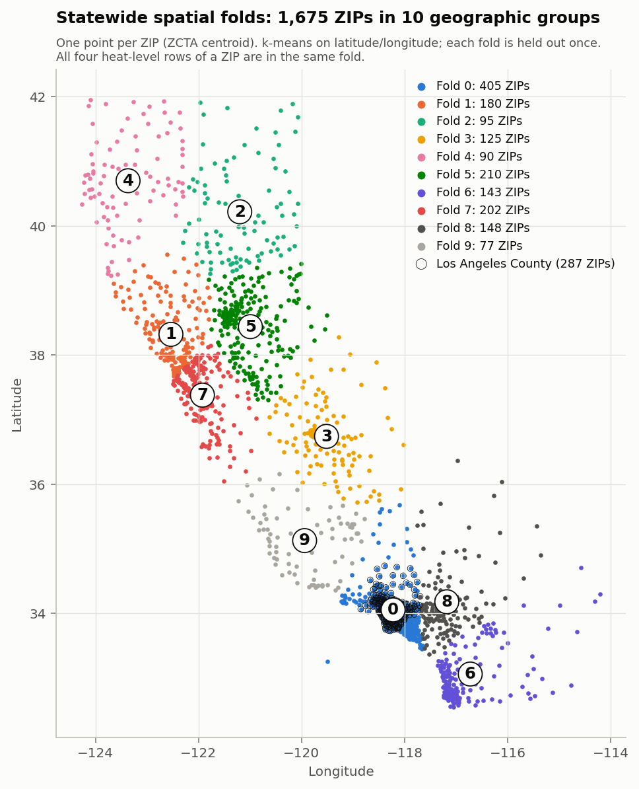
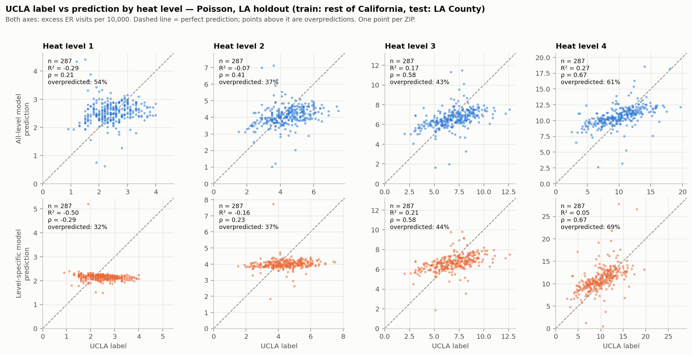
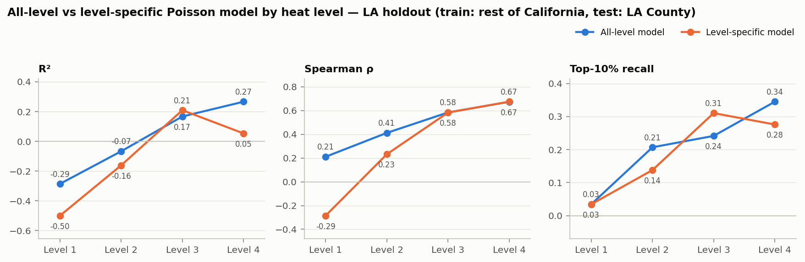
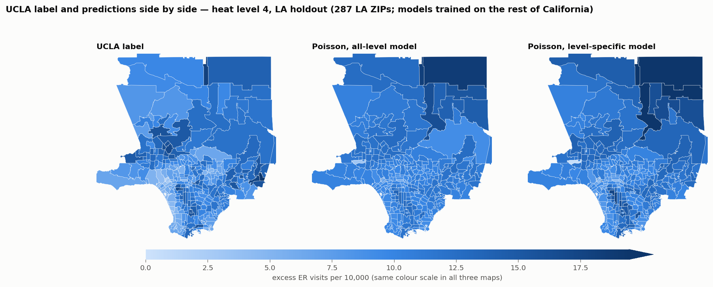
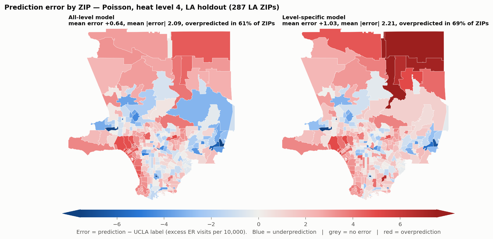

# Member 1 — Statewide models and geographic transfer

**Main question.** Can patterns learned elsewhere in California predict Los Angeles County, especially under extreme heat?

**Short answer.** Partly. A model trained on the rest of California ranks LA ZIPs at heat level 4 reasonably well (Spearman ρ = 0.67, 95% CI 0.59–0.74) but explains little of the variance (R² = 0.27, CI 0.16–0.35) and finds only about a third of the true top-10% ZIPs. The pooled numbers in the current report (ρ ≈ 0.89) describe the difference between heat levels, not skill within a level. Training a separate model per heat level did not improve the LA level-4 result.

Status of each item in this document:

| Item | Status |
|---|---|
| Existing statewide results reproduce from the data snapshot | Done — bit-identical to `results/metrics_ca.json` |
| Experimental setup and sample-count tables (Task 2) | Done |
| CES baseline on matched samples (Task 3) | Done — the old comparison was wrong; corrected numbers below |
| Per-level metrics (Task 4) | Done |
| All-level vs level-specific models (Task 5) | Done, including the optional statewide cross-validation extension |
| Figures (Task 6) | Done — statewide fold map, scatter plots, error maps, label-vs-prediction maps |
| Feature definitions and reference years (Task 1) | Done for CalEnviroScreen inputs from OEHHA's own documents; three items still to confirm (marked below) |
| Replacing temporally mismatched inputs and rerunning (Task 1) | **Not done** — a better-aligned source is identified (CalEnviroScreen 3.0) but not yet downloaded or run |
| Supporting literature (Task 1) | Bibliographic details checked; full texts not yet read by the team |

---

## 1. Data and samples

The unit of observation is a **ZIP × heat level** pair. The label is the UCLA Heat Maps excess ER visit rate per 10,000 for 2008–2018, at CalHeatScore levels 1–4. Every ZIP that survives cleaning has all four levels, so rows = 4 × ZIPs exactly.

**Table 1. Sample counts (verified from `data/processed/model_table_ca.csv`).**

| Stage | Unique ZIPs | Rows |
|---|---|---|
| Raw statewide table | 1,686 | 6,744 |
| After cleaning (label, ZCTA centroid and population present) | 1,675 | 6,700 |
|   — CalEnviroScreen inputs present | 1,338 | 5,352 |
|   — CalEnviroScreen inputs missing | 337 | 1,348 |
| Los Angeles County (LA holdout test set) | 287 | 1,148 |
|   — CalEnviroScreen inputs present | 276 | 1,104 |
|   — CalEnviroScreen inputs missing | 11 | 44 |
| Rest of California (LA holdout training set) | 1,388 | 5,552 |
|   — CalEnviroScreen inputs present | 1,062 | 4,248 |
|   — CalEnviroScreen inputs missing | 326 | 1,304 |
| Each heat level, statewide | 1,675 | 1,675 |
| Each heat level, Los Angeles | 287 | 287 |
| Each heat level, rest of California | 1,388 | 1,388 |

**Exclusion rule.** Rows are dropped only if the label, the ZCTA centroid or the population is missing. This removes 11 ZIPs (44 rows): 91123, 91522, 92152, 92318, 93435, 94035, 95141, 95192, 95724, 95836, 96162.

**Missing inputs are imputed, not dropped.** 337 ZIPs (20%) have no CalEnviroScreen values because no CalEnviroScreen tract lists them as its ZIP. These rows stay in training and testing. Their ten CalEnviroScreen inputs are filled with the training-fold median, so for those ZIPs the model sees only heat level and population density. The statement "no value is imputed" in `REPORT.md` is true of the data files but not of the models and needs correcting. The 11 LA ZIPs affected are mostly institutional or very small: 90014, 90073, 90089, 90095, 90263, 90639, 90822, 91210, 91608, 91759, 93553.

## 2. Inputs: definitions and reference years

The statewide model uses 12 inputs. Ten come from CalEnviroScreen 4.0 (census-tract values, aggregated to ZIP as a population-weighted mean using the tract's `ZIP` field and `TotPop19`).

**Table 2. Statewide feature audit.** Reference years are from OEHHA's *Summary of Changes in CalEnviroScreen Version 4.0* (October 2021) unless marked.

| Model input | Source field | Definition and unit | Reference period | Overlap with label period 2008–2018 | Decision |
|---|---|---|---|---|---|
| `chs_level` | UCLA `categry` | CalHeatScore heat level, 1–4 | 2008–2018 | Full | Keep |
| `pm25` | CES 4.0 `PM2_5` | Annual mean PM2.5, µg/m³ (monitor + satellite) | 2015–2017 | Last 3 years | Keep, flagged |
| `ozone` | CES 4.0 `Ozone` | Mean daily maximum 8-hour ozone, ppm | 2017–2019 | 2 of 3 years | Keep, flagged |
| `asthma_ed_per10k` | CES 4.0 `Asthma` | Age-adjusted asthma ED visits per 10,000, spatially modelled from ZIP to tract | 2015–2017 | Last 3 years | Keep, flagged — see note A |
| `cardiovascular_ed_per10k` | CES 4.0 `Cardiovas` | Age-adjusted heart-attack ED visits per 10,000, spatially modelled from ZIP to tract | 2015–2017 | Last 3 years | Keep, flagged — see note A |
| `poverty_pct` | CES 4.0 `Poverty` | % of population below 2× the federal poverty level | ACS 2015–2019 | 4 of 5 years | Keep, flagged — see note B |
| `edu_lt_hs_pct` | CES 4.0 `Educatn` | % of adults without a high-school degree | ACS 2015–2019 | 4 of 5 years | Keep, flagged |
| `ling_isol_pct` | CES 4.0 `Ling_Isol` | % of limited-English-speaking households | ACS 2015–2019 | 4 of 5 years | Keep, flagged |
| `unemployment_pct` | CES 4.0 `Unempl` | % of population over 16 unemployed and in the labour force | ACS 2015–2019 | 4 of 5 years | Keep, flagged |
| `housing_burden_pct` | CES 4.0 `HousBurd` | % of households that are low-income and pay more than 50% of income on housing | HUD CHAS 2013–2017 | Full | Keep |
| `elderly65_pct` | CES 4.0 `Elderly65` | % of population aged 65+ | **To confirm** (expected ACS 2015–2019; this is a demographic field, not a scored indicator) | 4 of 5 years if confirmed | Keep, unresolved |
| `pop_density_per_sqmi` | UCLA `popultn` ÷ Gazetteer 2023 `ALAND_SQMI` | Persons per square mile of ZCTA land area | Population year **to confirm** in the UCLA methods; land area 2023 | Unknown | Keep, unresolved |
| *(baseline only)* `ces4_percentile` | CES 4.0 `CIscoreP` | Overall CalEnviroScreen percentile, 0–100 | Mixed, 2013–2019 | Partial | Not a model input |

**Assessment.** Every CalEnviroScreen input describes roughly 2013–2019, the last third of the label window and slightly beyond it. None describes 2008–2012. This is closer than the "~2021" stated in `REPORT.md` (2021 is the publication year, not the data year), but the professor's concern stands: the model learns a relationship between 2008–2018 ER outcomes and community conditions measured late in that window.

**Better-aligned source identified, not yet used.** CalEnviroScreen 3.0 (January 2017) has the same indicators with ozone, PM2.5, asthma and cardiovascular data from 2011–2013 and ACS data from 2011–2015, per OEHHA's *New in CalEnviroScreen 3.0* summary. That sits in the middle of 2008–2018. Rerunning the statewide experiments on 3.0 would show how sensitive the results are to input year. This needs a new download and a tract-to-ZIP join (3.0 and 4.0 both use 2010 tract boundaries — to confirm), so it has not been run. The housing-burden year in 3.0 and whether the June 2018 update changed any years also need confirming.

**Note A — asthma and cardiovascular inputs share a data source with the label.** Both are ED-visit rates built from the same statewide ED records (ZIP-level counts supplied by the state health-data office) that UCLA uses for the label, and 2015–2017 lies inside 2008–2018. They are therefore partly measures of how much a community uses the ER at all, and an asthma or heart-attack visit on a heat day is counted on both sides. This does not make the label a function of our inputs, but it means these two inputs should be described as ER-utilisation proxies, and their importance should not be read as a causal heat-vulnerability signal.

**Note B — poverty threshold.** The CalEnviroScreen indicator is "below two times the federal poverty level" (3.0 summary and the indicator's standard definition). The 4.0 summary document says "below half", which looks like an error in that document; confirm against the full 4.0 report before quoting. Either way it is not the same threshold as the ACS poverty rate Member 2 uses.

**Aggregation limitation.** Each tract is assigned to one ZIP (the `ZIP` field CalEnviroScreen carries), but tracts and ZIPs overlap many-to-many. A population-weighted crosswalk would be more accurate and would likely recover most of the 337 ZIPs that currently have no CalEnviroScreen values.

### Supporting literature for the base inputs

Bibliographic details were checked online; the team should read each paper before citing what it shows.

| Input group | Why it is plausible | Supporting work |
|---|---|---|
| Age 65+, poverty, education | Standard components of heat-vulnerability indices; older adults had the largest ED and hospitalisation increases in the 2006 California heat wave | Reid et al. 2009; Knowlton et al. 2009; Gronlund 2014 |
| Cardiovascular ED rate | Heat is associated with more ER visits for ischaemic heart disease, stroke and other cardiovascular causes in California | Basu et al. 2012; Knowlton et al. 2009 |
| Asthma ED rate | Heat is associated with respiratory emergency hospitalisations and with asthma ED visits | Anderson et al. 2013; Xu et al. 2013 |
| PM2.5, ozone | Air pollution modifies and confounds heat effects; heat-wave mortality effects are larger on high-ozone and high-particulate days | Analitis et al. 2014; Basu et al. 2012 (tested pollutant confounding) |
| Linguistic isolation, unemployment, housing burden | Socioeconomic position and social/linguistic isolation are associated with heat distress calls and heat-health disparities | Uejio et al. 2011; Gronlund 2014 |
| Population density | Proxy for built-environment heat exposure; evidence is indirect | Uejio et al. 2011 |
| (context) outdoor work | Used by UCLA's cited method paper; relevant to Member 2's construction variable | Riley et al. 2018 |

The evidence is strongest for age, poverty and cardiovascular or respiratory disease, and weakest for housing burden, unemployment and population density, which rest on general socioeconomic-vulnerability arguments. References are listed in section 9.

## 3. Experimental setups

Two evaluations use the same data, models, preprocessing and seed. A third comparison changes only how heat level is handled.

**Table 3. Experimental setups.**

| | Statewide spatial cross-validation | LA holdout |
|---|---|---|
| Geographic scope | All of California | All of California |
| Training set | Nine of ten geographic folds | Every county except Los Angeles: 1,388 ZIPs, 5,552 rows |
| Test set | The held-out fold; every ZIP predicted once: 1,675 ZIPs, 6,700 rows | Los Angeles County: 287 ZIPs, 1,148 rows |
| Heat levels | 1–4 in training and test | 1–4 in training and test |
| Folds | 10, k-means on standardised ZCTA centroid latitude/longitude | None (single split) |
| "Level 4" results | Test rows filtered to level 4 (1,675 rows); same model | Test rows filtered to level 4 (287 rows); same model |

| | All-level model | Level-specific model |
|---|---|---|
| Training rows | All four heat levels | Only the level being evaluated (one quarter of the rows) |
| Inputs | 12, including heat level | 11 — heat level removed because it is constant |
| Models fitted | One per evaluation | Four per evaluation, one per level |
| LA holdout training size | 5,552 rows | 1,388 rows per level |

Models: Poisson regression (ridge penalty 1.0, population-weighted, standardised inputs), random forest (500 trees, minimum leaf size 2) and gradient boosting (scikit-learn defaults). Median imputation and standardisation are fitted on the training rows of each split only. Seed 42. The level-specific models use the same hyperparameters; the only differences are the training rows and the removed input.

**All heat levels of a ZIP stay in the same fold.** Verified in code: the four rows of a ZIP share coordinates, and every one of the 1,675 ZIPs appears in exactly one fold.

**Table 4. Statewide spatial folds.**

| Fold | Unique ZIPs | Rows | ZIPs missing CES | LA County ZIPs | Counties | Largest counties (ZIPs) |
|---|---|---|---|---|---|---|
| 0 | 405 | 1,620 | 19 | 286 | 5 | Los Angeles (286); Orange (80); Ventura (23) |
| 1 | 180 | 720 | 44 | 0 | 14 | Sonoma (32); San Francisco (27); Marin (27) |
| 2 | 95 | 380 | 55 | 0 | 12 | Butte (15); Plumas (14); Shasta (13) |
| 3 | 125 | 500 | 42 | 0 | 10 | Fresno (52); Tulare (26); Madera (12) |
| 4 | 90 | 360 | 46 | 0 | 7 | Humboldt (30); Siskiyou (17); Mendocino (14) |
| 5 | 210 | 840 | 42 | 0 | 16 | Sacramento (52); Placer (27); San Joaquin (25) |
| 6 | 143 | 572 | 20 | 0 | 4 | San Diego (105); Riverside (22); Imperial (11) |
| 7 | 202 | 808 | 24 | 0 | 11 | Santa Clara (58); Alameda (35); San Mateo (27) |
| 8 | 148 | 592 | 28 | 1 | 7 | San Bernardino (82); Riverside (49); Orange (8) |
| 9 | 77 | 308 | 17 | 0 | 7 | Kern (25); Santa Barbara (24); San Luis Obispo (20) |
| Total | 1,675 | 6,700 | 337 | 287 | | |



*Figure 1. The ten statewide spatial folds. One point per ZIP at its ZCTA centroid; the circled number marks each fold's centre. Black rings mark the 287 Los Angeles County ZIPs.*

**How the two evaluations relate.** Folds cross county boundaries, but 286 of the 287 LA ZIPs fall in fold 0. For LA, statewide cross-validation is therefore almost the same test as the LA holdout, except that fold 0 also withholds Orange and Ventura counties from training. The LA level-4 Poisson result is the same either way (R² 0.258 and ρ 0.675 inside cross-validation; R² 0.266 and ρ 0.674 in the holdout). Fold sizes are uneven, from 77 to 405 ZIPs, so the pooled cross-validation score is weighted towards Southern California.

## 4. Performance by heat level

**Table 5. LA holdout, all-level model. Train: rest of California, levels 1–4. Test: LA County.**

| Model | Scope | n | R² | Spearman ρ | Top-10% recall | Top-20% recall |
|---|---|---|---|---|---|---|
| Poisson | pooled (levels 1–4) | 1,148 | 0.753 | 0.891 | 0.71 | 0.75 |
| Poisson | level 1 | 287 | −0.286 | 0.211 | 0.03 | 0.23 |
| Poisson | level 2 | 287 | −0.067 | 0.412 | 0.21 | 0.37 |
| Poisson | level 3 | 287 | 0.167 | 0.584 | 0.24 | 0.46 |
| Poisson | level 4 | 287 | 0.266 | 0.674 | 0.34 | 0.56 |
| Random forest | pooled (levels 1–4) | 1,148 | 0.604 | 0.909 | 0.69 | 0.81 |
| Random forest | level 1 | 287 | −0.074 | 0.196 | 0.21 | 0.39 |
| Random forest | level 2 | 287 | 0.186 | 0.466 | 0.28 | 0.40 |
| Random forest | level 3 | 287 | 0.309 | 0.534 | 0.31 | 0.42 |
| Random forest | level 4 | 287 | −0.550 | 0.680 | 0.17 | 0.42 |
| Gradient boosting | pooled (levels 1–4) | 1,148 | 0.646 | 0.902 | 0.70 | 0.78 |
| Gradient boosting | level 1 | 287 | −0.193 | 0.218 | 0.00 | 0.23 |
| Gradient boosting | level 2 | 287 | −0.119 | 0.326 | 0.17 | 0.30 |
| Gradient boosting | level 3 | 287 | 0.246 | 0.521 | 0.24 | 0.33 |
| Gradient boosting | level 4 | 287 | −0.280 | 0.674 | 0.21 | 0.40 |

**Table 6. Statewide spatial cross-validation, all-level model. Every ZIP predicted by a model that did not see its fold.**

| Model | Scope | n | R² | Spearman ρ | Top-10% recall | Top-20% recall |
|---|---|---|---|---|---|---|
| Poisson | pooled (levels 1–4) | 6,700 | 0.517 | 0.866 | 0.53 | 0.81 |
| Poisson | level 1 | 1,675 | −1.678 | −0.326 | 0.02 | 0.07 |
| Poisson | level 2 | 1,675 | −0.568 | −0.033 | 0.06 | 0.15 |
| Poisson | level 3 | 1,675 | −0.004 | 0.329 | 0.13 | 0.27 |
| Poisson | level 4 | 1,675 | −0.036 | 0.493 | 0.16 | 0.36 |
| Random forest | pooled (levels 1–4) | 6,700 | 0.630 | 0.900 | 0.61 | 0.82 |
| Random forest | level 1 | 1,675 | −0.023 | 0.247 | 0.12 | 0.27 |
| Random forest | level 2 | 1,675 | 0.010 | 0.276 | 0.19 | 0.32 |
| Random forest | level 3 | 1,675 | 0.107 | 0.346 | 0.25 | 0.38 |
| Random forest | level 4 | 1,675 | 0.201 | 0.563 | 0.32 | 0.44 |
| Gradient boosting | pooled (levels 1–4) | 6,700 | 0.669 | 0.887 | 0.64 | 0.82 |
| Gradient boosting | level 1 | 1,675 | −0.257 | −0.071 | 0.05 | 0.14 |
| Gradient boosting | level 2 | 1,675 | −0.047 | 0.038 | 0.11 | 0.24 |
| Gradient boosting | level 3 | 1,675 | 0.141 | 0.323 | 0.24 | 0.27 |
| Gradient boosting | level 4 | 1,675 | 0.294 | 0.586 | 0.35 | 0.42 |

Top-10% recall at one level in LA is computed on 29 ZIPs, so one ZIP moves it by 0.03. Top-20% recall is supplementary.

**What the breakdown shows.**

1. **Pooled scores mostly measure the gap between heat levels.** Mean labels statewide rise from 2.08 at level 1 to 13.80 at level 4. Any model that knows the heat level gets a high pooled correlation. Within a level, no all-level model exceeds ρ = 0.68 or R² = 0.31.
2. **Level 4 is the best-predicted level, not the worst, when judged by ranking.** Within-level skill rises steadily from level 1 to level 4 in both evaluations. The professor's impression that "the numbers plummet" at level 4 comes from comparing level 4 with the pooled score; compared with the other levels, level 4 ranks best.
3. **Levels 1 and 2 are barely predictable.** Their labels vary little (statewide SD 0.73 and 1.17, reported to one decimal place), so there is little signal to rank, and some models rank them worse than chance in cross-validation.
4. **At level 4 in LA, the tree models rank well but miss the scale.** Random forest and gradient boosting have ρ ≈ 0.68 but negative R². The rest of California averages 14.58 at level 4, against 10.04 in LA, and the tree models carry that higher level into LA. The Poisson model's predicted LA mean (10.68) is close to the truth, which is why its R² stays positive.

**Table 7. Poisson error by heat level, LA holdout (error = prediction − UCLA label, per 10,000).**

| Config | Heat level | Label mean | Label SD | Prediction mean | Prediction SD | Mean error | Mean absolute error | ZIPs overpredicted |
|---|---|---|---|---|---|---|---|---|
| All-level | 1 | 2.47 | 0.61 | 2.54 | 0.39 | +0.07 | 0.53 | 54% |
| All-level | 2 | 4.40 | 1.09 | 4.10 | 0.63 | −0.29 | 0.88 | 37% |
| All-level | 3 | 6.93 | 1.83 | 6.62 | 1.01 | −0.31 | 1.32 | 43% |
| All-level | 4 | 10.04 | 3.10 | 10.68 | 1.63 | +0.64 | 2.09 | 61% |
| Level-specific | 1 | 2.47 | 0.61 | 2.15 | 0.21 | −0.32 | 0.59 | 32% |
| Level-specific | 2 | 4.40 | 1.09 | 4.00 | 0.34 | −0.40 | 0.94 | 37% |
| Level-specific | 3 | 6.93 | 1.83 | 6.69 | 0.81 | −0.24 | 1.30 | 44% |
| Level-specific | 4 | 10.04 | 3.10 | 11.07 | 2.84 | +1.03 | 2.21 | 69% |

The all-level Poisson predictions are compressed: at level 4 their spread (SD 1.63) is about half the spread of the labels (SD 3.10). High-burden ZIPs are underpredicted and low-burden ZIPs overpredicted, which is what limits top-10% recall.



*Figure 2. UCLA label against prediction for each heat level, LA holdout, Poisson. Top row: all-level model. Bottom row: level-specific models. 287 LA ZIPs per panel; models trained on the rest of California. Points above the dashed line are overpredictions.*

## 5. All-level versus level-specific models

The per-level breakdown shows that the relationship between inputs and labels is not the same at every level, and the all-level Poisson model forces one set of coefficients on all four. That made a model per level worth testing.

**Table 8. LA holdout: all-level vs level-specific, same 287 LA ZIPs at each level.**

| Model | Level | R² all | R² specific | ρ all | ρ specific | Top-10% all | Top-10% specific | Top-20% all | Top-20% specific |
|---|---|---|---|---|---|---|---|---|---|
| Poisson | 1 | −0.286 | −0.500 | 0.211 | −0.285 | 0.03 | 0.03 | 0.23 | 0.05 |
| Poisson | 2 | −0.067 | −0.161 | 0.412 | 0.232 | 0.21 | 0.14 | 0.37 | 0.33 |
| Poisson | 3 | 0.167 | 0.209 | 0.584 | 0.583 | 0.24 | 0.31 | 0.46 | 0.46 |
| Poisson | 4 | 0.266 | 0.053 | 0.674 | 0.674 | 0.34 | 0.28 | 0.56 | 0.47 |
| Random forest | 1 | −0.074 | −0.089 | 0.196 | 0.182 | 0.21 | 0.14 | 0.39 | 0.39 |
| Random forest | 2 | 0.186 | 0.196 | 0.466 | 0.482 | 0.28 | 0.34 | 0.40 | 0.44 |
| Random forest | 3 | 0.309 | 0.313 | 0.534 | 0.541 | 0.31 | 0.28 | 0.42 | 0.47 |
| Random forest | 4 | −0.550 | −0.528 | 0.680 | 0.681 | 0.17 | 0.17 | 0.42 | 0.40 |
| Gradient boosting | 1 | −0.193 | −0.124 | 0.218 | 0.148 | 0.00 | 0.10 | 0.23 | 0.30 |
| Gradient boosting | 2 | −0.119 | −0.017 | 0.326 | 0.249 | 0.17 | 0.14 | 0.30 | 0.25 |
| Gradient boosting | 3 | 0.246 | 0.360 | 0.521 | 0.586 | 0.24 | 0.34 | 0.33 | 0.37 |
| Gradient boosting | 4 | −0.280 | −0.367 | 0.674 | 0.660 | 0.21 | 0.24 | 0.40 | 0.40 |

**Table 9. Statewide spatial cross-validation: all-level vs level-specific (optional extension), same folds.**

| Model | Level | R² all | R² specific | ρ all | ρ specific | Top-10% all | Top-10% specific | Top-20% all | Top-20% specific |
|---|---|---|---|---|---|---|---|---|---|
| Poisson | 1 | −1.678 | −0.216 | −0.326 | −0.238 | 0.02 | 0.01 | 0.07 | 0.07 |
| Poisson | 2 | −0.568 | −0.204 | −0.033 | −0.128 | 0.06 | 0.02 | 0.15 | 0.16 |
| Poisson | 3 | −0.004 | 0.021 | 0.329 | 0.324 | 0.13 | 0.17 | 0.27 | 0.30 |
| Poisson | 4 | −0.036 | 0.091 | 0.493 | 0.539 | 0.16 | 0.21 | 0.36 | 0.41 |
| Random forest | 1 | −0.023 | −0.024 | 0.247 | 0.246 | 0.12 | 0.11 | 0.27 | 0.29 |
| Random forest | 2 | 0.010 | 0.009 | 0.276 | 0.274 | 0.19 | 0.19 | 0.32 | 0.31 |
| Random forest | 3 | 0.107 | 0.104 | 0.346 | 0.345 | 0.25 | 0.24 | 0.38 | 0.36 |
| Random forest | 4 | 0.201 | 0.202 | 0.563 | 0.567 | 0.32 | 0.32 | 0.44 | 0.45 |
| Gradient boosting | 1 | −0.257 | −0.007 | −0.071 | 0.228 | 0.05 | 0.07 | 0.14 | 0.22 |
| Gradient boosting | 2 | −0.047 | 0.045 | 0.038 | 0.261 | 0.11 | 0.16 | 0.24 | 0.31 |
| Gradient boosting | 3 | 0.141 | 0.182 | 0.323 | 0.375 | 0.24 | 0.29 | 0.27 | 0.37 |
| Gradient boosting | 4 | 0.294 | 0.293 | 0.586 | 0.597 | 0.35 | 0.38 | 0.42 | 0.44 |



*Figure 3. All-level and level-specific Poisson models on the LA holdout, by heat level. 287 LA ZIPs per level.*

**Did a specialised model help?**

- **For LA at level 4: no.** The level-specific Poisson model ranks LA ZIPs exactly as well (ρ = 0.674 for both) but is worse on R² (0.053 vs 0.266) and top-10% recall (0.28 vs 0.34). The R² confidence interval for the level-specific model (−0.22 to 0.27) spans zero. Its predictions are more spread out (SD 2.84 vs 1.63) but also more biased upward (+1.03 vs +0.64), because it learns only from non-LA level-4 rows, whose labels are much higher and more variable than LA's.
- **For LA at level 3: slightly yes** on R² and top-10% recall for Poisson and gradient boosting; unchanged for random forest.
- **Statewide: yes for Poisson, modestly.** In cross-validation the level-specific Poisson model improves at level 4 on every metric (R² −0.036 → 0.091, ρ 0.493 → 0.539, top-10% 0.16 → 0.21). Gradient boosting improves clearly at levels 1–3 and is unchanged at level 4. Random forest is unchanged everywhere.

**What this indicates.** Tree models can already treat each heat level differently, since they can split on heat level first, so separating the data gives them nothing new. The Poisson model cannot, so it gains from separation statewide. In LA that gain is cancelled by two things: the level-specific model has a quarter of the training rows, and it loses the information from levels 1–3 that helps the all-level model place LA's overall level correctly. The limit on level-4 skill in LA is the shift between LA and the rest of the state, not the way heat level enters the model.

## 6. CalEnviroScreen baseline on matched samples

**The problem with the current report.** `REPORT.md` says the level-4 Poisson result (ρ = 0.674, 287 LA ZIPs) "clearly beats the CES baseline (0.237)". The 0.237 was computed across all four heat levels (1,104 rows), where the CalEnviroScreen percentile cannot distinguish a ZIP's level-1 row from its level-4 row. The two numbers are on different samples and different tasks.

**The correction.** The baseline is now computed on the same ZIPs and the same heat level as the models, restricted to ZIPs that have a CalEnviroScreen percentile. Only rank metrics are compared: the percentile is an index, not a rate, so R² is not defined for it.

**Table 10. LA holdout, matched samples. 276 of 287 LA ZIPs at each level; 11 dropped for having no CalEnviroScreen value.**

| Heat level | Predictor | Spearman ρ | Top-10% recall | Top-20% recall |
|---|---|---|---|---|
| 1 | CES 4.0 percentile | 0.477 | 0.29 | 0.49 |
| 1 | Poisson | 0.224 | 0.04 | 0.20 |
| 1 | Random forest | 0.186 | 0.18 | 0.42 |
| 1 | Gradient boosting | 0.216 | 0.00 | 0.18 |
| 2 | CES 4.0 percentile | 0.496 | 0.32 | 0.44 |
| 2 | Poisson | 0.428 | 0.21 | 0.35 |
| 2 | Random forest | 0.473 | 0.29 | 0.38 |
| 2 | Gradient boosting | 0.330 | 0.18 | 0.29 |
| 3 | CES 4.0 percentile | 0.488 | 0.21 | 0.36 |
| 3 | Poisson | 0.602 | 0.25 | 0.45 |
| 3 | Random forest | 0.569 | 0.29 | 0.44 |
| 3 | Gradient boosting | 0.556 | 0.25 | 0.35 |
| 4 | CES 4.0 percentile | 0.524 | 0.14 | 0.35 |
| 4 | Poisson | 0.695 | 0.36 | 0.58 |
| 4 | Random forest | 0.727 | 0.18 | 0.44 |
| 4 | Gradient boosting | 0.725 | 0.21 | 0.45 |

**Table 11. Statewide spatial cross-validation, matched samples. 1,338 of 1,675 ZIPs at each level; 337 dropped.**

| Heat level | Predictor | Spearman ρ | Top-10% recall | Top-20% recall |
|---|---|---|---|---|
| 1 | CES 4.0 percentile | 0.099 | 0.26 | 0.31 |
| 1 | Poisson | −0.351 | 0.02 | 0.06 |
| 1 | Random forest | 0.282 | 0.10 | 0.29 |
| 1 | Gradient boosting | −0.038 | 0.04 | 0.14 |
| 2 | CES 4.0 percentile | 0.215 | 0.23 | 0.31 |
| 2 | Poisson | −0.015 | 0.04 | 0.12 |
| 2 | Random forest | 0.342 | 0.21 | 0.32 |
| 2 | Gradient boosting | 0.114 | 0.12 | 0.24 |
| 3 | CES 4.0 percentile | 0.278 | 0.16 | 0.26 |
| 3 | Poisson | 0.392 | 0.15 | 0.26 |
| 3 | Random forest | 0.454 | 0.31 | 0.45 |
| 3 | Gradient boosting | 0.398 | 0.31 | 0.31 |
| 4 | CES 4.0 percentile | 0.282 | 0.11 | 0.26 |
| 4 | Poisson | 0.620 | 0.28 | 0.48 |
| 4 | Random forest | 0.625 | 0.48 | 0.53 |
| 4 | Gradient boosting | 0.645 | 0.49 | 0.51 |

**Revised claims.**

- At heat level 4 in LA, on the same 276 ZIPs, the Poisson model has ρ = 0.695 against 0.524 for the CalEnviroScreen percentile, and top-10% recall of 0.36 against 0.14. The model still beats the index, but by about 0.17 in rank correlation, not 0.44.
- Dropping the 11 ZIPs with no CalEnviroScreen data raises the model's own level-4 ρ from 0.674 to 0.695. Both numbers are valid; they must not be mixed in one comparison.
- At heat levels 1 and 2 in LA, the CalEnviroScreen percentile ranks ZIPs better than every model. The advantage of the models is specific to levels 3 and 4.
- Statewide at level 4, the models (ρ 0.62–0.65) beat the index (0.28) by a wider margin than in LA.

## 7. Where the errors are



*Figure 4. UCLA label (left) and Poisson predictions from the all-level (centre) and level-specific (right) models. Heat level 4, LA holdout, 287 LA ZIPs, one colour scale for all three maps.*



*Figure 5. Prediction error (prediction − UCLA label, per 10,000) for the Poisson model. Heat level 4, LA holdout, 287 LA ZIPs. Red = overprediction, blue = underprediction, grey = no error.*

At level 4 the all-level Poisson model overpredicts 61% of LA ZIPs by an average of +0.64 per 10,000. The pattern follows the compression described in section 4: areas with low labels are overpredicted and areas with high labels are underpredicted.

**Table 12. Mean level-4 error by ZIP prefix, Poisson, LA holdout (per 10,000; prefixes with at least 10 ZIPs).**

| ZIP prefix (approximate area) | ZIPs | Mean label | Mean error, all-level | Mean error, level-specific |
|---|---|---|---|---|
| 902 (Westside, South Bay coast) | 35 | 8.00 | +2.01 | +2.02 |
| 935 (Antelope Valley) | 13 | 11.94 | +1.94 | +5.13 |
| 910 (Pasadena and foothills) | 12 | 9.01 | +1.92 | +2.16 |
| 900 (City of Los Angeles core) | 65 | 9.41 | +0.77 | +0.97 |
| 912 (Glendale) | 10 | 9.95 | +0.69 | +0.92 |
| 908 (Long Beach) | 13 | 9.50 | +0.29 | +0.56 |
| 906 (Whittier and southeast) | 12 | 11.58 | −0.60 | +0.11 |
| 907 (southeast county and harbour) | 17 | 10.94 | −0.65 | −0.20 |
| 917 (San Gabriel Valley, Pomona) | 32 | 11.77 | −0.67 | −0.25 |
| 913 (San Fernando Valley, Santa Clarita) | 33 | 11.87 | −0.72 | −0.40 |

Overprediction is largest on the coast, where labels are lowest: the five Santa Monica ZIPs (prefix 904, mean label 5.82) are overpredicted by +4.11 on average. Underprediction is concentrated in the inland valleys, where labels are highest. The Antelope Valley is the exception: its labels are high and it is still overpredicted, most strongly by the level-specific model (+5.13). Area names for prefixes are approximate. A statewide version of the error map for cross-validation is in `results/member1/figures/map_spatial_cv_L4_*_error.png`.

## 8. Limitations

- **Labels are estimates, not observations.** "UCLA label" means UCLA's estimated excess rate. How it was estimated is Member 3's task; until that is settled, results here describe agreement with UCLA's estimates.
- **Input years.** All CalEnviroScreen inputs describe 2013–2019 against a 2008–2018 label. The sensitivity run on CalEnviroScreen 3.0 has not been done.
- **Two inputs share a data source with the label** (asthma and cardiovascular ED rates; section 2, note A).
- **Imputed ZIPs.** A fifth of ZIPs have no CalEnviroScreen data and are predicted from heat level and density alone. Matched-sample results (section 6) exclude them; headline results include them.
- **LA differs from the rest of the state at level 4** (mean 10.04 vs 14.58). Transfer results for LA are limited by this shift and would not necessarily hold for another county.
- **One spatial split for LA.** The LA holdout is a single train/test split, and the cross-validation result for LA is effectively the same split. There is no independent second estimate of LA transfer skill.
- **Small top-k sets.** Top-10% recall in LA rests on 29 ZIPs per level.
- **Uneven folds.** Fold sizes range from 77 to 405 ZIPs.

**Corrections needed at integration:**

- `REPORT.md` section 4c: the "clearly beats the CES baseline (0.237)" sentence and the baseline row of that table. Replace with the matched comparison in Table 10.
- `REPORT.md` opening paragraph: "No value is imputed" is not true of the models.
- `REPORT.md` section 8 and `site/data/meta.json`: "CES ~2021" should give the data years (2013–2019), not the publication year.
- `REPORT.md` section 4c: the level-4 rows omit top-10% recall; Table 5 has it.

## 9. References

1. Analitis A, et al. (2014). Effects of heat waves on mortality: effect modification and confounding by air pollutants. *Epidemiology* 25(1):15–22. doi:10.1097/EDE.0b013e31828ac01b
2. Anderson GB, et al. (2013). Heat-related emergency hospitalizations for respiratory diseases in the Medicare population. *American Journal of Respiratory and Critical Care Medicine* 187(10):1098–1103. doi:10.1164/rccm.201211-1969OC
3. Basu R, Pearson D, Malig B, Broadwin R, Green R (2012). The effect of high ambient temperature on emergency room visits. *Epidemiology* 23(6):813–820. doi:10.1097/EDE.0b013e31826b7f97
4. Gronlund CJ (2014). Racial and socioeconomic disparities in heat-related health effects and their mechanisms: a review. *Current Epidemiology Reports* 1(3):165–173.
5. Knowlton K, et al. (2009). The 2006 California heat wave: impacts on hospitalizations and emergency department visits. *Environmental Health Perspectives* 117(1):61–67. *(page range from memory — confirm)*
6. OEHHA (2021). *Summary of Changes in CalEnviroScreen Version 4.0.* California Office of Environmental Health Hazard Assessment, October 2021.
7. OEHHA (2017). *New in CalEnviroScreen 3.0: Changes since Version 2.0.* January 2017.
8. Reid CE, et al. (2009). Mapping community determinants of heat vulnerability. *Environmental Health Perspectives* 117(11):1730–1736. doi:10.1289/ehp.0900683
9. Riley K, Wilhalme H, Delp L, Eisenman DP (2018). Mortality and morbidity during extreme heat events and prevalence of outdoor work: an analysis of community-level data from Los Angeles County, California. *International Journal of Environmental Research and Public Health* 15(4):580. doi:10.3390/ijerph15040580
10. Uejio CK, et al. (2011). Intra-urban societal vulnerability to extreme heat: the role of heat exposure and the built environment, socioeconomics, and neighborhood stability. *Health & Place* 17(2):498–507.
11. Xu Z, Huang C, Hu W, Turner LR, Su H, Tong S (2013). Extreme temperatures and emergency department admissions for childhood asthma in Brisbane, Australia. *Occupational and Environmental Medicine* 70(10):730–735. doi:10.1136/oemed-2013-101538

## 10. Reproduce

Starting point: commit `0980d9a`, data snapshot `heatla_data_0980d9a.zip` unpacked into `data/`. Work is on branch `member1/statewide-models`.

```bash
python3.11 -m venv .venv
.venv/bin/pip install numpy==2.1.3 pandas==2.2.3 scipy==1.14.1 scikit-learn==1.5.2 pulp==2.9.0 matplotlib==3.9.2
.venv/bin/python scripts/run_member1_statewide.py   # about 4 minutes
.venv/bin/python scripts/make_member1_figures.py
```

Python 3.11.15 was used. The run asserts that its all-level pooled results equal the committed `results/metrics_ca.json`; they do. Existing files in `results/` are not modified. New outputs are in `results/member1/`:

| File | Contents |
|---|---|
| `config.json` | Experiment names, models, feature lists, data hash, seed, splits, sample counts, exclusion rules |
| `sample_counts.csv` | Table 1 |
| `fold_assignment_statewide.csv`, `fold_counts_statewide.csv` | Fold of every ZIP; Table 4 |
| `predictions_la_holdout.csv`, `predictions_spatial_cv.csv` | Row-level label, prediction and error for every model and configuration |
| `metrics_by_level.csv`, `metrics_member1.json` | Tables 5, 6, 8, 9; the JSON adds bootstrap confidence intervals |
| `baseline_ces_matched.csv` | Tables 10 and 11 |
| `figures/` | 22 figures: fold map, and per model the scatter plots, per-level metric charts, LA label-vs-prediction maps, LA error maps and statewide error maps |
