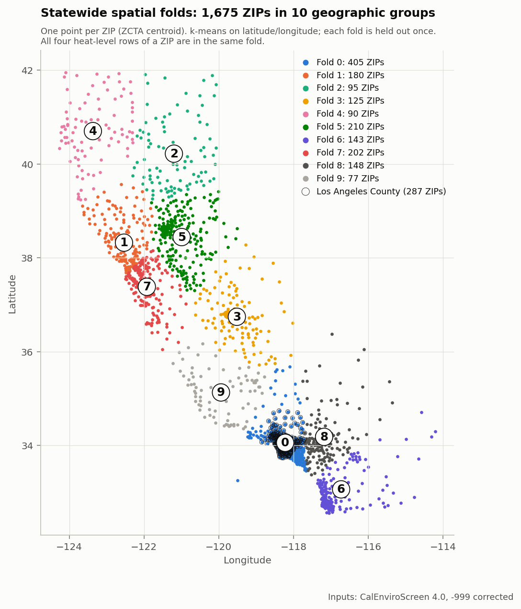
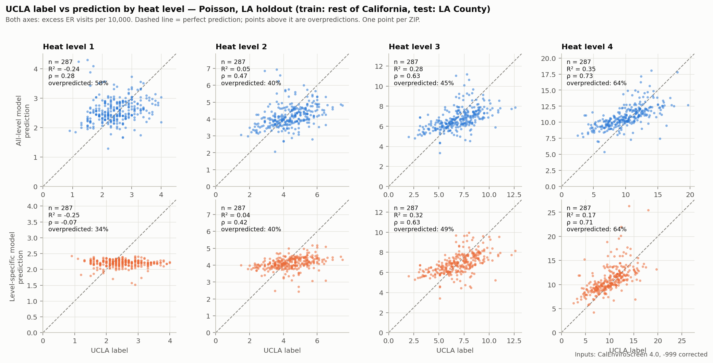
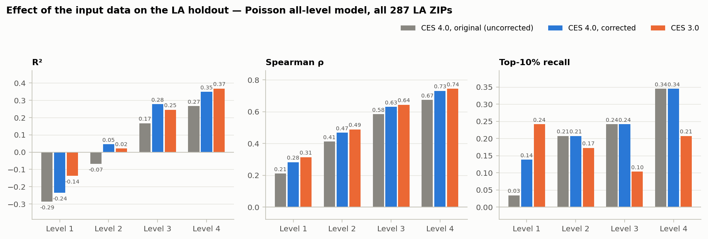
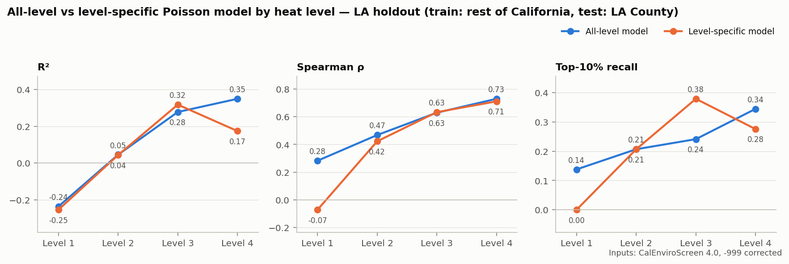
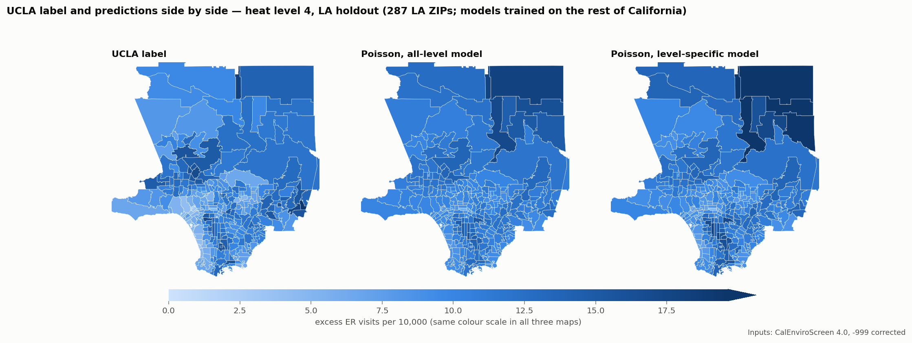
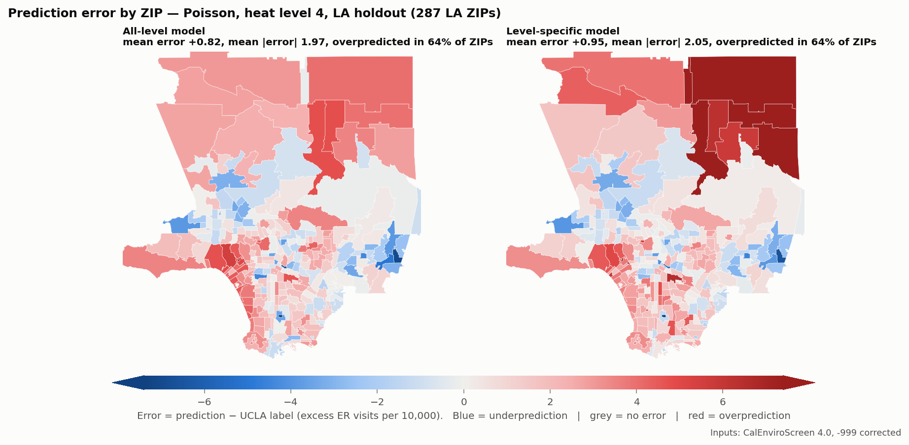
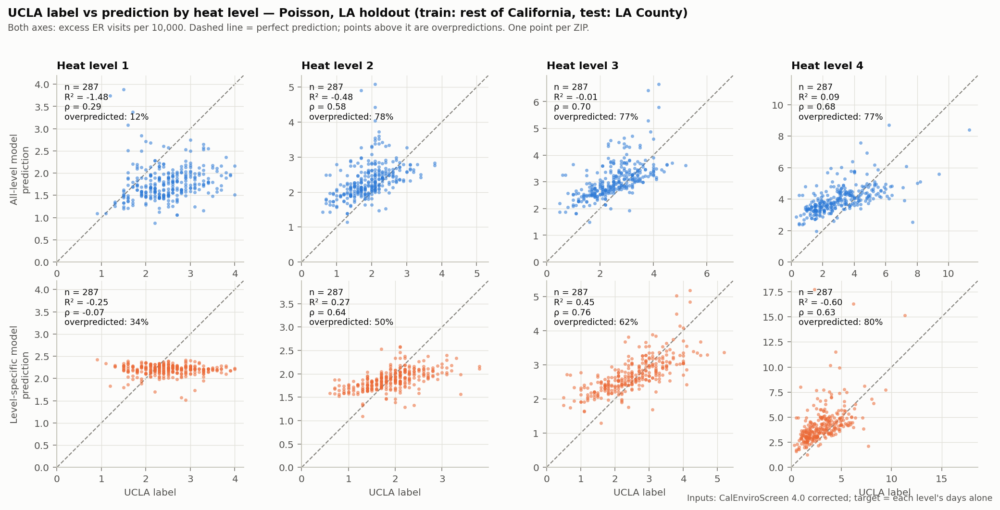

# Member 1 — Statewide models and geographic transfer

**Main question.** Can patterns learned elsewhere in California predict Los Angeles County, especially under extreme heat?

**Short answer.** Partly, and less well for extreme heat alone than for heat overall.

- **UCLA's published level-4 label** is a total over all heat levels (section 10). For it, a Poisson model trained on the rest of California ranks LA ZIPs reasonably well (Spearman ρ = 0.73, 95% CI 0.65–0.79), explains about a third of the variance (R² = 0.35, CI 0.25–0.43) and finds about a third of the true top-10% ZIPs.
- **The excess on level-4 days alone** is the quantity that matches "extreme heat". For it, the ranking holds up (ρ = 0.68, CI 0.61–0.74) but the scale does not transfer (R² = 0.09, CI −0.12 to 0.24): extreme-day excess averages 7.75 per 10,000 in the rest of California against 3.11 in LA.
- **Much of the skill comes from two inputs that share a data source with the label.** Without the asthma and cardiovascular ED rates, ρ falls to 0.63 on the published label and to 0.50 on the extreme-day target, where the model no longer clearly beats the CalEnviroScreen percentile (section 11).
- The pooled numbers in the current report (ρ ≈ 0.89) describe the difference between heat levels, not skill within a level. Training a separate model per heat level did not improve the LA level-4 result on either target. Replacing the inputs with ones measured inside the label period (CalEnviroScreen 3.0) did not change these conclusions.

## Read this first: three input variants

The first version of this module found, and this version fixes, a data error: CalEnviroScreen marks missing tract values as −999, and the original aggregation averaged those into the ZIP values. Results now exist for three sets of inputs. Labels, ZIPs, folds, models and seed are identical across all three; only the CalEnviroScreen inputs differ.

| Variant | Inputs | Role in this report | Results folder |
|---|---|---|---|
| CES 4.0 corrected | CalEnviroScreen 4.0, −999 treated as missing | **Headline results** | `results/member1/ces40_fixed/` |
| CES 3.0 | CalEnviroScreen 3.0 (2009–2015 data), missing values treated as missing | Sensitivity to input year | `results/member1/ces30/` |
| CES 4.0 original | CalEnviroScreen 4.0 with −999 averaged in | Superseded; kept unchanged for comparison | `results/member1/` |

Three follow-up runs use the corrected CES 4.0 inputs and change one more thing each:

| Run | What differs from "CES 4.0 corrected" | Role | Results folder |
|---|---|---|---|
| Level-only target | Target is each level's days alone (label k − label k−1) instead of the cumulative label | Answers the extreme-heat question (section 10) | `results/member1/ces40_fixed_level_only/` |
| No ED-rate inputs | Asthma and cardiovascular ED rates left out (10 inputs instead of 12) | Ablation (section 11) | `results/member1/ces40_fixed_no_ed/` |
| Level-only, no ED-rate inputs | Both changes | Ablation on the extreme-heat target | `results/member1/ces40_fixed_level_only_no_ed/` |

Every table below names its variant. Complete tables for all three variants are in [member1_tables.md](member1_tables.md), generated directly from the result files.

| Item | Status |
|---|---|
| Original statewide results reproduce from the data snapshot | Done — bit-identical to `results/metrics_ca.json` |
| −999 sentinel corrected before aggregation | Done — no negative value remains in either corrected table |
| CalEnviroScreen 3.0 downloaded, definitions and years verified | Done — from OEHHA's dataset on data.ca.gov and the 3.0 report |
| All ten CalEnviroScreen inputs available in 3.0 | Yes. Nine from the June 2018 results file; age 65+ from the 3.0 shapefile (not in the results file) |
| Experiments rerun on corrected 4.0 and on 3.0 | Done — spatial cross-validation, LA holdout, baseline, all-level vs level-specific |
| Level-only (extreme-heat) target | Done — section 10 |
| Ablation without the asthma and cardiovascular inputs | Done — section 11 |
| `REPORT.md` statewide sections 4b and 4c | Corrected in this branch |
| Sample counts, metrics and figures verified | Done — see section 13 |
| Supporting literature | Bibliographic details checked; full texts not yet read by the team |
| Still to confirm | Year of the 3.0 age-65+ field |
| Population year | 2020 Census, after the label period; kept in Parts 1 and 2 and documented as a limitation (section 3, note C). Impact not tested |

---

## 1. Input correction: the −999 sentinel

CalEnviroScreen 4.0 stores −999 where a tract has no value for an indicator. `scripts/fetch_statewide.py` took the population-weighted mean of each indicator across a ZIP's tracts without removing these, so one affected tract could drag a ZIP's value far below zero.

**Table 1. Extent of the problem (CES 4.0 tract file, 8,035 tracts).**

| Source field | Model input | Tracts with −999 | ZIPs with a negative value in the original table |
|---|---|---|---|
| `PM2_5` | `pm25` | 0 | 0 |
| `Ozone` | `ozone` | 0 | 0 |
| `Asthma` | `asthma_ed_per10k` | 11 | 0 |
| `Cardiovas` | `cardiovascular_ed_per10k` | 11 | 0 |
| `Poverty` | `poverty_pct` | 75 | 30 |
| `Elderly65` | `elderly65_pct` | 24 | 1 |
| `Educatn` | `edu_lt_hs_pct` | 103 | 51 |
| `Ling_Isol` | `ling_isol_pct` | 320 | 235 |
| `Unempl` | `unemployment_pct` | 335 | 248 |
| `HousBurd` | `housing_burden_pct` | 145 | 79 |
| `CIscoreP` | `ces4_percentile` (baseline) | 103 | 38 |

ZIP counts in the last column are out of the 1,686 ZIPs in the raw table. A ZIP can also be distorted without going negative, so the number of affected ZIPs is larger than the number with negative values:

- In the cleaned table, the inputs of **436 of 1,675 ZIPs (26%)** change once −999 is removed; 422 of them had at least one impossible negative value.
- In Los Angeles County, **92 of 287 ZIPs** change; 84 had a negative value. Example: ZIP 90024 had a "percentage without a high-school degree" of −314.8.
- 592 of 8,035 tracts carry −999 in at least one field we use.

**The correction** (`scripts/build_member1_ces_tables.py`). −999 is set to missing for each indicator and each tract before aggregation. A tract then contributes to a ZIP's mean for an indicator only if it has a value for that indicator and a positive population; a missing value enters neither the numerator nor the weight. If no tract in a ZIP has a value, the ZIP's value is missing and is median-imputed inside the training fold, as before. After correction no negative value remains.

CalEnviroScreen 3.0's results file uses blanks rather than −999; the same rule is applied to it.

**Effect on results** (details in section 5): the correction raises the LA level-4 Poisson result from R² 0.266 to 0.349 and from ρ 0.674 to 0.730. Statewide cross-validation and the tree models change little.

**Asthma and cardiovascular values are not affected, statewide or in LA.** Those two fields do contain −999 (11 tracts statewide, 9 of them in the LA file), but every one of those tracts has zero population. A zero-population tract carries no weight in a population-weighted mean, so the marker never entered any ZIP value. This is why Table 1 shows no affected ZIPs for those two inputs, and why PM2.5, ozone, asthma and cardiovascular are identical in the original and corrected tables.

**Note for Member 2 — not changed here.** The LA table has the same problem, in fewer columns. `data/raw/ces40_la_tracts.csv` contains −999 in `Asthma` (9 tracts), `Cardiovas` (9), `Poverty` (38), `Elderly65` (17) and `CIscoreP` (46).

- The four CalEnviroScreen inputs of the current LA model (PM2.5, ozone, asthma, cardiovascular) are unchanged, for the reason above, so existing LA model metrics are not affected.
- `ces4_percentile` in `data/processed/model_table.csv` is wrong for 26 LA ZIPs and negative for 8 of them. This affects the LA-only CES baseline.
- The CES poverty and age columns in the LA feature file are wrong for 22 ZIPs and 1 ZIP.

Corrected LA and statewide tables, every changed value and the affected ZIP lists are on branch `fix/ces-sentinel-preprocessing` (see `reports/ces_sentinel_fix.md` there). Member 2's code and results have not been modified.

*Correction, 2026-11-08: an earlier version of this note said the LA asthma and cardiovascular inputs were distorted. That was wrong; the statement above replaces it.*

## 2. Data and samples

The unit of observation is a **ZIP × heat level** pair. The label is the UCLA Heat Maps excess ER visit rate per 10,000 for 2008–2018, at CalHeatScore levels 1–4. Every ZIP that survives cleaning has all four levels, so rows = 4 × ZIPs exactly.

**Table 2. Sample counts, verified from the model tables.** Rows are always 4 × ZIPs.

| Stage | ZIPs: CES 4.0 corrected | ZIPs: CES 3.0 | ZIPs: CES 4.0 original |
|---|---|---|---|
| Raw statewide table | 1,686 | 1,686 | 1,686 |
| After cleaning (label, centroid, population present) | 1,675 | 1,675 | 1,675 |
|   — all ten CES inputs present | 1,281 | 1,295 | 1,338 |
|   — some but not all CES inputs missing | 57 | 43 | 0 |
|   — all CES inputs missing | 337 | 337 | 337 |
|   — CES percentile present (baseline sample) | 1,326 | 1,328 | 1,338 |
| Los Angeles County (LA holdout test set) | 287 | 287 | 287 |
|   — all ten CES inputs present | 270 | 273 | 276 |
|   — some but not all CES inputs missing | 6 | 3 | 0 |
|   — all CES inputs missing | 11 | 11 | 11 |
|   — CES percentile present (baseline sample) | 273 | 275 | 276 |
| Rest of California (LA holdout training set) | 1,388 | 1,388 | 1,388 |
|   — all ten CES inputs present | 1,011 | 1,022 | 1,062 |
| Each heat level: statewide / LA / rest of California | 1,675 / 287 / 1,388 | same | same |

The "original" column shows fewer missing values only because −999 was being counted as data.

**Exclusion rule.** Rows are dropped only if the label, the ZCTA centroid or the population is missing. This removes 11 ZIPs (44 rows): 91123, 91522, 92152, 92318, 93435, 94035, 95141, 95192, 95724, 95836, 96162. The rule and the resulting 1,675 ZIPs are the same in all three variants.

**Missing inputs are imputed, not dropped.** 337 ZIPs (20%) have no CalEnviroScreen values because no CalEnviroScreen tract lists them as its ZIP. With the correction, a further 57 ZIPs lack one or more inputs. All of these rows stay in training and testing, and missing inputs are filled with the training-fold median. The statement "no value is imputed" in `REPORT.md` is true of the data files but not of the models.

LA ZIPs with incomplete inputs in the corrected 4.0 table (17): 90014, 90067, 90073, 90089, 90095, 90263, 90639, 90822, 90840, 91210, 91330, 91608, 91759, 93532, 93544, 93553, 93563. Most are institutional or very small.

## 3. Inputs: definitions and reference years

The statewide model uses 12 inputs: heat level, population density and ten CalEnviroScreen fields. Tract values are aggregated to ZIP as a population-weighted mean using the tract's `ZIP` field.

**Table 3. Feature audit for both CalEnviroScreen versions.** Years for 4.0 are from OEHHA's *Summary of Changes in CalEnviroScreen Version 4.0* (October 2021). Years and definitions for 3.0 are from the *CalEnviroScreen 3.0* report (January 2017, with the June 2018 results).

| Model input | Definition and unit | CES 4.0 reference period | CES 3.0 reference period | Available in 3.0 |
|---|---|---|---|---|
| `pm25` | Annual mean PM2.5, µg/m³ | 2015–2017 | 2012–2014 | Yes |
| `ozone` | Mean daily maximum 8-hour ozone, ppm (3.0: summer months May–October) | 2017–2019 | 2012–2014 | Yes |
| `asthma_ed_per10k` | Age-adjusted, spatially modelled asthma ED visits per 10,000 | 2015–2017 | 2011–2013 | Yes |
| `cardiovascular_ed_per10k` | Age-adjusted, spatially modelled heart-attack ED visits per 10,000 | 2015–2017 | 2011–2013 | Yes |
| `poverty_pct` | % of population below 2× the federal poverty level | ACS 2015–2019 | ACS 2011–2015 | Yes |
| `edu_lt_hs_pct` | % of population over 25 without a high-school education | ACS 2015–2019 | ACS 2011–2015 | Yes |
| `ling_isol_pct` | % of limited-English-speaking households | ACS 2015–2019 | ACS 2011–2015 | Yes |
| `unemployment_pct` | % of population over 16 unemployed and in the labour force | ACS 2015–2019 | ACS 2011–2015 | Yes |
| `housing_burden_pct` | % of households that are low-income and pay more than 50% of income on housing | HUD CHAS 2013–2017 | HUD CHAS 2009–2013 | Yes |
| `elderly65_pct` | % of population aged 65+ (demographic field, not a scored indicator) | To confirm (expected ACS 2015–2019) | To confirm (expected 2010 Census) | Yes, from the shapefile only |
| Aggregation weight | Tract population | `TotPop19` (ACS 2015–2019) | 2010 Census population | Yes |
| `chs_level` | CalHeatScore heat level 1–4 (UCLA) | 2008–2018 | same | Not a CES field |
| `pop_density_per_sqmi` | UCLA population ÷ Gazetteer 2023 ZCTA land area | Population 2020 Census (note C); land area 2023 | same | Not a CES field |
| *(baseline)* percentile | Overall CalEnviroScreen percentile, 0–100 | Mixed, 2013–2019 | Mixed, 2009–2015 | Yes (`CES 3.0 Percentile`) |

**Assessment of 4.0.** Every 4.0 input describes roughly 2013–2019: the last third of the 2008–2018 label window and slightly beyond. This is closer than the "~2021" stated in `REPORT.md` (2021 is the publication year), but none of it describes 2008–2012.

**Assessment of 3.0.** Every 3.0 input describes 2009–2015, inside the label window. Both versions use the same 8,035 census tracts on 2010 boundaries and assign the same 1,355 ZIPs, so the tract-to-ZIP step is identical.

**No feature was substituted.** All ten inputs exist in 3.0 with the same definitions and units. One needed a second official file: the June 2018 results file has no age field, so `elderly65_pct` is taken from the "Elderly > 65 (%)" field of OEHHA's 3.0 shapefile and joined by census tract ID (8,035 of 8,035 tracts matched). The shapefile is the January 2017 release; only this one field is taken from it. Its metadata states that the population is the 2010 population but does not state the year of the age field.

**Differences between the versions that are not just the year:**

| Input | ZIP-level Spearman, 3.0 vs corrected 4.0 | Median 3.0 → 4.0 | What changed besides the year |
|---|---|---|---|
| `ozone` | 0.963 | 0.0474 → 0.0478 | Same method |
| `edu_lt_hs_pct` | 0.965 | 12.9 → 11.7 | — |
| `poverty_pct` | 0.957 | 33.6 → 28.7 | — |
| `elderly65_pct` | 0.936 | 11.9 → 14.7 | Different source (census vs ACS, to confirm) |
| `ling_isol_pct` | 0.934 | 6.3 → 5.8 | — |
| `asthma_ed_per10k` | 0.929 | 41.1 → 41.5 | Diagnosis coding changed from ICD-9 to ICD-10 during 2015 |
| `pm25` | 0.878 | 9.69 → 9.16 | 4.0 blends monitors with 1-km satellite data; 3.0 used monitors with coarser satellite fill |
| `cardiovascular_ed_per10k` | 0.874 | 7.66 → 11.89 | ICD-9 to ICD-10 change; rates are markedly higher in 4.0 |
| `housing_burden_pct` | 0.821 | 17.0 → 16.5 | — |
| `unemployment_pct` | 0.732 | 9.5 → 5.6 | 2011–2015 includes the post-recession years |
| percentile | 0.965 | 42.6 → 42.3 | 4.0 adds a lead-risk indicator |

ZIPs are ranked similarly by both versions for most inputs. Unemployment, housing burden, PM2.5 and the cardiovascular rate differ most, so a 3.0-versus-4.0 comparison mixes the effect of the year with changes in method for those four.

**Note A — asthma and cardiovascular inputs share a data source with the label.** In both versions these are ED-visit rates built from the same statewide ED records that UCLA uses for the label, for years inside 2008–2018. They are partly measures of how much a community uses the ER at all, and an asthma or heart-attack visit on a heat day is counted on both sides. They should be described as ER-utilisation proxies, and their importance should not be read as a causal heat-vulnerability signal. Section 11 reports what happens without them.

**Note B — poverty threshold.** The indicator is "below two times the federal poverty level", confirmed in the 3.0 report. (The 4.0 summary document says "below half", which appears to be an error in that document.) It is not the same threshold as the ACS poverty rate Member 2 uses.

**Note C — population year (retained).** Density and the Poisson weights use UCLA's population field, which represents 2020. Its California total is 39,535,231 against 39,538,212 in the Census Bureau's 2020 base, and its county totals fit 2020 better than any year from 2010 to 2023 (median county difference 0.55%; this check is at county level only). An earlier UCLA methods document, since removed from UCLA's repository, describes it as EPA EnviroAtlas dasymetric population built from 2020 Census blocks and summed to 2019 ZIP boundaries; EPA issued that dataset in 2022. It is a single snapshot used for every year and heat level, and it is the denominator of UCLA's rate.

The label covers 2008–2018, so this population comes from after the label period. Statewide, 2020 is about 3.4% above 2013 and 6.1% above 2010; the gap for individual ZIPs may be larger. The mismatch matters most for density, a model input, which also uses 2023 land area. For the Poisson weights, the 2020 population at least matches the denominator of the label. The team chose to keep the 2020 population in both Part 1 and Part 2 and to document the mismatch as a limitation. **The effect on the results has not been tested.**

**Aggregation limitation.** Each tract is assigned to one ZIP, but tracts and ZIPs overlap many-to-many. A population-weighted crosswalk would be more accurate and would likely recover most of the 337 ZIPs that have no CalEnviroScreen values.

### Supporting literature for the base inputs

Bibliographic details were checked online; the team should read each paper before citing what it shows.

| Input group | Why it is plausible | Supporting work |
|---|---|---|
| Age 65+, poverty, education | Standard components of heat-vulnerability indices; older adults had the largest ED and hospitalisation increases in the 2006 California heat wave | Reid et al. 2009; Knowlton et al. 2009; Gronlund 2014 |
| Cardiovascular ED rate | Heat is associated with more ER visits for ischaemic heart disease, stroke and other cardiovascular causes in California | Basu et al. 2012; Knowlton et al. 2009 |
| Asthma ED rate | Heat is associated with respiratory emergency hospitalisations and with asthma ED visits | Anderson et al. 2013; Xu et al. 2013 |
| PM2.5, ozone | Air pollution modifies and confounds heat effects; heat-wave mortality effects are larger on high-ozone and high-particulate days | Analitis et al. 2014; Basu et al. 2012 (tested pollutant confounding) |
| Linguistic isolation, unemployment, housing burden | Socioeconomic position and social/linguistic isolation are associated with heat distress calls and heat-health disparities | Uejio et al. 2011; Gronlund 2014 |
| Population density | Proxy for built-environment heat exposure; evidence is indirect | Uejio et al. 2011 |
| (context) outdoor work | Used by UCLA's cited method paper; relevant to Member 2's construction variable | Riley et al. 2018 |

The evidence is strongest for age, poverty and cardiovascular or respiratory disease, and weakest for housing burden, unemployment and population density, which rest on general socioeconomic-vulnerability arguments.

## 4. Experimental setups

Two evaluations use the same data, models, preprocessing and seed. A third comparison changes only how heat level is handled. These setups are identical for all three input variants.

**Table 4. Experimental setups.**

| | Statewide spatial cross-validation | LA holdout |
|---|---|---|
| Geographic scope | All of California | All of California |
| Training set | Nine of ten geographic folds | Every county except Los Angeles: 1,388 ZIPs, 5,552 rows |
| Test set | The held-out fold; every ZIP predicted once: 1,675 ZIPs, 6,700 rows | Los Angeles County: 287 ZIPs, 1,148 rows |
| Heat levels | 1–4 in training and test | 1–4 in training and test |
| Folds | 10, k-means on standardised ZCTA centroid latitude/longitude | None (single split) |
| "Level 4" results | Test rows filtered to level 4 (1,675 rows); same model | Test rows filtered to level 4 (287 rows); same model |

| | All-level model | Level-specific model |
|---|---|---|
| Training rows | All four heat levels | Only the level being evaluated (one quarter of the rows) |
| Inputs | 12, including heat level | 11 — heat level removed because it is constant |
| Models fitted | One per evaluation | Four per evaluation, one per level |
| LA holdout training size | 5,552 rows | 1,388 rows per level |

Models: Poisson regression (ridge penalty 1.0, population-weighted, standardised inputs), random forest (500 trees, minimum leaf size 2) and gradient boosting (scikit-learn defaults). Median imputation and standardisation are fitted on the training rows of each split only. Seed 42. The level-specific models use the same hyperparameters; the only differences are the training rows and the removed input.

**All heat levels of a ZIP stay in the same fold.** Verified in code for every variant: each of the 1,675 ZIPs appears in exactly one fold.

**Table 5. Statewide spatial folds.** Fold membership depends only on coordinates, so it is the same for all variants.

| Fold | Unique ZIPs | Rows | ZIPs with incomplete inputs (4.0 corrected) | LA County ZIPs | Counties | Largest counties (ZIPs) |
|---|---|---|---|---|---|---|
| 0 | 405 | 1,620 | 30 | 286 | 5 | Los Angeles (286); Orange (80); Ventura (23) |
| 1 | 180 | 720 | 50 | 0 | 14 | Sonoma (32); San Francisco (27); Marin (27) |
| 2 | 95 | 380 | 64 | 0 | 12 | Butte (15); Plumas (14); Shasta (13) |
| 3 | 125 | 500 | 44 | 0 | 10 | Fresno (52); Tulare (26); Madera (12) |
| 4 | 90 | 360 | 51 | 0 | 7 | Humboldt (30); Siskiyou (17); Mendocino (14) |
| 5 | 210 | 840 | 48 | 0 | 16 | Sacramento (52); Placer (27); San Joaquin (25) |
| 6 | 143 | 572 | 27 | 0 | 4 | San Diego (105); Riverside (22); Imperial (11) |
| 7 | 202 | 808 | 28 | 0 | 11 | Santa Clara (58); Alameda (35); San Mateo (27) |
| 8 | 148 | 592 | 34 | 1 | 7 | San Bernardino (82); Riverside (49); Orange (8) |
| 9 | 77 | 308 | 18 | 0 | 7 | Kern (25); Santa Barbara (24); San Luis Obispo (20) |
| Total | 1,675 | 6,700 | 394 | 287 | | |



*Figure 1. The ten statewide spatial folds. One point per ZIP at its ZCTA centroid; the circled number marks each fold's centre. Black rings mark the 287 Los Angeles County ZIPs.*

**How the two evaluations relate.** Folds cross county boundaries, but 286 of the 287 LA ZIPs fall in fold 0. For LA, statewide cross-validation is therefore almost the same test as the LA holdout, except that fold 0 also withholds Orange and Ventura counties from training. With corrected 4.0 inputs the LA level-4 Poisson result is similar either way (R² 0.318 and ρ 0.739 inside cross-validation; R² 0.349 and ρ 0.730 in the holdout). Fold sizes are uneven, from 77 to 405 ZIPs, so the pooled cross-validation score is weighted towards Southern California.

## 5. Performance by heat level

**Table 6. LA holdout, all-level model, three input variants. Train: rest of California, levels 1–4. Test: LA County.**

| Model | Scope | n | R² 4.0 corrected | R² 3.0 | R² 4.0 original | ρ 4.0 corrected | ρ 3.0 | ρ 4.0 original | Top-10% 4.0 corrected | Top-10% 3.0 | Top-10% 4.0 original |
|---|---|---|---|---|---|---|---|---|---|---|---|
| Poisson | pooled (1–4) | 1,148 | 0.781 | 0.783 | 0.753 | 0.905 | 0.907 | 0.891 | 0.75 | 0.72 | 0.71 |
| Poisson | level 1 | 287 | −0.235 | −0.137 | −0.286 | 0.282 | 0.313 | 0.211 | 0.14 | 0.24 | 0.03 |
| Poisson | level 2 | 287 | 0.046 | 0.021 | −0.067 | 0.468 | 0.488 | 0.412 | 0.21 | 0.17 | 0.21 |
| Poisson | level 3 | 287 | 0.277 | 0.245 | 0.167 | 0.630 | 0.643 | 0.584 | 0.24 | 0.10 | 0.24 |
| Poisson | level 4 | 287 | 0.349 | 0.369 | 0.266 | 0.730 | 0.744 | 0.674 | 0.34 | 0.21 | 0.34 |
| Random forest | pooled (1–4) | 1,148 | 0.619 | 0.660 | 0.604 | 0.911 | 0.915 | 0.909 | 0.66 | 0.68 | 0.69 |
| Random forest | level 1 | 287 | −0.047 | 0.044 | −0.074 | 0.213 | 0.333 | 0.196 | 0.17 | 0.24 | 0.21 |
| Random forest | level 2 | 287 | 0.212 | 0.262 | 0.186 | 0.480 | 0.578 | 0.466 | 0.34 | 0.24 | 0.28 |
| Random forest | level 3 | 287 | 0.321 | 0.312 | 0.309 | 0.531 | 0.568 | 0.534 | 0.31 | 0.24 | 0.31 |
| Random forest | level 4 | 287 | −0.483 | −0.289 | −0.550 | 0.688 | 0.707 | 0.680 | 0.14 | 0.21 | 0.17 |
| Gradient boosting | pooled (1–4) | 1,148 | 0.642 | 0.655 | 0.646 | 0.898 | 0.909 | 0.902 | 0.70 | 0.69 | 0.70 |
| Gradient boosting | level 1 | 287 | −0.259 | 0.074 | −0.193 | 0.148 | 0.412 | 0.218 | 0.03 | 0.17 | 0.00 |
| Gradient boosting | level 2 | 287 | −0.140 | 0.019 | −0.119 | 0.267 | 0.437 | 0.326 | 0.21 | 0.17 | 0.17 |
| Gradient boosting | level 3 | 287 | 0.243 | 0.269 | 0.246 | 0.487 | 0.554 | 0.521 | 0.21 | 0.24 | 0.24 |
| Gradient boosting | level 4 | 287 | −0.291 | −0.269 | −0.280 | 0.683 | 0.655 | 0.674 | 0.24 | 0.24 | 0.21 |

**Table 7. Statewide spatial cross-validation, all-level model, three input variants.**

| Model | Scope | n | R² 4.0 corrected | R² 3.0 | R² 4.0 original | ρ 4.0 corrected | ρ 3.0 | ρ 4.0 original | Top-10% 4.0 corrected | Top-10% 3.0 | Top-10% 4.0 original |
|---|---|---|---|---|---|---|---|---|---|---|---|
| Poisson | pooled (1–4) | 6,700 | 0.525 | 0.527 | 0.517 | 0.871 | 0.865 | 0.866 | 0.56 | 0.55 | 0.53 |
| Poisson | level 1 | 1,675 | −1.791 | −1.937 | −1.678 | −0.314 | −0.319 | −0.326 | 0.03 | 0.02 | 0.02 |
| Poisson | level 2 | 1,675 | −0.621 | −0.738 | −0.568 | −0.017 | −0.024 | −0.033 | 0.05 | 0.04 | 0.06 |
| Poisson | level 3 | 1,675 | 0.001 | −0.054 | −0.004 | 0.342 | 0.347 | 0.329 | 0.14 | 0.12 | 0.13 |
| Poisson | level 4 | 1,675 | −0.015 | −0.003 | −0.036 | 0.512 | 0.532 | 0.493 | 0.16 | 0.18 | 0.16 |
| Random forest | pooled (1–4) | 6,700 | 0.629 | 0.640 | 0.630 | 0.900 | 0.903 | 0.900 | 0.61 | 0.64 | 0.61 |
| Random forest | level 1 | 1,675 | −0.022 | 0.073 | −0.023 | 0.250 | 0.337 | 0.247 | 0.11 | 0.22 | 0.12 |
| Random forest | level 2 | 1,675 | 0.020 | 0.008 | 0.010 | 0.286 | 0.260 | 0.276 | 0.20 | 0.15 | 0.19 |
| Random forest | level 3 | 1,675 | 0.106 | 0.072 | 0.107 | 0.348 | 0.334 | 0.346 | 0.25 | 0.12 | 0.25 |
| Random forest | level 4 | 1,675 | 0.199 | 0.226 | 0.201 | 0.567 | 0.598 | 0.563 | 0.32 | 0.33 | 0.32 |
| Gradient boosting | pooled (1–4) | 6,700 | 0.665 | 0.658 | 0.669 | 0.888 | 0.891 | 0.887 | 0.64 | 0.64 | 0.64 |
| Gradient boosting | level 1 | 1,675 | −0.259 | −0.150 | −0.257 | −0.101 | 0.038 | −0.071 | 0.04 | 0.15 | 0.05 |
| Gradient boosting | level 2 | 1,675 | −0.032 | −0.023 | −0.047 | 0.042 | 0.082 | 0.038 | 0.14 | 0.12 | 0.11 |
| Gradient boosting | level 3 | 1,675 | 0.146 | 0.110 | 0.141 | 0.330 | 0.276 | 0.323 | 0.23 | 0.10 | 0.24 |
| Gradient boosting | level 4 | 1,675 | 0.284 | 0.268 | 0.294 | 0.585 | 0.579 | 0.586 | 0.33 | 0.31 | 0.35 |

Top-10% recall at one level in LA is computed on 29 ZIPs, so one ZIP moves it by 0.03. Top-20% recall is supplementary and is in [member1_tables.md](member1_tables.md), section C.

**What the breakdown shows for the published, cumulative label (all three input variants agree on these points).**

1. **Pooled scores mostly measure the gap between heat levels.** Mean labels statewide rise from 2.08 at level 1 to 13.80 at level 4. Any model that knows the heat level gets a high pooled correlation. Within a level, no all-level model exceeds ρ = 0.75 or R² = 0.37.
2. **On the published (cumulative) label, level 4 is the best-predicted level, not the worst, when judged by ranking.** Within-level skill rises from level 1 to level 4 in both evaluations. The impression that "the numbers plummet" at level 4 comes from comparing level 4 with the pooled score; compared with the other levels, level 4 ranks best. **This does not carry over to extreme heat alone.** The level-4 label includes all lower levels, so part of this is the lower levels being counted again. On each level's own days (section 10), level 3 is ranked best in LA and level 4's scale transfers worst.
3. **Levels 1 and 2 are barely predictable.** Their labels vary little (statewide SD 0.73 and 1.17, reported to one decimal place), so there is little signal to rank, and the Poisson model ranks level 1 worse than chance in cross-validation.
4. **At level 4 in LA, the tree models rank well but miss the scale.** Random forest and gradient boosting have ρ ≈ 0.68 but negative R². The rest of California averages 14.58 at level 4, against 10.04 in LA, and the tree models carry that higher level into LA. Much of the damage comes from the 17 LA ZIPs with incomplete inputs: with corrected 4.0 inputs the random forest overpredicts those by +6.09 on average, against +1.96 for the 270 ZIPs with complete inputs. The Poisson model overpredicts them by +1.78.

**Table 8. Poisson error by heat level, LA holdout, CES 4.0 corrected (error = prediction − UCLA label, per 10,000).**

| Config | Heat level | Label mean | Label SD | Prediction mean | Prediction SD | Mean error | Mean absolute error | ZIPs overpredicted |
|---|---|---|---|---|---|---|---|---|
| All-level | 1 | 2.47 | 0.61 | 2.59 | 0.42 | +0.11 | 0.52 | 58% |
| All-level | 2 | 4.40 | 1.09 | 4.17 | 0.67 | −0.22 | 0.84 | 40% |
| All-level | 3 | 6.93 | 1.83 | 6.73 | 1.08 | −0.20 | 1.24 | 45% |
| All-level | 4 | 10.04 | 3.10 | 10.86 | 1.75 | +0.82 | 1.97 | 64% |
| Level-specific | 1 | 2.47 | 0.61 | 2.20 | 0.12 | −0.27 | 0.54 | 34% |
| Level-specific | 2 | 4.40 | 1.09 | 4.11 | 0.37 | −0.28 | 0.85 | 40% |
| Level-specific | 3 | 6.93 | 1.83 | 6.89 | 1.03 | −0.04 | 1.21 | 49% |
| Level-specific | 4 | 10.04 | 3.10 | 10.99 | 2.80 | +0.95 | 2.05 | 64% |

The all-level Poisson predictions are compressed: at level 4 their spread (SD 1.75) is a little over half the spread of the labels (SD 3.10). High-burden ZIPs are underpredicted and low-burden ZIPs overpredicted, which is what limits top-10% recall.



*Figure 2. UCLA label against prediction for each heat level. LA holdout, Poisson, CES 4.0 corrected inputs. Top row: all-level model. Bottom row: level-specific models. 287 LA ZIPs per panel; models trained on the rest of California. Points above the dashed line are overpredictions.*

## 6. Does the input year matter? CalEnviroScreen 3.0 versus 4.0

The professor's concern was that inputs from the wrong period would teach the model the wrong relationship. Tables 6 and 7 put corrected 4.0 (2013–2019 data) beside 3.0 (2009–2015 data).



*Figure 3. LA holdout, Poisson all-level model, all 287 LA ZIPs per level, for the three input variants.*

Because the two versions leave slightly different ZIPs with missing inputs, Table 9 repeats the comparison on identical ZIPs: those with all ten inputs and a percentile in both versions. No model is refitted; only the scoring sample changes.

**Table 9. Level 4 only, same ZIPs with complete inputs in both versions. LA holdout: 270 LA ZIPs. Cross-validation: 1,262 ZIPs.**

| Evaluation | Predictor | R² 4.0 corrected | R² 3.0 | ρ 4.0 corrected | ρ 3.0 | Top-10% 4.0 corrected | Top-10% 3.0 |
|---|---|---|---|---|---|---|---|
| LA holdout | Poisson | 0.396 | 0.410 | 0.767 | 0.783 | 0.33 | 0.19 |
| LA holdout | Random forest | −0.029 | 0.150 | 0.749 | 0.760 | 0.19 | 0.30 |
| LA holdout | Gradient boosting | 0.048 | 0.076 | 0.747 | 0.715 | 0.22 | 0.22 |
| LA holdout | CES percentile of that version | — | — | 0.566 | 0.532 | 0.15 | 0.22 |
| Spatial CV | Poisson | 0.174 | 0.200 | 0.657 | 0.682 | 0.25 | 0.29 |
| Spatial CV | Random forest | 0.327 | 0.371 | 0.643 | 0.684 | 0.48 | 0.48 |
| Spatial CV | Gradient boosting | 0.374 | 0.351 | 0.650 | 0.652 | 0.46 | 0.42 |
| Spatial CV | CES percentile of that version | — | — | 0.323 | 0.320 | 0.13 | 0.10 |

**Findings.**

- **Input year makes little difference at level 4.** For the Poisson model on the LA holdout, 3.0 gives R² 0.369 (CI 0.29–0.44) and ρ 0.744 (CI 0.67–0.80) against 0.349 (CI 0.25–0.43) and 0.730 (CI 0.65–0.79) for corrected 4.0. The intervals overlap almost entirely. Statewide, 3.0 is slightly better for Poisson and random forest and slightly worse for gradient boosting.
- **Top-10% recall does not improve with 3.0 and is noisy.** For Poisson on the LA holdout it falls from 0.34 to 0.21 — a difference of four ZIPs out of 29. For random forest it rises from 0.14 to 0.21.
- **Levels 1 and 2 benefit most from 3.0 for the tree models** (for example gradient boosting at level 1 in LA: ρ 0.148 → 0.412), though these levels remain weakly predicted.
- **The conclusions of section 5 hold under both versions.** Within-level skill rises with heat level, pooled scores are dominated by the level gap, and tree models mis-scale LA at level 4.
- **This is not a pure test of year.** Four inputs also changed in method or economic context between versions (section 3). What the experiment shows is that the results are robust to swapping the whole input set for one measured inside the label period.

**Decision.** Corrected CalEnviroScreen 4.0 is retained as the headline input set, because it is what the rest of the project uses and the 3.0 results do not differ beyond sampling noise. The temporal mismatch is reported as a limitation whose measured effect is small. If the team prefers inputs that fall inside the label period on principle, the 3.0 results are complete and can be substituted.

## 7. All-level versus level-specific models

The per-level breakdown shows that the relationship between inputs and labels is not the same at every level, and the all-level Poisson model forces one set of coefficients on all four. That made a model per level worth testing.

**Table 10. LA holdout, level 4: all-level vs level-specific, same 287 LA ZIPs.**

| Inputs | Model | R² all | R² specific | ρ all | ρ specific | Top-10% all | Top-10% specific |
|---|---|---|---|---|---|---|---|
| 4.0 corrected | Poisson | 0.349 | 0.174 | 0.730 | 0.711 | 0.34 | 0.28 |
| 4.0 corrected | Random forest | −0.483 | −0.485 | 0.688 | 0.683 | 0.14 | 0.14 |
| 4.0 corrected | Gradient boosting | −0.291 | −0.325 | 0.683 | 0.670 | 0.24 | 0.24 |
| 3.0 | Poisson | 0.369 | 0.289 | 0.744 | 0.695 | 0.21 | 0.28 |
| 3.0 | Random forest | −0.289 | −0.264 | 0.707 | 0.707 | 0.21 | 0.21 |
| 3.0 | Gradient boosting | −0.269 | −0.306 | 0.655 | 0.639 | 0.24 | 0.28 |

**Table 11. LA holdout, levels 1–3, CES 4.0 corrected.**

| Model | Level | R² all | R² specific | ρ all | ρ specific | Top-10% all | Top-10% specific |
|---|---|---|---|---|---|---|---|
| Poisson | 1 | −0.235 | −0.253 | 0.282 | −0.072 | 0.14 | 0.00 |
| Poisson | 2 | 0.046 | 0.044 | 0.468 | 0.423 | 0.21 | 0.21 |
| Poisson | 3 | 0.277 | 0.317 | 0.630 | 0.633 | 0.24 | 0.38 |
| Random forest | 1 | −0.047 | −0.031 | 0.213 | 0.219 | 0.17 | 0.14 |
| Random forest | 2 | 0.212 | 0.198 | 0.480 | 0.474 | 0.34 | 0.31 |
| Random forest | 3 | 0.321 | 0.313 | 0.531 | 0.525 | 0.31 | 0.31 |
| Gradient boosting | 1 | −0.259 | −0.123 | 0.148 | 0.132 | 0.03 | 0.10 |
| Gradient boosting | 2 | −0.140 | 0.045 | 0.267 | 0.309 | 0.21 | 0.14 |
| Gradient boosting | 3 | 0.243 | 0.395 | 0.487 | 0.633 | 0.21 | 0.41 |

**Table 12. Statewide spatial cross-validation, level 4 (optional extension): all-level vs level-specific, 1,675 ZIPs.**

| Inputs | Model | R² all | R² specific | ρ all | ρ specific | Top-10% all | Top-10% specific |
|---|---|---|---|---|---|---|---|
| 4.0 corrected | Poisson | −0.015 | 0.123 | 0.512 | 0.564 | 0.16 | 0.23 |
| 4.0 corrected | Random forest | 0.199 | 0.201 | 0.567 | 0.569 | 0.32 | 0.33 |
| 4.0 corrected | Gradient boosting | 0.284 | 0.289 | 0.585 | 0.595 | 0.33 | 0.36 |
| 3.0 | Poisson | −0.003 | 0.112 | 0.532 | 0.586 | 0.18 | 0.24 |
| 3.0 | Random forest | 0.226 | 0.225 | 0.598 | 0.599 | 0.33 | 0.33 |
| 3.0 | Gradient boosting | 0.268 | 0.271 | 0.579 | 0.599 | 0.31 | 0.36 |



*Figure 4. All-level and level-specific Poisson models on the LA holdout, by heat level. CES 4.0 corrected inputs, 287 LA ZIPs per level.*

**Did a specialised model help?**

- **For LA at level 4: no.** With corrected 4.0 inputs the level-specific Poisson model is worse on all three metrics (R² 0.174 vs 0.349, ρ 0.711 vs 0.730, top-10% 0.28 vs 0.34), and its R² confidence interval (−0.06 to 0.35) reaches zero. With 3.0 inputs it is worse on R² and ρ and better on top-10% recall by two ZIPs. Tree models are unchanged.
- **For LA at level 3: yes for two of three models.** Gradient boosting improves clearly (R² 0.243 → 0.395, ρ 0.487 → 0.633) and Poisson improves on R² and top-10% recall. Random forest is unchanged.
- **Statewide at level 4: yes for Poisson, modestly.** In cross-validation the level-specific Poisson model improves on every metric under both input sets (4.0 corrected: R² −0.015 → 0.123, ρ 0.512 → 0.564). Gradient boosting gains slightly; random forest is unchanged.

**What this indicates.** Tree models can already treat each heat level differently, since they can split on heat level first, so separating the data gives them little. The Poisson model cannot, so it gains from separation statewide. In LA at level 4 that gain is cancelled: the level-specific model has a quarter of the training rows, and it learns only from non-LA level-4 rows, whose labels are much higher and more variable than LA's (its predictions have SD 2.80 against 1.75 for the all-level model, and a larger upward bias). The limit on level-4 skill in LA is the shift between LA and the rest of the state, not the way heat level enters the model.

## 8. CalEnviroScreen baseline on matched samples

**The problem with the current report.** `REPORT.md` says the level-4 Poisson result (ρ = 0.674, 287 LA ZIPs) "clearly beats the CES baseline (0.237)". The 0.237 was computed across all four heat levels (1,104 rows), where the percentile cannot distinguish a ZIP's level-1 row from its level-4 row. It was also computed on percentile values contaminated by −999. The two numbers are on different samples and different tasks.

**The correction.** The baseline is computed on the same ZIPs and the same heat level as the models, restricted to ZIPs that have a percentile in that version. Only rank metrics are compared: the percentile is an index, not a rate, so R² is not defined for it. Each model is compared with the percentile of the CalEnviroScreen version it was trained on.

**Table 13. LA holdout, matched samples, all-level models.**

| Heat level | Predictor | ρ, 4.0 corrected (273 ZIPs) | Top-10%, 4.0 corrected | ρ, 3.0 (275 ZIPs) | Top-10%, 3.0 |
|---|---|---|---|---|---|
| 1 | CES percentile | 0.510 | 0.30 | 0.523 | 0.25 |
| 1 | Poisson | 0.300 | 0.11 | 0.331 | 0.21 |
| 1 | Random forest | 0.208 | 0.22 | 0.323 | 0.25 |
| 1 | Gradient boosting | 0.140 | 0.04 | 0.406 | 0.18 |
| 2 | CES percentile | 0.532 | 0.30 | 0.526 | 0.29 |
| 2 | Poisson | 0.486 | 0.19 | 0.506 | 0.21 |
| 2 | Random forest | 0.489 | 0.37 | 0.586 | 0.25 |
| 2 | Gradient boosting | 0.262 | 0.19 | 0.432 | 0.18 |
| 3 | CES percentile | 0.532 | 0.19 | 0.492 | 0.21 |
| 3 | Poisson | 0.654 | 0.22 | 0.665 | 0.11 |
| 3 | Random forest | 0.567 | 0.33 | 0.605 | 0.29 |
| 3 | Gradient boosting | 0.519 | 0.22 | 0.563 | 0.25 |
| 4 | CES percentile | 0.566 | 0.15 | 0.520 | 0.21 |
| 4 | Poisson | 0.757 | 0.30 | 0.770 | 0.21 |
| 4 | Random forest | 0.736 | 0.19 | 0.755 | 0.29 |
| 4 | Gradient boosting | 0.742 | 0.22 | 0.704 | 0.25 |

14 of 287 LA ZIPs are dropped for 4.0 corrected and 12 for 3.0, for having no percentile.

**Table 14. Statewide spatial cross-validation, matched samples, level 4.**

| Predictor | ρ, 4.0 corrected (1,326 ZIPs) | Top-10%, 4.0 corrected | ρ, 3.0 (1,328 ZIPs) | Top-10%, 3.0 |
|---|---|---|---|---|
| CES percentile | 0.300 | 0.11 | 0.293 | 0.09 |
| Poisson | 0.647 | 0.24 | 0.666 | 0.27 |
| Random forest | 0.631 | 0.45 | 0.670 | 0.45 |
| Gradient boosting | 0.644 | 0.48 | 0.641 | 0.44 |

**Revised claims.**

- At heat level 4 in LA, on the same 273 ZIPs, the Poisson model has ρ = 0.757 against 0.566 for the CalEnviroScreen 4.0 percentile, and top-10% recall of 0.30 against 0.15. The model beats the index by about 0.19 in rank correlation — not the 0.44 implied by the current report.
- With 3.0 inputs the rank-correlation margin is larger (0.770 vs 0.520) but top-10% recall is tied at 0.21.
- At heat levels 1 and 2 in LA, the percentile ranks ZIPs as well as or better than the models. The models' advantage is specific to levels 3 and 4.
- Statewide at level 4, the models (ρ 0.63–0.67) beat the index (0.29–0.30) by a wider margin than in LA.
- Model scores on the matched sample are higher than on all 287 ZIPs (Poisson ρ 0.757 vs 0.730) because the dropped ZIPs are the hard, imputed ones. Both numbers are valid; they must not be mixed in one comparison.

## 9. Where the errors are



*Figure 5. UCLA label (left) and Poisson predictions from the all-level (centre) and level-specific (right) models. Heat level 4, LA holdout, 287 LA ZIPs, CES 4.0 corrected inputs, one colour scale for all three maps.*



*Figure 6. Prediction error (prediction − UCLA label, per 10,000) for the Poisson model. Heat level 4, LA holdout, 287 LA ZIPs, CES 4.0 corrected inputs. Red = overprediction, blue = underprediction, grey = no error.*

At level 4 the all-level Poisson model overpredicts 64% of LA ZIPs by an average of +0.82 per 10,000. The pattern follows the compression described in section 5: areas with low labels are overpredicted and areas with high labels are underpredicted.

**Table 15. Mean level-4 error by ZIP prefix, Poisson, LA holdout, CES 4.0 corrected (per 10,000; prefixes with at least 10 ZIPs).**

| ZIP prefix (approximate area) | ZIPs | Mean label | Mean error, all-level | Mean error, level-specific |
|---|---|---|---|---|
| 902 (Westside, South Bay coast) | 35 | 8.00 | +2.34 | +2.21 |
| 935 (Antelope Valley) | 13 | 11.94 | +2.31 | +5.19 |
| 910 (Pasadena and foothills) | 12 | 9.01 | +1.64 | +1.42 |
| 900 (City of Los Angeles core) | 65 | 9.41 | +1.18 | +1.35 |
| 908 (Long Beach) | 13 | 9.50 | +0.88 | +1.12 |
| 912 (Glendale) | 10 | 9.95 | +0.13 | −0.17 |
| 907 (southeast county and harbour) | 17 | 10.94 | −0.40 | −0.13 |
| 913 (San Fernando Valley, Santa Clarita) | 33 | 11.87 | −0.41 | −0.70 |
| 906 (Whittier and southeast) | 12 | 11.58 | −0.45 | −0.23 |
| 917 (San Gabriel Valley, Pomona) | 32 | 11.77 | −0.73 | −0.57 |

Overprediction is largest on the coast, where labels are lowest: the five Santa Monica ZIPs (prefix 904, mean label 5.82) are overpredicted by +3.87 on average. Underprediction is concentrated in the inland valleys, where labels are highest. The Antelope Valley is the exception: its labels are high and it is still overpredicted, most strongly by the level-specific model. The same pattern appears with 3.0 inputs ([member1_tables.md](member1_tables.md), section G). Area names for prefixes are approximate. Statewide error maps for cross-validation are in each variant's `figures/` folder.

## 10. Extreme heat specifically: the level-4-only target

**Why this section exists.** Member 3's review of UCLA's methods found that the published level-k value is cumulative: it covers every warm-season day at or below level k. The level-4 label modelled in sections 5–9 is therefore the total over all heat levels, not the excess on extreme-heat days. The project's question says "especially under extreme heat", and the quantity that matches it is the excess on level-4 days alone:

- level-only(k) = label(k) − label(k−1) for k = 2, 3, 4
- level-only(1) = label(1), which covers level 1 and all milder days

The cumulative reading is an inference from the data, not something UCLA states (the level-4 day count is all 2,024 warm-season days in every ZIP; details in Member 3's report, pull request 4). If it is wrong, this section does not apply and sections 5–9 stand as they are.

**Setup.** Everything is as in the corrected CES 4.0 runs — the same 1,675 ZIPs, folds, 12 inputs and models — except the target (`scripts/build_member1_level_only_table.py`). The four level-only values of a ZIP add back to its level-4 label in all 1,675 ZIPs, and none is negative.

**Table 16. The level-only target (excess ER visits per 10,000, total over May–October 2008–2018).**

| Level's days alone | LA mean | LA SD | Rest of California mean | Rest of California SD |
|---|---|---|---|---|
| Level 1 and below | 2.47 | 0.61 | 2.00 | 0.72 |
| Level 2 only | 1.92 | 0.59 | 1.83 | 0.66 |
| Level 3 only | 2.53 | 0.88 | 3.00 | 1.27 |
| Level 4 only | 3.11 | 1.68 | 7.75 | 7.52 |

LA and the rest of the state are similar at levels 1–3 and very different at level 4: extreme-day excess is two and a half times higher, and about four and a half times more variable, outside LA.

**Table 17. Level 4: published cumulative label versus level-4-only target.**

| Evaluation | Model | R² cumulative | R² level-4 only | ρ cumulative | ρ level-4 only | Top-10% cumulative | Top-10% level-4 only |
|---|---|---|---|---|---|---|---|
| LA holdout (287 ZIPs) | Poisson | 0.349 | 0.089 | 0.730 | 0.681 | 0.34 | 0.34 |
| LA holdout | Random forest | −0.483 | −2.748 | 0.688 | 0.650 | 0.14 | 0.28 |
| LA holdout | Gradient boosting | −0.291 | −2.143 | 0.683 | 0.646 | 0.24 | 0.38 |
| Spatial CV (1,675 ZIPs) | Poisson | −0.015 | −0.078 | 0.512 | 0.451 | 0.16 | 0.19 |
| Spatial CV | Random forest | 0.199 | 0.181 | 0.567 | 0.563 | 0.32 | 0.33 |
| Spatial CV | Gradient boosting | 0.284 | 0.269 | 0.585 | 0.574 | 0.33 | 0.33 |

All-level models (one model for the four levels, heat level as an input). Bootstrap 95% intervals for the LA holdout Poisson model on the level-4-only target: R² −0.12 to 0.24, ρ 0.61 to 0.74.

**Table 18. LA holdout, level-only target, every level (all-level models; level-specific Poisson for comparison).**

| Level's days alone | ρ Poisson | ρ random forest | ρ gradient boosting | ρ Poisson, level-specific | R² Poisson | R² Poisson, level-specific |
|---|---|---|---|---|---|---|
| Level 1 and below | 0.288 | 0.159 | 0.075 | −0.072 | −1.482 | −0.253 |
| Level 2 only | 0.581 | 0.561 | 0.438 | 0.636 | −0.485 | 0.266 |
| Level 3 only | 0.700 | 0.691 | 0.675 | 0.764 | −0.009 | 0.448 |
| Level 4 only | 0.681 | 0.650 | 0.646 | 0.625 | 0.089 | −0.597 |

**Table 19. CalEnviroScreen baseline on the level-4-only target, matched samples.**

| Evaluation | ZIPs | CES 4.0 percentile ρ | Poisson ρ | Random forest ρ | Gradient boosting ρ | CES top-10% | Poisson top-10% |
|---|---|---|---|---|---|---|---|
| LA holdout | 273 | 0.498 | 0.707 | 0.695 | 0.698 | 0.15 | 0.37 |
| Spatial CV | 1,326 | 0.254 | 0.597 | 0.614 | 0.624 | 0.09 | 0.29 |



*Figure 7. UCLA level-only label against prediction for each heat level. LA holdout, Poisson, CES 4.0 corrected inputs. Top row: all-level model. Bottom row: level-specific models. 287 LA ZIPs per panel; models trained on the rest of California.*

**Findings.**

- **Ranking of extreme-day excess transfers to LA almost as well as ranking of the total.** Poisson ρ is 0.68 against 0.73, and the tree models 0.65 against 0.68–0.69. Top-10% recall does not fall for any model.
- **The level does not transfer.** R² on the LA holdout drops to 0.09 for Poisson, with an interval that includes zero, and to below −2 for the tree models. Predicting the rest-of-California mean for every LA ZIP gives R² = −7.65, so the models still correct most of the shift, but not enough: the all-level Poisson model predicts an LA mean of 4.00 against a true 3.11 and overpredicts 77% of ZIPs.
- **Statewide, the two targets behave almost the same** at level 4 for the tree models (ρ 0.56–0.57), and somewhat worse for Poisson (0.45 against 0.51).
- **Level 4 is no longer the best-predicted level in LA.** On each level's own days, level 3 is ranked best by all three models (ρ 0.68–0.70, and 0.76 for a level-specific Poisson model), with level 4 close behind. Statewide the tree models still rank level 4 best. The earlier statement that level 4 is the best-predicted level is true of the cumulative label only.
- **A level-specific model still does not help at level 4** (Poisson ρ 0.625 and R² −0.60 on the LA holdout), but it helps clearly at levels 2 and 3 on this target (level 3: R² −0.01 → 0.45, ρ 0.70 → 0.76). An all-level Poisson model assumes the target changes steadily with level, which is not true of the level-only values (means 2.47, 1.92, 2.53, 3.11 in LA).
- **The models still beat the CalEnviroScreen index on the extreme-day target**: ρ about 0.70 against 0.50 in LA on the same 273 ZIPs.

**A check the reviewer ran.** Scoring the existing cumulative-label predictions against the level-4-only label gives ρ = 0.67 on the LA holdout. That is reproduced here (0.666). It measures a model trained for one quantity against another; the 0.68 above is from a model trained on the level-4-only target itself. The two agree closely because the cumulative and level-4-only labels rank LA ZIPs similarly.

**Which number answers the main question.** For "can patterns learned elsewhere predict LA under extreme heat", the answer is the level-4-only row: ZIPs can be ranked (ρ ≈ 0.68) but the amount of excess cannot be transferred from the rest of the state (R² ≈ 0.09). The cumulative-label result (ρ 0.73, R² 0.35) answers a broader question: total heat-attributable ER burden across the whole warm season. Both are reported; they should not be used interchangeably, and the siting and website currently use the cumulative label.

## 11. Without the asthma and cardiovascular inputs

The asthma and cardiovascular inputs are ER-visit rates from the same state records as the label, for years inside the label period (section 3, note A). A model that leans on them may be learning "ZIPs whose residents use the ER more" as much as "ZIPs vulnerable to heat". This ablation removes both and keeps everything else the same: 10 inputs instead of 12, same ZIPs, folds and models.

**Table 20. Level 4, with and without the two ED-rate inputs (all-level models).**

| Evaluation | Target | Model | R² with | R² without | ρ with | ρ without | Top-10% with | Top-10% without |
|---|---|---|---|---|---|---|---|---|
| LA holdout | Cumulative | Poisson | 0.349 | 0.233 | 0.730 | 0.633 | 0.34 | 0.31 |
| LA holdout | Cumulative | Random forest | −0.483 | −0.329 | 0.688 | 0.559 | 0.14 | 0.17 |
| LA holdout | Cumulative | Gradient boosting | −0.291 | −0.121 | 0.683 | 0.586 | 0.24 | 0.21 |
| LA holdout | Level-4 only | Poisson | 0.089 | −0.161 | 0.681 | 0.502 | 0.34 | 0.14 |
| LA holdout | Level-4 only | Random forest | −2.748 | −1.915 | 0.650 | 0.372 | 0.28 | 0.17 |
| LA holdout | Level-4 only | Gradient boosting | −2.143 | −1.628 | 0.646 | 0.390 | 0.38 | 0.24 |
| Spatial CV | Cumulative | Poisson | −0.015 | −0.021 | 0.512 | 0.441 | 0.16 | 0.14 |
| Spatial CV | Cumulative | Random forest | 0.199 | 0.115 | 0.567 | 0.461 | 0.32 | 0.29 |
| Spatial CV | Cumulative | Gradient boosting | 0.284 | 0.199 | 0.585 | 0.469 | 0.33 | 0.32 |
| Spatial CV | Level-4 only | Poisson | −0.078 | −0.082 | 0.451 | 0.345 | 0.19 | 0.21 |
| Spatial CV | Level-4 only | Random forest | 0.181 | 0.104 | 0.563 | 0.446 | 0.33 | 0.28 |
| Spatial CV | Level-4 only | Gradient boosting | 0.269 | 0.202 | 0.574 | 0.480 | 0.33 | 0.32 |

Bootstrap 95% intervals for the LA holdout Poisson ρ without the two inputs: 0.55 to 0.70 on the cumulative label and 0.41 to 0.58 on the level-4-only target.

**Table 21. Against the CalEnviroScreen percentile, LA holdout, level 4, same 273 ZIPs.**

| Target | CES 4.0 percentile ρ | Poisson ρ with | Poisson ρ without | CES top-10% | Poisson top-10% with | Poisson top-10% without |
|---|---|---|---|---|---|---|
| Cumulative | 0.566 | 0.757 | 0.658 | 0.15 | 0.30 | 0.30 |
| Level-4 only | 0.498 | 0.707 | 0.535 | 0.15 | 0.37 | 0.11 |

**Findings.**

- **The two inputs carry a real share of the level-4 skill.** Removing them lowers rank correlation at level 4 in every model, both evaluations and both targets: by about 0.10 on the cumulative label and by 0.18 to 0.28 on the level-4-only target in LA.
- **The effect is largest where it matters most.** On the extreme-day target in LA, Poisson ρ falls from 0.68 to 0.50 and top-10% recall from 0.34 to 0.14.
- **Without them, the model's advantage over the CalEnviroScreen index on extreme-day excess in LA nearly disappears**: ρ 0.535 against 0.498 on the same ZIPs, and lower top-10% recall (0.11 against 0.15). On the cumulative label the model stays ahead (0.658 against 0.566).
- **R² moves little or improves for the tree models** in LA, because they were already mis-scaled and the two inputs added to the overprediction. R² falls for Poisson.
- **Lower levels are not hurt.** At levels 1–3 on the LA holdout, rank correlation changes little for Poisson and random forest and rises for gradient boosting (full tables in [member1_tables.md](member1_tables.md), section J). The dependence on these two inputs is specific to the top level.

**How to read this.** It does not show the two inputs are invalid: prior asthma and cardiovascular ER use may genuinely mark heat-vulnerable communities, and the literature in section 3 supports that. It does show that the model's skill at extreme heat rests heavily on inputs that measure ER use from the same records as the label, and that the remaining ten inputs alone predict extreme-day excess in LA about as well as an existing index does. Both results should be reported together. An input that measured chronic disease without going through ER records (for example prevalence estimates) would separate the two explanations; none is in the current data.

## 12. Limitations

- **Labels are estimates, not observations.** "UCLA label" means UCLA's model-based estimate, totalled over May–October 2008–2018 (Member 3's report, pull request 4). Results here describe agreement with those estimates.
- **The level-only target rests on an inference.** Section 10 assumes UCLA's level values are cumulative. That fits every ZIP but UCLA does not state it.
- **Sections 5–9 describe the cumulative label.** They answer a question about total warm-season heat burden. Section 10 is the one that addresses extreme heat alone.
- **Extreme-day skill depends on two ER-derived inputs** (section 11). Without them the model is close to the CalEnviroScreen index on that target in LA.
- **Input years.** CalEnviroScreen 4.0 inputs describe 2013–2019 against a 2008–2018 label. Rerunning on 3.0 (2009–2015) changes level-4 results by less than their confidence intervals, so the measured effect of the mismatch is small; it is not zero, and it could not be isolated from method changes in four inputs.
- **Two inputs share a data source with the label** (asthma and cardiovascular ED rates; section 3, note A; ablation in section 11).
- **Imputed ZIPs.** 394 of 1,675 ZIPs (17 of 287 in LA) have at least one input filled with a training median, and 337 of them have no CalEnviroScreen data at all. Tree models are especially poor on these.
- **The population used for density and Poisson weights is from 2020, after the 2008–2018 label period** (section 3, note C). It is kept in Parts 1 and 2; its effect on the results has not been tested.
- **The CES 3.0 age-65+ field has an unconfirmed reference year** (section 3).
- **LA differs from the rest of the state at level 4** (mean 10.04 vs 14.58). Transfer results for LA are limited by this shift and would not necessarily hold for another county.
- **One spatial split for LA.** The LA holdout is a single train/test split, and the cross-validation result for LA is effectively the same split.
- **Small top-k sets.** Top-10% recall in LA rests on 29 ZIPs per level, and it moved in different directions across input sets.
- **Uneven folds.** Fold sizes range from 77 to 405 ZIPs.
- **Tract-to-ZIP assignment** uses one ZIP per tract rather than a crosswalk.

**Corrections needed at integration:**

- `scripts/fetch_statewide.py` and `scripts/fetch_features_ces_geo.py`: treat −999 as missing before aggregating. This changes `model_table_ca.csv`, `results/metrics_ca.json`, the downscale and anything else built on them. Not changed here, so that the original results stay available for comparison.
- `REPORT.md` sections 4b and 4c: **done in this branch.** They now carry the corrected statewide numbers, the matched CalEnviroScreen comparison, the level-4-only result and the ablation.
- `REPORT.md` section 4a (LA-only models) is Member 2's and still shows numbers from before the −999 correction; its CES baseline changes with the corrected percentile.
- `REPORT.md` opening paragraph: "No value is imputed" is not true of the models.
- `REPORT.md` section 8 and `site/data/meta.json`: "CES ~2021" should give the data years (2013–2019), not the publication year.
- `site/data/meta.json` headline ("Spearman 0.674") is the uncorrected value; the corrected value is 0.730 for the cumulative label and 0.681 for level-4 only. That file is also edited by pull request 4, so it is left for the integration step to avoid a conflict.
- `site/data/metrics_ca.json` and `results/metrics_ca.json` come from the original pipeline and still hold uncorrected numbers. They change only when the shared fetch scripts adopt the fix and the pipeline is rerun.

## 13. Verification

| Check | Result |
|---|---|
| Original configuration rerun after the script changes | All eight output files byte-identical to the committed ones |
| Original run matches `results/metrics_ca.json` | Yes |
| Label, population, centroid and density columns identical across the three tables | Yes (asserted in the build script) |
| Negative values in corrected 4.0 and 3.0 tables | None |
| ZIP and row counts | 1,675 ZIPs and 6,700 rows in every variant; 287 LA ZIPs; 4 rows per ZIP |
| All heat levels of a ZIP in one fold | Yes, every variant |
| Fold assignment identical across variants | Yes (depends only on coordinates) |
| 3.0 age-65+ join | 8,035 of 8,035 tracts matched on tract ID |
| Figures | 22 per variant plus 3 comparison figures; fold map, scatter, error map, side-by-side map and comparison chart inspected |
| Follow-up runs use the same samples and folds | Fold assignment files identical to the corrected run; 1,675 ZIPs, 6,700 rows, 287 LA ZIPs in each |
| Level-only values add back to the level-4 label | Yes, in all 1,675 ZIPs; no negative values |
| Corrected run reproduces after adding the `--drop` option | All seven output files byte-identical |
| Ablation runs use 10 inputs | Yes; `asthma_ed_per10k` and `cardiovascular_ed_per10k` recorded as dropped in each run's `config.json` |
| Reviewer's 0.67 check | Reproduced: 0.666 |
| Report tables | Copied from `member1_tables.md`, which is generated from the result files |

## 14. References

1. Analitis A, et al. (2014). Effects of heat waves on mortality: effect modification and confounding by air pollutants. *Epidemiology* 25(1):15–22. doi:10.1097/EDE.0b013e31828ac01b
2. Anderson GB, et al. (2013). Heat-related emergency hospitalizations for respiratory diseases in the Medicare population. *American Journal of Respiratory and Critical Care Medicine* 187(10):1098–1103. doi:10.1164/rccm.201211-1969OC
3. Basu R, Pearson D, Malig B, Broadwin R, Green R (2012). The effect of high ambient temperature on emergency room visits. *Epidemiology* 23(6):813–820. doi:10.1097/EDE.0b013e31826b7f97
4. Gronlund CJ (2014). Racial and socioeconomic disparities in heat-related health effects and their mechanisms: a review. *Current Epidemiology Reports* 1(3):165–173.
5. Knowlton K, et al. (2009). The 2006 California heat wave: impacts on hospitalizations and emergency department visits. *Environmental Health Perspectives* 117(1):61–67. *(page range from memory — confirm)*
6. OEHHA (2021). *Summary of Changes in CalEnviroScreen Version 4.0.* California Office of Environmental Health Hazard Assessment, October 2021.
7. OEHHA (2017). *CalEnviroScreen 3.0: Update to the California Communities Environmental Health Screening Tool.* January 2017. Retrieved from the California Open Data Portal, dataset "CalEnviroScreen 3.0 Results", 2026-11-08.
8. OEHHA (2018). *CalEnviroScreen 3.0 Results (June 2018 Update)* [CSV] and *CalEnviroScreen 3.0 Shapefile*. California Open Data Portal, https://data.ca.gov/dataset/calenviroscreen-3-0-results. Retrieved 2026-11-08.
9. Reid CE, et al. (2009). Mapping community determinants of heat vulnerability. *Environmental Health Perspectives* 117(11):1730–1736. doi:10.1289/ehp.0900683
10. Riley K, Wilhalme H, Delp L, Eisenman DP (2018). Mortality and morbidity during extreme heat events and prevalence of outdoor work: an analysis of community-level data from Los Angeles County, California. *International Journal of Environmental Research and Public Health* 15(4):580. doi:10.3390/ijerph15040580
11. Uejio CK, et al. (2011). Intra-urban societal vulnerability to extreme heat: the role of heat exposure and the built environment, socioeconomics, and neighborhood stability. *Health & Place* 17(2):498–507.
12. Xu Z, Huang C, Hu W, Turner LR, Su H, Tong S (2013). Extreme temperatures and emergency department admissions for childhood asthma in Brisbane, Australia. *Occupational and Environmental Medicine* 70(10):730–735. doi:10.1136/oemed-2013-101538

## 15. Reproduce

Starting point: commit `0980d9a`, data snapshot `heatla_data_0980d9a.zip` unpacked into `data/`. Work is on branch `member1/statewide-models`.

**Additional downloads (CalEnviroScreen 3.0).** OEHHA's own website blocks scripted downloads, so the files were taken from OEHHA's dataset on the California Open Data Portal (`data.ca.gov/dataset/calenviroscreen-3-0-results`) on 2026-11-08 and saved under `data/raw/ces30/` (not tracked in git, like the rest of `data/raw/`):

| File | Saved as | SHA-256 (first 16) |
|---|---|---|
| CalEnviroScreen 3.0 Results (June 2018 Update), CSV | `ces30_results_june2018.csv` | `470c2cde2d345efe` |
| CalEnviroScreen 3.0 Shapefile, ZIP (only `CES3Results.dbf` is read) | `shp/ces30_shapefile.zip` | `98b619d6b58000bd` |
| CalEnviroScreen 3.0 Report, PDF (documentation only) | `ces30_report.pdf` | `8d4d9176d5de2f94` |

```bash
python3.11 -m venv .venv
.venv/bin/pip install numpy==2.1.3 pandas==2.2.3 scipy==1.14.1 scikit-learn==1.5.2 pulp==2.9.0 matplotlib==3.9.2

# 1. original CES 4.0 inputs (superseded; about 4 minutes)
.venv/bin/python scripts/run_member1_statewide.py
.venv/bin/python scripts/make_member1_figures.py

# 2. corrected tables for CES 4.0 and CES 3.0
.venv/bin/python scripts/build_member1_ces_tables.py

# 3. experiments on the corrected tables
.venv/bin/python scripts/run_member1_statewide.py --tag ces40_fixed --table data/processed/model_table_ca_ces40_fixed.csv --out results/member1/ces40_fixed
.venv/bin/python scripts/run_member1_statewide.py --tag ces30 --baseline ces3_percentile --table data/processed/model_table_ca_ces30.csv --out results/member1/ces30
.venv/bin/python scripts/make_member1_figures.py --dir results/member1/ces40_fixed --inputs "CalEnviroScreen 4.0, -999 corrected"
.venv/bin/python scripts/make_member1_figures.py --dir results/member1/ces30 --inputs "CalEnviroScreen 3.0 (2009-2015 data)"

# 4. level-only target and the ablation without the asthma and cardiovascular inputs
.venv/bin/python scripts/build_member1_level_only_table.py
.venv/bin/python scripts/run_member1_statewide.py --tag ces40_fixed_level_only --table data/processed/model_table_ca_ces40_fixed_level_only.csv --out results/member1/ces40_fixed_level_only
.venv/bin/python scripts/run_member1_statewide.py --tag ces40_fixed_no_ed --table data/processed/model_table_ca_ces40_fixed.csv --out results/member1/ces40_fixed_no_ed --drop asthma_ed_per10k,cardiovascular_ed_per10k
.venv/bin/python scripts/run_member1_statewide.py --tag ces40_fixed_level_only_no_ed --table data/processed/model_table_ca_ces40_fixed_level_only.csv --out results/member1/ces40_fixed_level_only_no_ed --drop asthma_ed_per10k,cardiovascular_ed_per10k
.venv/bin/python scripts/make_member1_figures.py --dir results/member1/ces40_fixed_level_only --inputs "CalEnviroScreen 4.0 corrected; target = each level's days alone"

# 5. three-way comparison and report tables
.venv/bin/python scripts/compare_member1_variants.py
.venv/bin/python scripts/build_member1_tables.py
```

Python 3.11.15 was used. Existing files in `results/` outside `results/member1/` are not modified, and neither is `data/processed/model_table_ca.csv`.

| Location | Contents |
|---|---|
| `results/member1/` | Original-input run: config, sample counts, folds, row-level predictions, metrics, baseline, 22 figures |
| `results/member1/ces40_fixed/` | The same set for corrected CES 4.0 inputs |
| `results/member1/ces30/` | The same set for CES 3.0 inputs |
| `results/member1/ces40_fixed_level_only/` | Level-only target, with figures |
| `results/member1/ces40_fixed_no_ed/`, `results/member1/ces40_fixed_level_only_no_ed/` | Ablation runs (no figures) |
| `results/member1/input_checks/` | Sentinel audit by tract field, ZIP-level feature comparison, table checks, run logs |
| `results/member1/inputs/` | Copies of the two corrected model tables the runs used (the originals live in the untracked `data/processed/`) |
| `results/member1/comparison/` | Three-way metrics on all rows and on the same complete-input ZIPs; 3 comparison figures |
| `reports/member1_tables.md` | Every table for every variant, generated from the files above |
