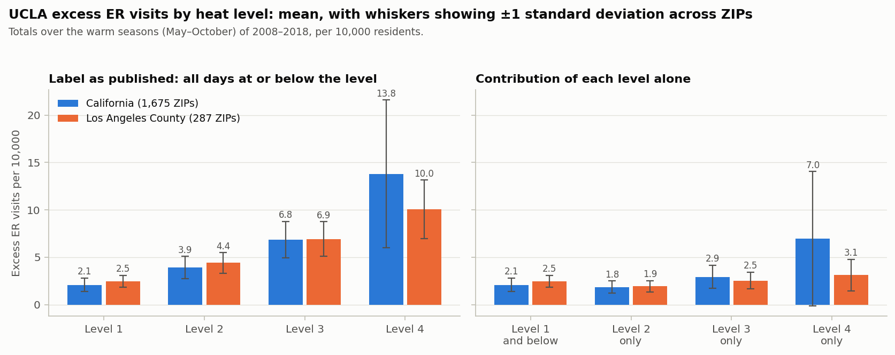
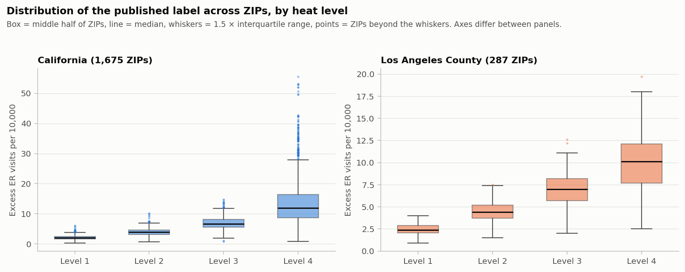

# Member 3 — UCLA labels, website and cooling-center siting

**Main question.** What do the labels mean, how should results be presented, and how are they used for siting?

**Short answers.**

- **The label is a model-based estimate, not a raw count.** UCLA fits a Bayesian spatial Poisson model to daily ER visits and temperature, and reports observed visits minus the visits the model expects at typical temperatures.
- **The "level 4" value is a total, and it is cumulative.** It sums eleven May–October seasons (2008–2018), and it covers every heat day up to and including level 4, not only the most extreme days. The yearly values UCLA publishes add up exactly to it.
- **UCLA's documented default uses no sociodemographic inputs,** but its current code has an optional socioeconomic adjustment using poverty, limited English, age 65+, uninsured and outdoor work. Which setting produced the published map is not stated. This is the main open question for the professor's concern about overlapping inputs.
- **The website now shows label and prediction side by side and as an error map,** with the prediction version labelled.
- **The siting model is a maximal-coverage integer program** that chooses among the 153 existing cooling centers. All 16 committed solutions reproduce exactly from an independent re-solve.
- **Annual ER data exist.** UCLA publishes a yearly per-ZIP layer for 2008–2018.

| Task | Status |
|---|---|
| 1. UCLA label methodology | Done from UCLA's methods documents and the data. Three points remain unconfirmed (section 1.5) |
| 2. Label distributions by heat level | Done — tables and two figures |
| 3. Website: side-by-side maps, error map, version labels | Done and tested in a browser, using existing results |
| 4. Audit of report and website claims | Done — corrections made where they are Member 3's; the rest recorded for their owners |
| 5. Siting formulation | Done and verified against the code's output |
| 6. Annual ER data | Done — bounded search, findings recorded |
| Final model versions on the website | **Not done** — development versions from commit `0980d9a` are loaded; swap at integration |
| CalEnviroScreen −999 correction on the website and in siting | **Not done here** — depends on the shared fix (pull request 1) |

---

## 1. What the UCLA labels are

### 1.1 Sources

| Source | What it is | How it is used here |
|---|---|---|
| *Heat Analysis Algorithm: Unified Technical Reference*, September 2025 (`2025_Methods.pdf`) | The methods document linked from uclaheatmaps.org/about as "the full methods" | Primary source for the model and the excess calculation |
| *Empirical Model Methods* (file added to UCLA's methods repository 2025-09-15, removed 2025-10-13) | An earlier methods write-up, no longer in the repository but still in its history | Only source for the ER data, diagnoses, season and temperature data. **Superseded**, so those details are likely but not confirmed for the current layer |
| UCLA Heat Map app configuration (ArcGIS item `4c158842b5c94857a06c3a85c7aa02de`) | The app's own descriptive text and its list of data layers | What the layers are said to show; discovery of the yearly layers |
| The published layers themselves (`zip_ER`, `time_trend_zip`) | The data | Checks on structure, units and totals |

The older Google Sites "About" page referenced in `DATA_SOURCES.md` now requires a sign-in and could not be read.

### 1.2 What is confirmed

| Question | Answer | Basis |
|---|---|---|
| Is the label a raw aggregate or a model output? | **A model output.** Excess visits on a day = observed ER visits − (population × the model's expected rate at a counterfactual "typical" temperature) | Current methods document |
| What model? | Poisson regression on daily ZIP counts with a population offset, fitted by INLA. ZIP intercepts follow a spatial BYM2 model and ZIP heat slopes a spatial Besag model, so each ZIP's estimate borrows from neighbouring ZIPs. Temporal effects are included | Current methods document |
| What is the counterfactual? | By default each ZIP's own long-term mean temperature | Current methods document (recommended settings) |
| How are heat levels defined? | From the model's risk ratio (expected rate at the observed temperature ÷ expected rate at the counterfactual). Days with a risk ratio above 1 are binned by percentile of the risk-ratio distribution (25th, 50th, 75th), and a temperature threshold per level is then estimated for each ZIP, with imputation from neighbours where needed | Current methods document |
| Are thresholds the same everywhere? | **No.** Each ZIP has its own four temperature thresholds in °F. There are 267 distinct level-4 thresholds, from 69.7 to 107.6 °F | Data (`lvl1_th`–`lvl4_th`) |
| What time span does one label cover? | **The whole of 2008–2018, as a total.** For ZIPs 90001 and 91767, UCLA's yearly values sum to the label to within rounding, for both the count and the rate, and for both the 2008–2018 and 2014–2018 versions | Data (`time_trend_zip` vs `zip_ER`), two ZIPs checked |
| How are rate and number related? | number = rate × population ÷ 10,000 | Data; also stated in `DATA_SOURCES.md` |
| Which ZIPs are covered? | 1,686 ZIPs in the published layer; 1,675 after the project's cleaning; 287 in LA County | Data |

**Checked totals (level 4, ZIP row, count of excess visits):**

| ZIP | Sum of yearly values 2008–2018 | Label 2008–2018 | Sum of yearly values 2014–2018 | Label 2014–2018 |
|---|---|---|---|---|
| 90001 | 64.5 | 64.4 | 46.0 | 46.0 |
| 91767 | 100.9 | 100.8 | 52.7 | 52.7 |

### 1.3 What is inferred from the data

**The level-k value is cumulative: it covers every warm-season day at or below level k.** This is not stated in either document. The evidence, across all 1,675 cleaned ZIPs:

| Check | Result |
|---|---|
| ZIPs whose level-4 day count is exactly 2,024 | 1,675 of 1,675. 2,024 = 184 days (1 May–31 October) × 11 years, i.e. every warm-season day |
| ZIPs where the day count rises from level 1 to level 4 | 1,675 of 1,675 |
| ZIPs where the label rises from level 1 to level 4 | 1,675 of 1,675 |
| ZIPs with a negative difference between consecutive levels | 0 |
| Mean days added at levels 2, 3 and 4 | 169, 158 and 153 — roughly equal, as percentile-based bins would give |

A count of "heat days" that is largest at the most extreme level, and equal to the whole season, only makes sense if each row includes all lower levels. On that reading:

- The level-4 label is the **total heat-attributable excess over all heat levels**, not the excess on extreme days.
- The excess on level-4 days alone is level 4 minus level 3.
- The `n_heat_days` column is not a count of extreme-heat days, and `DATA_SOURCES.md` described it wrongly (corrected in this branch).

### 1.4 What comes only from the superseded document

These describe an earlier version of UCLA's pipeline. They are consistent with the current layer where they can be checked, but UCLA has not restated them for it.

| Item | Earlier document says | Consistent with current data? |
|---|---|---|
| ER data | California HCAI emergency department records, 2008–2018, by patient ZIP of residence and date | Years match |
| Diagnoses | Primary diagnosis of dehydration, renal failure, or heat illness and heat stroke (533,416 visits; 80%, 13% and 7%) | Cannot check |
| Season | Warm season, 1 May to 30 October | Data imply 184 days per year, which is 1 May–31 October |
| Temperature | Daily maximum apparent temperature (temperature and humidity) from gridMET, at each ZIP's population-weighted centroid | Thresholds are in °F and plausible for apparent temperature |
| Population | EPA EnviroAtlas dasymetric population, derived from 2020 Census blocks | Cannot check; this would be the population used in our density feature |
| Covariates | Day of week, month, day of year, temperature. No sociodemographic variables | Matches the current default |
| Level definition | Clustering of risk ratios (thresholds 1.08 / 1.22 / 1.38 / 1.63), mean level-4 threshold 97.1 °F | **No.** Current data have a mean level-4 threshold of 91.3 °F and near-equal day counts per level, which fits the percentile method in the current document. The level definition has changed |

### 1.5 What is not known

1. **Whether the published layer was produced with a socioeconomic adjustment.** The current document lists three options: none (default), intercept only, and intercept plus slope. The variables are poverty, limited English, Hispanic share, Black share, outdoor work, uninsured and age 65+. If either adjusted option was used, the labels are partly a function of variables that overlap with ours (poverty, linguistic isolation, age 65+, uninsured, construction work).
2. **Whether the cumulative reading in 1.3 is what UCLA intends.** It fits every ZIP, but it is our inference.
3. **Whether the data sources in 1.4 still apply** to the current layer.

These three should be put to UCLA (csolutions@ph.ucla.edu is the contact listed on the About page) or raised at office hours.

### 1.6 Answer to the professor's question

> Are they predictions, or are they just aggregates of raw data at the ZIP level over ten years?

Neither exactly. They are observed ZIP-level ER counts minus a model's expectation, totalled over eleven warm seasons. The observed part is raw data; the baseline it is compared with is a spatial Bayesian model.

On the specific worry that the targets were built from the same community features we use:

- **Under UCLA's documented default, no.** The model's inputs are daily ER counts, daily temperature, population, calendar terms and ZIP adjacency. The professor's reading in the meeting matches this.
- **It cannot be ruled out,** because the optional socioeconomic adjustment exists in the current code and the setting used is not stated.
- **A different kind of dependence does exist.** Each ZIP's baseline and heat slope are smoothed towards its neighbours, so the labels are spatially smooth by construction. Any feature that varies smoothly over space (pollution, income, climate) will correlate with them partly for that reason. This is a strong argument for the spatial cross-validation the project already uses, and a limit on interpreting feature importance as vulnerability.

### 1.7 Consequences for the project

| Area | Consequence |
|---|---|
| Wording everywhere | "Excess ER rate at extreme heat" should be "UCLA's estimated excess heat-related ER visits per 10,000, total over May–October 2008–2018, all heat levels up to 4". Corrected in `REPORT.md`, `DATA_SOURCES.md` and the website in this branch |
| Heat levels as rows (Member 1) | The four rows of a ZIP are nested sums, not four separate measurements. This explains why a model that knows the level scores well when pooled, and why lower levels carry less to predict |
| Level-specific targets | To study extreme heat specifically, the target should be level 4 minus level 3. Section 2 gives its distribution |
| Units of burden in siting | Predicted rate × population ÷ 10,000 is a number of excess ER visits over eleven seasons, about 37 per ZIP on average in LA, not per year or per event |
| 2030 scenario | It multiplies an all-levels, eleven-season total by a ratio of extreme-heat days defined differently by Cal-Adapt. Stated as an added assumption in `REPORT.md` |
| Data years | The label spans 2008–2018 evenly as a sum, so inputs from the middle of that period match it best |

## 2. Label distributions by heat level

Computed for the 1,675 ZIPs used in the statewide models and the 287 LA ZIPs (`scripts/member3_label_eda.py`). Unit throughout: excess ER visits per 10,000 residents, total over May–October 2008–2018.

**Table 1. The label as published (cumulative up to each level).**

| Region | Level | ZIPs | Mean | SD | Median | Min | Max | SD ÷ mean | Mean ÷ previous level |
|---|---|---|---|---|---|---|---|---|---|
| California | 1 | 1,675 | 2.08 | 0.73 | 2.1 | 0.3 | 6.1 | 0.35 | — |
| California | 2 | 1,675 | 3.93 | 1.17 | 3.9 | 0.7 | 10.2 | 0.30 | 1.89 |
| California | 3 | 1,675 | 6.84 | 1.94 | 6.7 | 0.8 | 14.8 | 0.28 | 1.74 |
| California | 4 | 1,675 | 13.80 | 7.82 | 12.0 | 0.9 | 55.5 | 0.57 | 2.02 |
| Los Angeles County | 1 | 287 | 2.47 | 0.61 | 2.4 | 0.9 | 4.0 | 0.25 | — |
| Los Angeles County | 2 | 287 | 4.40 | 1.09 | 4.4 | 1.5 | 7.5 | 0.25 | 1.78 |
| Los Angeles County | 3 | 287 | 6.93 | 1.83 | 7.0 | 2.0 | 12.6 | 0.26 | 1.57 |
| Los Angeles County | 4 | 287 | 10.04 | 3.10 | 10.1 | 2.5 | 19.7 | 0.31 | 1.45 |

**Table 2. Contribution of each level alone (difference between consecutive levels).**

| Region | Days | Mean days | Mean | SD | Median | Max | SD ÷ mean | Share of the level-4 total |
|---|---|---|---|---|---|---|---|---|
| California | Level 1 and below | 1,545 | 2.08 | 0.73 | 2.1 | 6.1 | 0.35 | 15.1% |
| California | Level 2 only | 169 | 1.84 | 0.65 | 1.8 | 4.7 | 0.35 | 13.4% |
| California | Level 3 only | 158 | 2.92 | 1.22 | 2.9 | 8.6 | 0.42 | 21.2% |
| California | Level 4 only | 153 | 6.95 | 7.10 | 4.4 | 48.7 | 1.02 | 50.4% |
| Los Angeles County | Level 1 and below | 1,634 | 2.47 | 0.61 | 2.4 | 4.0 | 0.25 | 24.6% |
| Los Angeles County | Level 2 only | 175 | 1.92 | 0.59 | 1.9 | 3.8 | 0.30 | 19.2% |
| Los Angeles County | Level 3 only | 136 | 2.53 | 0.88 | 2.5 | 5.2 | 0.35 | 25.2% |
| Los Angeles County | Level 4 only | 79 | 3.11 | 1.68 | 2.9 | 11.3 | 0.54 | 30.9% |



*Figure 1. Mean UCLA excess ER visits per 10,000 by heat level. Whiskers show ±1 standard deviation across ZIPs. Left: the label as published, which includes all lower levels. Right: the contribution of each level alone. California 1,675 ZIPs, Los Angeles County 287 ZIPs; totals over May–October 2008–2018.*



*Figure 2. Distribution of the published label across ZIPs at each heat level. Box = middle half of ZIPs, line = median, whiskers = 1.5 × interquartile range, points = ZIPs beyond the whiskers. Vertical axes differ between panels.*

**Findings.**

- **There is a jump at level 4 statewide, and a smaller one in LA.** The statewide mean doubles from level 3 to level 4 (6.84 → 13.80) and the spread quadruples (SD 1.94 → 7.82). In LA the mean rises by 45% (6.93 → 10.04) and the spread by 70%.
- **The jump is concentrated in the level-4-only days.** Statewide they contribute half of the total (50.4%) on 153 days out of 2,024, with a spread as large as the mean. In LA they contribute 30.9% on 79 days.
- **LA is unlike the rest of the state at level 4.** LA ZIPs have fewer level-4 days (79 against 153) and a much smaller, less variable level-4 contribution (mean 3.11 against 6.95). This is the shift that limits transfer of a statewide model to LA.
- **Levels do not rank ZIPs the same way.** Across California ZIPs the Spearman correlation between the level-1 and level-4 labels is −0.29, and between level 2 and level 4 it is 0.08. ZIPs that are high at mild levels tend to be low at the top level.

**What this motivates.** One model with one set of coefficients for all four levels has to fit targets that rank ZIPs in nearly opposite orders at the two ends, so testing a separate model per level is reasonable. It does not by itself show that separate models will do better; that is what Member 1's comparison tests. A second option the data suggest is to model each level's own contribution (Table 2) instead of the nested totals.

## 3. Website changes

All in `site/index.html`, with data prepared by `scripts/member3_add_site_predictions.py`.

**New section "Label vs prediction".**

| Requirement | What was built |
|---|---|
| UCLA labels on the left, a chosen model's predictions on the right | Two maps side by side: left is always the UCLA label, right is the selected prediction. Model selector: Poisson, random forest, gradient boosting |
| Matching colour scales and synchronized views | Both maps use the same six fixed classes (under 5 to 15 or more), so a colour means the same value on both and for every selection. Panning or zooming either map moves the other |
| Units and prediction source identified | Caption over each map; the legend states the unit; a banner names the model and prediction version in words |
| Error map with model selection | A third view shows prediction − UCLA label for the selected model and version |
| Colour scale centred at zero | Seven fixed classes: blue for underprediction, grey for within ±1, red for overprediction |
| Legend explains over- and underprediction and units | Legend labels each end and gives the unit; a line under the map gives mean error, mean absolute error and the number of ZIPs over, under and within ±1 |
| Version labels: LA out-of-fold or LA holdout | Selector between the two, with a one-sentence description of how each was trained |

Error is defined as prediction − UCLA label everywhere: positive is overprediction.

**Prediction versions loaded** (described in `site/data/prediction_sources.json`, which the page reads):

| Version | Source file | How it was trained |
|---|---|---|
| LA out-of-fold | `results/predictions_oof.csv` | Each ZIP predicted by a model trained on the other four LA spatial folds, heat level 4 only |
| LA holdout | `results/predictions_la_holdout.csv` | One model trained on all California ZIPs outside LA, heat levels 1–4; level-4 predictions shown |

These are the existing results at commit `0980d9a`, which were built on inputs with the CalEnviroScreen −999 error. The banner on the page says they are development versions. At integration, rerun `scripts/member3_add_site_predictions.py` against the final prediction files; the page needs no change.

**Other changes to the page.**

- "Observed" is now "UCLA label" in buttons, popups and tables, because the values are UCLA's estimates.
- The 2030 layers sit in their own control group labelled as a scenario, and the section states the formula and assumptions.
- The out-of-region note no longer compares the level-4 model score with a CalEnviroScreen score computed across all four levels.
- The downscale note describes the check as a pseudo-ZIP recovery test.
- Popups show "n/a" for a CalEnviroScreen percentile outside 0–100 instead of a negative number.
- The limitations list is rewritten (12 items); `scripts/build_site_data.py` generates the same text.

**Verification** (local server, built-in browser):

| Check | Result |
|---|---|
| Console errors on load and after every control change | None |
| ZIPs drawn on left, right and error maps | 287 each |
| Maps stay synchronized after moving the left, then the right | Centre and zoom identical |
| Statistics under the map against an independent calculation | Poisson out-of-fold: mean error +0.28, mean absolute error 1.69. Random forest holdout: +2.29 and 2.89. Both match |
| Error classes add up | Random forest holdout: 28 under, 55 within ±1, 204 over = 287 |
| Switching view hides the other panel | Yes |
| Narrow screen (375 px) and dark theme | Maps stack in one column, no horizontal scroll |
| Site label and out-of-fold values against `results/` | Equal for all 287 ZIPs (asserted in the script) |

To view: `python3 -m http.server 8765 --directory site`, then open `http://localhost:8765`.

## 4. Siting formulation

This documents what `src/heatla/siting.py` does. It was checked by re-solving the program independently (`scripts/member3_check_siting.py`).

### 4.1 Inputs

| Symbol | Meaning | Value in the code |
|---|---|---|
| $Z$ | Demand points | The 287 LA ZIPs with a label and a centroid |
| $S$ | Candidate sites | The 153 existing LA County regional cooling centers (2022 layer) |
| $w_z$ | Burden weight of ZIP $z$ | $\max(0,\hat r_z)\cdot p_z/10{,}000$ |
| $\hat r_z$ | Predicted rate | LA out-of-fold Poisson prediction, excess ER visits per 10,000 |
| $p_z$ | Population | The population in UCLA's layer |
| $d_{zs}$ | Distance | Great-circle (haversine) distance in miles between the ZIP's centroid and the site |
| $R$ | Coverage radius | 1, 2, 3 or 5 miles |
| $a_{zs}$ | Coverage indicator | 1 if $d_{zs}\le R$, else 0 |
| $k$ | Budget | 5, 10, 20 or 40 centers; every center costs the same |

**Converting rates to counts.** The model predicts a rate. Multiplying by population and dividing by 10,000 gives a predicted number of excess ER visits in the ZIP, so that a large ZIP counts for more than a small one with the same rate. Because of what the label is (section 1), this is a number of visits over eleven warm seasons. Totals over LA: 10,774 predicted and 10,545 from the UCLA label.

**ZIP representative point.** Each ZIP is represented by one point, its Census ZCTA centroid (2023 Gazetteer internal point). The whole ZIP is covered or not covered according to that one point.

### 4.2 Integer program

Decision variables: $x_s\in\{0,1\}$ is 1 if site $s$ is selected; $y_z\in\{0,1\}$ is 1 if ZIP $z$ is covered.

$$\max \sum_{z\in Z} w_z\,y_z$$

subject to

$$y_z \le \sum_{s\in S} a_{zs}\,x_s \quad \forall z\in Z \qquad\text{(a ZIP is covered only if a selected site is within } R\text{)}$$

$$\sum_{s\in S} x_s \le k \qquad\text{(at most } k \text{ centers)}$$

$$x_s\in\{0,1\}\ \ \forall s\in S,\qquad y_z\in\{0,1\}\ \ \forall z\in Z$$

A ZIP with no site within $R$ has $y_z=0$.

**Overlapping centers count a ZIP once.** Each ZIP has a single variable $y_z$ that appears once in the objective. If two selected centers both reach a ZIP, $y_z$ is still 1, so its burden is counted once. This is what makes spreading centers out worthwhile.

**Size.** 153 + 287 binary variables and 288 constraints per instance; 16 instances (4 radii × 4 budgets). Solved exactly with CBC through PuLP. This is the maximal covering location problem.

**Greedy comparison.** The code also runs a greedy heuristic: repeatedly add the site that covers the most not-yet-covered burden, until $k$ sites are chosen or no site adds anything.

**Reported but not optimized.** For each solution the code reports coverage of predicted burden, coverage of UCLA-label burden, and coverage within quartiles of income and of CalEnviroScreen percentile. These equity figures are outputs only; nothing in the program constrains them.

### 4.3 Check against the code

| Check | Result |
|---|---|
| Instance size | 287 ZIPs, 153 sites — matches the committed file |
| Exact coverage, all 16 radius × budget combinations | Reproduced to four decimals |
| Selected site sets | Identical in all 16 |
| ZIPs covered and UCLA-label coverage | Identical in all 16 |
| "Exact is at least as good as greedy" | True in all 16 |
| "Gap is at most 3.9 percentage points" | True: largest gap 3.89 points, at 5 miles and 20 centers |

**Table 3. Exact solutions (share of predicted burden covered) and the ceiling set by where existing centers are.**

| Radius | ZIPs any center can reach | Ceiling | k = 5 | k = 10 | k = 20 | k = 40 |
|---|---|---|---|---|---|---|
| 1 mile | 99 of 287 | 42.9% | 6.6% | 11.7% | 20.5% | 32.3% |
| 2 miles | 183 of 287 | 69.0% | 13.4% | 22.1% | 35.2% | 53.8% |
| 3 miles | 235 of 287 | 84.1% | 26.2% | 40.2% | 60.4% | 80.5% |
| 5 miles | 268 of 287 | 92.6% | 47.2% | 69.0% | 87.6% | 92.6% |

At 5 miles and a budget of 40, only 36 centers are selected: the ceiling is reached and the remaining budget has nothing to add.

### 4.4 Limitations

- **It chooses among existing centers.** The candidates are the 153 centers that already exist, so the answer is "which existing centers to prioritize", not "where to open new ones". The website heading "Where to open them" overstates this.
- **Coverage is capped by current locations.** With a 1-mile radius, existing centers can reach only 43% of the predicted burden however many are chosen.
- **Coverage is all-or-nothing and straight-line.** A ZIP is in or out by its centroid, whatever its size or shape; there is no travel time, transit, walking distance or distance decay. The median ZIP centroid is 1.4 miles from its nearest center and the farthest is 17.5 miles.
- **No capacity, hours or cost differences.** Every center counts the same and can serve any number of people.
- **Coverage is not benefit.** Being within range of a center does not mean residents use it or that ER visits fall. The objective is exposure to a facility, not a health outcome.
- **The burden is not specific to extreme heat.** It is the all-levels, eleven-season total (section 1), while cooling centers open on the hottest days.
- **Weights are predictions although labels exist for every LA ZIP.** The predicted and UCLA-label coverage of the chosen sites are almost the same (for example 22.1% and 22.0% at 2 miles and 10 centers), so in LA the predictions add little to the siting decision over using the labels directly.
- **Equity is reported, not enforced,** and the CalEnviroScreen quartiles use the uncorrected percentile, which is wrong for 26 LA ZIPs. Site selection itself does not use it.

## 5. Audit of report and website claims

Claims within Member 3's scope were corrected in this branch. Others are recorded for the member who owns them.

| # | Claim | Where | Finding | Action |
|---|---|---|---|---|
| 1 | "No value is imputed, interpolated, or fabricated" | `REPORT.md` intro | Data files leave gaps blank, but every model fills missing inputs with the training-fold median: 394 of 1,675 statewide ZIPs (337 with no CalEnviroScreen data at all) and 17 of 287 modelled LA ZIPs (21 with the four ACS features). An earlier version of this row gave 18 and 337 | Corrected |
| 2 | Target is the "excess ER-visit rate … (CHS-4, extreme heat)" | `REPORT.md` §2, website section 01 | It is an eleven-season total, cumulative across heat levels, and model-based | Corrected in both |
| 3 | Downscale "validated … comparing tract-level MAE" | `REPORT.md` §5, website | The test merges ZIPs into 47 groups and recovers ZIP values; the error is ZIP-level. No tract-level health data exist | Corrected in both |
| 4 | Tract output implies census tracts | `results/tract_risk_la.csv` | Tract identifiers were sequence numbers within a ZIP (`90001-1`), not census tract IDs | Resolved: the downscale now uses real 2020 census tract GEOIDs, split across ZIPs by land area (`REPORT.md` §5) |
| 5 | "2030 outlook", "How much worse by 2030?" | `REPORT.md` §6, website | A proportional scaling scenario; uses a different heat definition from the label | Retitled as a scenario, formula and assumptions stated, separated from model layers on the map |
| 6 | Model score "still beats the existing CalEnviroScreen index (ρ 0.24)" | Website out-of-region note | Compares a level-4 score with a baseline computed over all four levels | Removed from the website. `REPORT.md` §4c is Member 1's; their corrected comparison is in pull request 2 |
| 7 | `n_heat_days` is "heat days at CHS-4 threshold … constant across ZIPs = 2024" | `DATA_SOURCES.md` | 2,024 is every warm-season day in 2008–2018 (184 × 11) | Corrected |
| 8 | `lvl1_th`, `lvl4_th` are "legend class-break thresholds … constant across all ZIPs" | `DATA_SOURCES.md` | They are ZIP-specific temperature thresholds; 267 distinct level-4 values | Corrected, with a dated note |
| 9 | "ACS features: all pending, blocked on the Census API key" | `DATA_SOURCES.md` known gaps | Stale; the ACS features are in the model table | Corrected. The known-gaps entry now gives the current missing-input counts: 17 of 287 LA ZIPs (11 inputs), 21 (15 inputs), 394 of 1,675 statewide |
| 10 | README quick start, layout and outputs | `README.md` | Describes the archived pipeline; `make`, `tests/` and `dashboard/` exist only under `legacy/` | Banner added at the top; full rewrite left for integration |
| 11 | "Observed" used for UCLA values | Website | They are estimates | Renamed "UCLA label" |
| 12 | "Exact ILP ≥ greedy … (gap ≤ 3.9 percentage points)" | `REPORT.md` §7 | Verified: true in all 16 runs, largest gap 3.89 | No change needed |
| 13 | Siting described as where to open centers | `REPORT.md` §7, website section title | Chooses among existing centers | Stated in `REPORT.md`; website title recorded, not changed |
| 14 | "Features (17)" | `REPORT.md` §3 | The LA table has 17 feature columns; the LA model uses 13 | Recorded for Member 2 |
| 15 | Missing top-10% values shown as "—" for gradient boosting and the CES baseline | `REPORT.md` §4a | Both exist in `results/metrics.json` (0.21 and 0.14) | Recorded for Member 2 |
| 16 | "CES ~2021" as the data year | `REPORT.md` §8 | 2021 is the publication year; the data are from 2013–2019 | Fixed in `site/data/meta.json`; `REPORT.md` line recorded for Member 1 |
| 17 | CalEnviroScreen percentile in popups and equity quartiles | Website, `siting.py` | Wrong for 26 LA ZIPs, 8 negative, from the −999 error | Popup now hides out-of-range values; data fix is pull request 1 |
| 18 | Hero: "Where extreme heat sends people to the ER"; closing: heat "lands hardest on the ZIP codes with the least cooling, the oldest residents, and the fewest cars" | Website | The label covers all heat levels, not only extreme heat. The closing sentence is not a result of any analysis in the project | Recorded; wording is a team decision |
| 19 | Retrieval date "2026-10-28" for all entries | `DATA_SOURCES.md` | The snapshot's raw label file records 2026-11-07 | Recorded |

## 6. Annual ER data

| Source | Accessible? | Geography | Time | Outcome | Suitable for this study? |
|---|---|---|---|---|---|
| UCLA `time_trend_zip` layer (same ArcGIS service as the labels) | **Yes, public.** 74,184 rows | 1,686 ZIPs, plus a statewide ZIP average | Yearly, 2008–2018 | UCLA's estimated excess ER visits, count and rate, level-4 layer only | **Yes.** Same definition as the label; the yearly values sum to it. Only the level-4 total is published by year |
| UCLA `time_trend_county` layer | Yes, public. 2,552 rows | 58 counties | Yearly, 2008–2018 | Same, by county | For context only |
| UCLA `zip_time_trend_graph` layer | Yes, public. 73,832 rows | ZIP | Yearly | Per-year heat days, threshold and excess at level 4 | **Use with care.** Its thresholds (about 94 °F for ZIP 90001) differ from the label layer's (91.5 °F), so it appears to come from an earlier model version |
| HCAI emergency department records (the underlying data) | **Restricted.** Patient-level data with ZIP of residence need a data request and ethics approval; UCLA cites both | Patient ZIP | Daily | Any diagnosis | Not obtainable in the project's time frame |
| HCAI public "Encounters by Facility" | Public | Hospital, not patient ZIP | Yearly, 2012–2024 | All ED encounters, not heat-specific | No |
| CDPH and county dashboards | Public | County | Yearly or weekly | Heat-related illness, some occupational only | No: not ZIP-level |

**What the yearly UCLA layer would allow.** A check over time: train on early years and test on later ones, or see whether a ZIP's ranking is stable from year to year. Two cautions. Yearly values are small and noisy (ZIP 90001 ranges from 1.9 to 11.5 excess visits a year). And every year's value comes from the same fitted model, so years are not independent of one another. This was not asked for in the current report and has not been done.

The layer can be pulled with the project's existing `heatla.arcgis.query_all("time_trend_zip", ...)`. It has not been added to the data snapshot.

## 7. Questions for office hours

**On the labels**

1. Given that the labels are a spatial model's output and are smooth across neighbouring ZIPs by construction, is predicting them from community features still a meaningful task, and how should we describe what the model learns?
2. The level-4 value is cumulative across all heat levels. Should the target for "extreme heat" be the level-4-only contribution (level 4 minus level 3) instead?
3. UCLA's code has an optional socioeconomic adjustment and we cannot tell whether it was used. Is it enough to state this, or should we ask UCLA before the final report?
4. Would a check over time using UCLA's yearly layer strengthen the report, or is it out of scope?

**On siting**

5. The program chooses among existing centers. Is "which existing centers to prioritize" an acceptable framing, or should candidates include new locations such as libraries, schools or a grid of points?
6. Coverage is all-or-nothing by ZIP centroid within a straight-line radius. Is that acceptable for a course project, or should we use distance decay or a smaller unit?
7. In LA, labels exist for every ZIP and give almost the same siting result as the predictions. What should the predictions add: siting in places without labels, or a future scenario?
8. Should equity be a constraint in the program (for example a minimum coverage for the lowest-income quartile) or stay as a reported outcome?
9. Which baselines would make the result convincing: random selection, the top-k centers by nearby burden, or the greedy heuristic already included?
10. Is covered burden a defensible objective when we cannot show that proximity to a center reduces ER visits?

## 8. Reproduce

Starting point: commit `0980d9a`, data snapshot `heatla_data_0980d9a.zip` unpacked into `data/`. Branch `member3/labels-website-siting`.

```bash
python3.11 -m venv .venv
.venv/bin/pip install numpy==2.1.3 pandas==2.2.3 scipy==1.14.1 scikit-learn==1.5.2 pulp==2.9.0 matplotlib==3.9.2

.venv/bin/python scripts/member3_label_eda.py             # section 2
.venv/bin/python scripts/member3_check_siting.py          # section 4.3
.venv/bin/python scripts/member3_add_site_predictions.py  # website data (already applied)
python3 -m http.server 8765 --directory site               # view the website
```

| Location | Contents |
|---|---|
| `results/member3/label_eda/` | Tables 1 and 2, structure checks, thresholds, rank correlations between levels, one row per ZIP, two figures |
| `results/member3/siting/` | Solution-by-solution check and instance summary |
| `site/index.html`, `site/data/prediction_sources.json`, `site/data/zips.geojson`, `site/data/meta.json` | Website |
| `REPORT.md`, `DATA_SOURCES.md`, `README.md` | Corrected wording (section 5) |

The label checks in section 1.2 used live queries to UCLA's public layers on 2026-11-08 and are not scripted.

## 9. References

1. UCLA CalHeatScore modeling group (2025). *Heat Analysis Algorithm: Unified Technical Reference.* Technical documentation, September 2025. `github.com/CalHeatScore-UCLA-modeling/Methods`, file `2025_Methods.pdf`. Retrieved 2026-11-08.
2. UCLA CalHeatScore modeling group (2025). *Empirical Model Methods.* Earlier methods write-up, same repository, file `CalHeatScore_Empirical_Model_Methods.pdf` at commit `b1ed1b3`; removed from the repository on 2025-10-13. Retrieved from the repository history 2026-11-08.
3. UCLA Heat Maps. About page, `uclaheatmaps.org/about`, and map application (ArcGIS item `4c158842b5c94857a06c3a85c7aa02de`). Retrieved 2026-11-08.
4. UCLA Heat Maps. Feature layers `zip_ER`, `time_trend_zip`, `time_trend_county`, `zip_time_trend_graph`, `services7.arcgis.com/2hYXmwteFLemN5bW`. Queried 2026-11-08.
5. Riley K, Wilhalme H, Delp L, Eisenman DP (2018). Mortality and morbidity during extreme heat events and prevalence of outdoor work: an analysis of community-level data from Los Angeles County, California. *International Journal of Environmental Research and Public Health* 15(4):580. Cited on UCLA's About page.
6. Church R, ReVelle C (1974). The maximal covering location problem. *Papers of the Regional Science Association* 32(1):101–118. doi:10.1007/BF01942293
